<!-- _class: title -->

  

    <svg viewBox="0 0 16 16" role="img" aria-label="GitHub mark"><path d="M8 0C3.58 0 0 3.58 0 8c0 3.54 2.29 6.53 5.47 7.59.4.07.55-.17.55-.38 0-.19-.01-.82-.01-1.49-2.01.37-2.53-.49-2.69-.94-.09-.23-.48-.94-.82-1.13-.28-.15-.68-.52-.01-.53.63-.01 1.08.58 1.23.82.72 1.21 1.87.87 2.33.66.07-.52.28-.87.51-1.07-1.78-.2-3.64-.89-3.64-3.95 0-.87.31-1.59.82-2.15-.08-.2-.36-1.02.08-2.12 0 0 .67-.21 2.2.82.64-.18 1.32-.27 2-.27.68 0 1.36.09 2 .27 1.53-1.04 2.2-.82 2.2-.82.44 1.1.16 1.92.08 2.12.51.56.82 1.27.82 2.15 0 3.07-1.87 3.75-3.65 3.95.29.25.54.73.54 1.48 0 1.07-.01 1.93-.01 2.2 0 .21.15.46.55.38A8.013 8.013 0 0016 8c0-4.42-3.58-8-8-8z"/></svg>
    GitHub
  

  <h1>GitHub Agentic Workflows</h1>
  

  
FROM AI THAT SUGGESTS TO AI THAT DOES

  
When did a page of documentation last mislead you?

<svg class="loop" viewBox="0 0 640 520" role="img" aria-label="Illustrative cycle diagram: the GitHub Octocat mark at the centre of a loop of six steps, Plan, Code, Test, Review, Open PR and Monitor, connected by glowing arrows">
  <defs>
    <filter id="t1-glow" x="-50%" y="-50%" width="200%" height="200%">
      <feGaussianBlur stdDeviation="5" result="b"/>
      <feMerge><feMergeNode in="b"/><feMergeNode in="SourceGraphic"/></feMerge>
    </filter>
    <marker id="t1-arr" viewBox="0 0 10 10" refX="7" refY="5" markerWidth="5" markerHeight="5" orient="auto-start-reverse">
      <path d="M0,0 L10,5 L0,10 z" fill="#b9d0ee"/>
    </marker>
  </defs>
  <g class="glow">
    <path class="wire" marker-end="url(#t1-arr)" d="M175,80 C200,50 220,45 244,60"/>
    <path class="wire" marker-end="url(#t1-arr)" d="M385,55 C430,55 470,75 492,98"/>
    <path class="wire" marker-end="url(#t1-arr)" d="M590,220 C610,245 610,270 590,292"/>
    <path class="wire" marker-end="url(#t1-arr)" d="M470,400 C450,430 430,440 408,440"/>
    <path class="wire" marker-end="url(#t1-arr)" d="M268,450 C240,460 220,455 200,440"/>
    <path class="wire" marker-end="url(#t1-arr)" d="M70,330 C20,280 20,210 70,172"/>
  </g>
  <g class="glow">
    <ellipse class="ring" cx="320" cy="335" rx="130" ry="34" stroke-width="2" opacity=".55"/>
    <ellipse class="ring" cx="320" cy="335" rx="95" ry="24" stroke-width="3"/>
    <ellipse class="plate" cx="320" cy="328" rx="70" ry="16"/>
    <circle class="ring" cx="320" cy="235" r="88" stroke-width="2.5"/>
  </g>
  <path class="bot glow" transform="translate(248,163) scale(9)" d="M8 0C3.58 0 0 3.58 0 8c0 3.54 2.29 6.53 5.47 7.59.4.07.55-.17.55-.38 0-.19-.01-.82-.01-1.49-2.01.37-2.53-.49-2.69-.94-.09-.23-.48-.94-.82-1.13-.28-.15-.68-.52-.01-.53.63-.01 1.08.58 1.23.82.72 1.21 1.87.87 2.33.66.07-.52.28-.87.51-1.07-1.78-.2-3.64-.89-3.64-3.95 0-.87.31-1.59.82-2.15-.08-.2-.36-1.02.08-2.12 0 0 .67-.21 2.2.82.64-.18 1.32-.27 2-.27.68 0 1.36.09 2 .27 1.53-1.04 2.2-.82 2.2-.82.44 1.1.16 1.92.08 2.12.51.56.82 1.27.82 2.15 0 3.07-1.87 3.75-3.65 3.95.29.25.54.73.54 1.48 0 1.07-.01 1.93-.01 2.2 0 .21.15.46.55.38A8.013 8.013 0 0016 8c0-4.42-3.58-8-8-8z"/>
  <g transform="translate(60,40)">
    <rect class="step glow" width="120" height="122" rx="16"/>
    <rect class="ic" x="48" y="14" width="24" height="30" rx="3"/><path class="ic" d="M54,24 h12 M54,31 h12 M54,38 h8"/>
    <text class="tt" x="60" y="72">PLAN</text>
    <text class="td" x="60" y="92">Understand</text><text class="td" x="60" y="107">requirements</text>
  </g>
  <g transform="translate(255,8)">
    <rect class="step glow" width="120" height="122" rx="16"/>
    <path class="ic" d="M50,20 l-10,10 l10,10 M70,20 l10,10 l-10,10 M64,16 l-8,28"/>
    <text class="tt" x="60" y="72">CODE</text>
    <text class="td" x="60" y="92">Write and</text><text class="td" x="60" y="107">generate code</text>
  </g>
  <g transform="translate(490,95)">
    <rect class="step glow" width="120" height="122" rx="16"/>
    <circle class="ic" cx="60" cy="30" r="15"/><path class="ic" d="M53,30 l5,5 l9,-10"/>
    <text class="tt" x="60" y="72">TEST</text>
    <text class="td" x="60" y="92">Run tests and</text><text class="td" x="60" y="107">validate</text>
  </g>
  <g transform="translate(490,298)">
    <rect class="step glow" width="120" height="122" rx="16"/>
    <path class="ic" d="M44,16 h32 a4,4 0 0 1 4,4 v18 a4,4 0 0 1 -4,4 h-20 l-8,7 v-7 h-4 a4,4 0 0 1 -4,-4 v-18 a4,4 0 0 1 4,-4 z M50,26 h20 M50,33 h14"/>
    <text class="tt" x="60" y="72">REVIEW</text>
    <text class="td" x="60" y="92">Review and get</text><text class="td" x="60" y="107">feedback</text>
  </g>
  <g transform="translate(275,388)">
    <rect class="step glow" width="120" height="122" rx="16"/>
    <circle class="ic" cx="48" cy="18" r="4.5"/><path class="ic" d="M48,22.5 V37.5"/><circle class="ic" cx="48" cy="42" r="4.5"/><circle class="ic" cx="74" cy="42" r="4.5"/><path class="ic" d="M74,37.5 V28 a6,6 0 0 0 -6,-6 h-9"/><path class="ic" d="M63,18 l-4,4 l4,4"/>
    <text class="tt" x="60" y="72">OPEN PR</text>
    <text class="td" x="60" y="92">Writes checked</text><text class="td" x="60" y="107">before they land</text>
  </g>
  <g transform="translate(70,330)">
    <rect class="step glow" width="120" height="122" rx="16"/>
    <path class="ic" d="M44,44 v-8 M54,44 v-14 M64,44 v-20 M74,44 v-28 M42,30 l12,-8 l8,5 l14,-12"/>
    <text class="tt" x="60" y="72">MONITOR</text>
    <text class="td" x="60" y="92">Monitor and</text><text class="td" x="60" y="107">improve</text>
  </g>
</svg>

<!--
Say: [hook, no statistic; it is also on the slide, so pause two seconds before speaking] "When did a page of documentation last mislead you? [pause] You followed the steps. They were wrong. The code had moved on. Was that just you? Today's question is whether an AI agent can fix that, and on what terms we could trust it to." Roadmap: "I will tell you what I am going to ask for early, then show the evidence, the controls and the cost."

Detail: the idea in one line. We describe the task, keep documentation aligned with code, and we review the result. The agent proposes; a person decides what merges. A controlled path from stale docs to a reviewed pull request.

Evidence: the loop on this slide is illustrative. gh-aw does not deploy; the step is "Open PR" because agents open pull requests and every write is checked before it lands (github.github.com/gh-aw, checked 12 Oct 2026).

Careful wording: do not read the survey number here; it belongs to the next slide. The proposal is a bounded documentation pilot, not a commitment to automate every repository task. Treat all pilot details as proposals until the owner and repository are agreed.

Questions:
Q: Is this a proposal to automate everything? A: No. One documentation workflow, with a person reviewing every result.
Q: Is this generally available? A: No. It has been in public preview since 11 Jun 2026, so features and defaults can change.

Transition: "Stack Overflow's 2026 survey asked developers what makes context hard to get. Here's what they said."
-->

---

01 / THE PROBLEM

## Outdated documentation already costs developers time

56.5%

of 12,374 developers say <b>outdated information</b> makes it hard to get the context they need.

<h3>In plain words: more than half</h3>

Industry survey (multi-select, about context in general), not our repositories · our own drift is not yet measured.

<a href="https://survey.stackoverflow.co/2026/knowledge/data#context-challenges">Stack Overflow Developer Survey 2026 · context challenges</a>

<!--
Say: "Was that just you? In Stack Overflow's 2026 survey, 56.5 percent of developers named outdated information as something that makes context hard to get. I will call the accumulated cost documentation debt, borrowing Ward Cunningham's technical-debt metaphor."

Analogy: interest on a loan nobody is tracking. Each release adds a little; no one sees the balance until a reader trips over it.

Detail: the hook question was asked on the title slide and the closing slide echoes it; this slide gives the number behind it. The earlier-attempt story has its own slide next - do not tell it here. The right-hand grid of 100 squares redraws the same figure: 6,989 named outdated information; 5,385 (12,374 minus 6,989, derived) did not. It adds no claim.

Evidence: Stack Overflow Developer Survey 2026, "Which of the following make it difficult to get the context you need for work? Select all that apply." Outdated information: 56.5% (6,989 of 12,374). Checked 17 Oct 2026. The metaphor is Cunningham's technical debt, from his 1992 OOPSLA experience report.

Careful wording: it is a multi-select industry survey about context in general, not a measurement of our documentation or of documentation alone. "Documentation debt" is this deck's framing, by analogy with technical debt; the survey shows the cost (outdated information blocks people), not a rate of drift. Our own drift is not yet measured.

Questions:
Q: What failed in the earlier approach? A: That is the next slide.
Q: Is this our data? A: No. It is an industry survey, not our repositories; our own drift is not yet measured.

Transition: "Numbers like that are easy to nod at. Here is how it showed up for me."

[Presenter only: if the earlier-attempt story is not supplied, skip the next slide and say instead: "If that is the cost, here is how the debt builds up."]
-->

---

01b / THE PROBLEM

## My earlier attempt solved part of the problem, and left a gap

<h3>What I built</h3>
tool name what it did

<h3>What it left undone</h3>
the remaining gap, one concrete instance

Still blank: my own story. Nothing here is a claim until I supply it. Keep it to one tool, one limitation, one moment.

<!--
Say: "I have tried to fix this before. [TODO: one sentence - the tool, and the part of the problem it solved.] It did not close the gap. [TODO: one concrete moment where a page was still out of date after the tool had run.]"

Analogy: patching one pothole on a road that keeps cracking - the patch holds, the road keeps wearing.

Detail: TODO. The whole slide waits on the real story; the hook promises it, so do not ship without it. Do not describe how the tool worked, who triggered it, or whether it ran manually, unless that is confirmed. The point to land is the limitation. Only link it to the later script-versus-agent slide if that is true of the real tool.

Evidence: none. This is the presenter's own experience; say so aloud.

Careful wording: do not invent the tool, its results or the moment. Say what it left undone, not that it failed unless it did. Keep it under 45 seconds - a story, not a post-mortem.

Questions:
Q: Why did it stop short? A: TODO - answer with the real limitation only.
Q: Is this the same thing you are proposing now? A: No. This is the starting point; the ask is on the ask slide.

Transition: "That gap is not unusual. Here is why it keeps opening."
-->

---

02 / THE MECHANISM

## Documentation can fall behind code between doc passes

Every shipped change adds to it; each doc pass pays only some back.

<b class="fig">Fig. 1</b> · Illustrative · no data · extends Cunningham’s (1992) technical-debt metaphor to documentation.

<!--
Say: "Documentation rarely fails all at once. Each shipped change adds a small liability, and each doc pass repays only part of it, so the balance never returns to zero."

Analogy: a ledger. Every shipped change is a charge, every doc pass a partial repayment; the hatched area is the running balance.

Detail: the blue staircase is shipped changes; the dashed line is documentation, which only moves when someone does a doc pass. The hatched area is what readers hit: instructions that no longer match the code.

Evidence: none. This is a conceptual picture, labelled illustrative on the slide. It extends Cunningham's (1992) technical-debt metaphor to documentation. The only number in this part of the talk is the survey on the previous slide.

Careful wording: "documentation debt" is this deck's analogy with technical debt; the survey measures perceived barriers, not accrual, and the title is hedged ("can fall behind") for that reason. Do not present the chart shape as measured; we have not measured our own drift.

Questions:
Q: Is this our data? A: No, it is illustrative. Measuring our own gap is part of what the pilot does.
Q: Why not just do more doc passes? A: That is the manual fix we already rely on; the cost is people's time, and it is the step that gets skipped when shipping is busy.

Transition: "Repaying it by hand is the step that gets skipped when shipping is busy. Before I show the alternative, here is exactly what I will ask you for, so you can judge everything that follows against it."
-->

---

03 / THE ASK

## The ask is four weeks, one repository, and docs only

<b>4 weeks</b>
then a stop-or-go decision

<b>1 repository</b>
not yet chosen

<b>Docs only</b>
by instruction, reviewed in the diff

<b>Draft PR</b>
a proposed change, not yet merged; a person decides

Everything after this slide is evidence for or against that ask. The cost is unknown; the pilot measures it.

Still blank: repository owner budget week-four thresholds

This deck's proposal · public preview since 11 Jun 2026 · bounds: slide 14.

<!--
Say: "Before I show you anything, here is what I am going to ask for at the end, so you can weigh every slide against it. Four weeks. One repository. Documentation only. Every change arrives as a draft pull request, and a person decides whether it merges."

Analogy: telling the room the price before the demonstration. If the ask is small, saying it early costs nothing and buys attention; if you hide it, people spend the talk guessing.

Detail: this slide exists because the ask used to arrive only on the last slide, which left the audience with no yardstick for the evidence. Do not go through the bounds here - that is the bounds slide. State the shape, say the numbers are still blank, and move on. Thirty seconds at most. If someone asks for the budget now, say it is the last open question and you will come back to it.

Evidence: none required. The shape of the ask - four weeks, one repository, docs only, draft pull requests, human merge - is this deck's proposal, stated on the bounds slide. No external claim is made here.

Careful wording: do not present this as agreed or approved. Do not give a budget figure, a repository name or an owner: those are genuinely undecided and the gap line at the foot of the slide says so. Do not say "small" or "cheap" - cost is the one thing we have not measured.

Questions:
Q: What will it cost? A: That is the honest gap, and the cost slide is coming. We set explicit caps before anything runs.
Q: Which repository? A: Not decided. Naming it is part of what I am asking for today.

Transition: "That is the ask. Everything from here is the evidence for and against it, starting with what actually changes."
-->

---

04 / THE SOLUTION

## An agentic workflow hands the human a prepared change to review

The agent drafts, a person decides what merges: the work moves from writing to judging.

<b class="fig">Fig. 2</b> · Illustrative, this deck's framing · <code>draft: true</code> is enforced PR policy · reviewer minutes not yet measured · Actions is GitHub's built-in automation.

<a href="https://github.github.com/gh-aw/reference/safe-outputs-pull-requests/">PR policy (draft: true)</a> · <a href="https://github.github.com/gh-aw/introduction/architecture/">Architecture</a>

<!--
Say: "The change is one of role, not headcount. Today a person carries each change into the repository by hand; with an agentic workflow, the person reviews a change that has already been prepared."

Analogy: from author to editor. A journal editor does not write the paper; they decide whether it is fit to publish. The agent drafts; you edit and decide.

Detail: the workflow gives the agent a task and controlled access to repository context. The agent can inspect information, use tools, and propose an output through the configured mechanism. The output can be a pull request, issue or comment; for this talk, keep the example on a documentation draft pull request. Point at the dashed box: that manual step is the one the workflow removes. The blue box is where the person now sits: reviewing.

Evidence: illustrative comparison, this deck's framing. Copilot is the default engine.

If asked exactly who does what, jump to Appendix 8 (the agent drafts; a person decides what merges).

Careful wording: this is not a claim that every chat tool or agent behaves identically. The workflow still needs good instructions, appropriate permissions and a reviewer. Avoid listing alternative engines; the supported set is not the point of this slide. Do not imply fewer people or promise headcount is unaffected; the person still decides what merges. Human merge is our proposed pilot policy, not a product guarantee; gh-aw does not universally prohibit automatic merging. draft: true is enforced PR-creation policy (PR policy reference, checked 17 Oct 2026); the rest is this deck's framing. Reviewer minutes are not measured yet.

Questions:
Q: How is this different from asking Copilot Chat? A: Chat gives you a suggestion to carry into the repo yourself. The workflow runs in GitHub Actions and hands back a PR, issue or comment through the outputs it is allowed.
Q: Which model runs it? A: Copilot is the default engine. Others can be configured, but that is not the point of this talk.
Transition: "Fair question: why hand this to an agent at all, when we already automate with scripts?"

Sources (checked 17 Oct 2026):
Architecture: https://github.github.com/gh-aw/introduction/architecture/
-->

---

05 / WHY AN AGENT

## Scripts check fixed rules; an agent is for the part that needs reading

First ask: can a fixed rule decide this?

<h3>Yes: use a script</h3>
Broken links · missing API entries · formatting Cheaper, faster, predictable.

<h3>No, it needs reading: use an agent</h3>
“Does this paragraph still describe what the function does?” Few fixed rules express that.

Use the deterministic tool wherever one solves the task.

TODO · decide before week one: by default CI does not run on the agent's pull requests (workflow-token PRs do not trigger it); gh-aw documents an optional token that does. Framing is this deck's.

<a href="https://github.github.com/gh-aw/">gh-aw docs: a third pillar beside CI and CD</a> · <a href="https://github.github.com/gh-aw/reference/triggering-ci/">Triggering CI</a>

<!--
Say: "We already automate things. Why hand this to an agent instead of writing a script?"

Analogy: a spellchecker versus an editor. A spellchecker applies a fixed rule and is better than a person at it. Deciding whether a paragraph still tells the truth is not a rule, and no spellchecker has ever done it.

Detail: doctests and API diffs catch some drift too, so say so aloud (it is off the slide to keep one idea). Read the left card first and concede it properly - if a deterministic tool solves the task, the tool wins every time. It is cheaper, it is faster, and its failures are predictable. Then the right card: the documentation question is "does this explanation still describe what this code now does", which requires reading the code and the prose and forming a view. Few fixed rules express it, which is why it has stayed a manual job. Finish on the takeaway: this sits beside CI, it does not replace it. Whether CI runs on the agent's own pull requests: by default it does not, because pull requests created with the default GITHUB_TOKEN do not trigger CI runs (Triggering CI page, checked 19 Oct 2026). gh-aw documents an optional token (github-token-for-extra-empty-commit) that pushes an extra empty commit so CI runs. Choosing that is a pilot decision, and it is a security decision as well.

Evidence: the gh-aw docs position Continuous AI as a third pillar beside CI and CD (docs home, checked 17 Oct 2026). The split between mechanical and judgement work is this deck's framing, labelled as such on the slide, not GitHub's wording.

Careful wording: do not claim agents are better than scripts, or that scripts cannot do documentation work - many documentation chores are mechanical and should stay mechanical. The claim is narrow: the specific task of deciding whether prose still matches code needs interpretation. Do not say this replaces or improves CI.

Questions:
Q: Couldn't a linter catch this? A: For anything with a fixed rule, yes, and we should use one. A linter cannot tell you that a paragraph describes behaviour the code no longer has.
Q: Why not generate the docs from the code? A: That works where docs are a projection of code, like API reference. It does not work for explanation, which is the part that goes stale and the part readers rely on.
Q: Isn't an LLM overkill? A: It may be. That is a cost question, and the cost slide is how we answer it with numbers rather than opinion.

Transition: "So some of this work needs reading, not rules. Here is what the thing you would review looks like, from a real repository."
-->

---

06 / THE REAL EXAMPLE

## A documentation agent's real pull request adds two glossary entries in one file

A workflow named “[docs] Update glossary - daily scan” opened it. It adds two glossary entries.

ADDED · docs/…/reference/glossary.md · +8 −0 · TRIMMED
<pre class="add"><code>+ ### Work Queue (`tools.work-queue`)
+ A native, Git-backed queue for fair scheduling of
+ Work with immutable task dependency graphs. …
+
+ ### Claim (Work Queue)
+ Authorization for one attempt at a Work item in
+ a native work queue … See Work Queues.</code></pre>

One example, not a rate: it shows the size of a change, not that an agent repairs stale docs.

Public example · github/gh-aw #68654, merged 14 Oct 2026 · GitHub's own repository, not our pilot · text trimmed with …

<a href="https://github.com/github/gh-aw/pull/68654">Real PR and diff #68654</a> · <a href="https://github.github.com/gh-aw/blog/2026-01-13-meet-the-workflows-documentation/">GitHub documentation report</a>

<!--
Say: "This is what you would review. Not a rewrite: two new glossary entries in one file, from a docs agent in GitHub's own repository."

Analogy: a good footnote. Small enough that a reader can check it without having to trust the author.

Detail: open the linked PR and its Files changed tab. The patch adds two glossary entries under docs/src/content/docs/reference/glossary.md and removes nothing. The slide trims the long definition text with "…". Fallback: keep the PR open before presenting; the excerpt remains if the network fails. Do not wait for a live run.

Evidence: github/gh-aw PR #68654 "[docs] Update glossary - daily scan", +8/-0, 1 file, merged 14 Oct 2026 (read with gh, 18 Oct 2026). The PR body says it was generated by the Glossary Maintainer workflow, which is one of the three samples on the evidence slide.

Careful wording: it is GitHub's workflow in GitHub's repository, not the githubnext/agentics Update Docs file and not ours. One PR illustrates size; it is not evidence of quality, and do not say all agent PRs are this small. The diff adds documentation for new code; it does not show the agent correcting stale text, which is the problem this talk opened with. Of the 8 added lines, 2 are blank and 2 are headings, so say "two entries", not "eight lines of prose". Say "minutes", not "seconds": the entries are dense prose. Describe only what the diff shows; do not claim it repaired drift.

Questions:
Q: Is this our run? A: No. It is an explicitly labelled public example.
Q: Was it correct? A: It merged. Merge is acceptance, not proof of accuracy.
Q: Where is your own run? A: TODO: supply the completed run and PR URLs to replace this slide when they exist.

Transition: "That is one pull request, honestly labelled. One is not evidence. Here is what GitHub reports at volume."

Sources (checked 18 Oct 2026):
https://github.com/github/gh-aw/pull/68654
https://github.github.com/gh-aw/blog/2026-01-13-meet-the-workflows-documentation/
-->

---

07 / THE EVIDENCE

## In three of GitHub's documentation workflows, most pull requests were merged, but not all

Selected samples from other people’s repositories, not a forecast for our pilot.

<b class="fig">Fig. 4</b> · Reported by GitHub, 13 Jan 2026, repository not stated · same post, lower: Noob Tester 9 of 21 (43%) · these PRs were ready for review, not drafts: they show quality of changes, not the draft step.

<a href="https://github.github.com/gh-aw/blog/2026-01-13-meet-the-workflows-documentation/">GitHub: Continuous Documentation</a>

<!--
Say: "GitHub reports high merge rates for three of its own documentation workflows. I show them to motivate measurement, not to predict our result."

Detail: this is the only outcome evidence in the main talk, so handle it carefully. Each square is one pull request; the strip length is the sample size. We are showing three selected workflows; the same post includes lower ones: Documentation Noob Tester 9 merged of 21 proposed (43%), Slide Deck Maintainer 2 of 5 (40%). Say the denominators out loud - 59 pull requests is a small sample, and saying so is what makes the number usable rather than salesy.

Evidence: reported by GitHub, 13 Jan 2026 (Continuous Documentation post), repository not stated, not independently reproduced. Daily Documentation Updater 57 of 59 merged (96%); Documentation Unbloat 88 of 103 (85%); Glossary Maintainer 10 of 10 (100%). Our own recount (derived, not in the post) with the GitHub search API, 18 Oct 2026: repo:github/gh-aw is:pr author:app/github-actions returned 4,034 PRs, 2,688 of them merged. That filter is every GitHub Actions-authored PR, so say "bot-authored", not "documentation".

Draft caveat (verified 19 Oct 2026): github/gh-aw .github/workflows/daily-doc-updater.md had draft: false in its create-pull-request block on 27 Dec 2025, before the 13 Jan 2026 post; auto-merge support for safe-outputs.create-pull-request was added on 20 Jan 2026 (github/gh-aw #10890) and the current file sets auto-merge: true and draft: false. So the 57/59 PRs were ready-for-review, not draft, PRs. The figure supports the quality of the changes, not the safety of our draft-and-review step; say so if it is used to justify the pilot.

Careful wording: these are selected small samples, not a forecast for our pilot. A merged PR is evidence of acceptance, not a direct measurement of accuracy, time saved or return on investment. The post does not explicitly identify the repository for these measurements.

Questions:
Q: Will we get 96%? A: These are small, selected samples reported by GitHub, not a forecast. We will measure our own.
Q: Which repository were these measured in? A: The post does not explicitly identify it.

Transition: "Those are good numbers, from someone else's repositories. The question to ask next is what happens when it is wrong."

Sources (checked 17 Oct 2026):
GitHub: Continuous Documentation: https://github.github.com/gh-aw/blog/2026-01-13-meet-the-workflows-documentation/
daily-doc-updater.md: https://github.com/github/gh-aw/blob/main/.github/workflows/daily-doc-updater.md (history; PR #10890)
-->

---

08 / THE RISK

## It will be wrong sometimes, and that has to be survivable

<svg class="ico" viewBox="0 0 32 32" role="img" aria-label="Question mark: misread code" fill="none" stroke="currentColor" stroke-width="2.4" stroke-linecap="round" stroke-linejoin="round"><circle cx="16" cy="16" r="12"/><path d="M12 12.5a4 4 0 1 1 5.5 3.7c-1 .5-1.5 1.2-1.5 2.3"/><path d="M16 23h.01"/></svg><h3>Confidently wrong</h3>
It matches a page to code it misread.

<b>Limit</b> A person reads the diff.

<svg class="ico" viewBox="0 0 32 32" role="img" aria-label="Arrows pointing outward: scope too wide" fill="none" stroke="currentColor" stroke-width="2.4" stroke-linecap="round" stroke-linejoin="round"><path d="M4 16h24M4 16l5-5M4 16l5 5M28 16l-5-5M28 16l-5 5"/></svg><h3>Too wide a diff</h3>
A one-page fix touches twenty files.

<b>Limit</b> Draft PR and patch-size limits; docs only by instruction.

<svg class="ico" viewBox="0 0 32 32" role="img" aria-label="Speech bubble: instructions planted in text" fill="none" stroke="currentColor" stroke-width="2.4" stroke-linecap="round" stroke-linejoin="round"><path d="M5 6h22v15H15l-6 5v-5H5z"/></svg><h3>Planted instructions</h3>
A pasted issue says “ignore your rules”.

<b>Limit</b> Read-only agent job; checks before any write.

<svg class="ico" viewBox="0 0 32 32" role="img" aria-label="Coin: spend with nothing merged" fill="none" stroke="currentColor" stroke-width="2.4" stroke-linecap="round" stroke-linejoin="round"><circle cx="16" cy="16" r="12"/><path d="M16 9v14M12 13.5c0-3 8-3 8 0s-8 2-8 5 8 3 8 0"/></svg><h3>Spend, no merge</h3>
AI usage charges (credits) burn whether or not anything lands.

<b>Limit</b> Spend caps: TODO

Each has a limit we set; none is a guarantee, so a person still reads the diff.

Failure modes this deck names · prompt injection is documented by GitHub; the rest follow from the task.

TODO · our own error rate is unmeasured — week one's staged preview is the first measurement.

<a href="https://github.github.com/gh-aw/reference/threat-detection/">Threat detection</a> · <a href="https://github.github.com/gh-aw/reference/cost-management/">Cost management</a>

<!--
Say: "I have shown you a good result. This will sometimes be wrong, and a pilot that cannot survive being wrong is not worth running. Here are four ways it fails."

Analogy: hiring a capable new starter. You do not assume their first week is flawless; you scope the work so that a mistake is cheap and visible. Nothing here depends on the agent being right.

Detail: walk the four cards left to right. Confidently wrong is the model misreading code and writing confident prose about it; this is the one a reviewer must catch by reading, and the reason the output is a diff. Too wide a diff is scope creep, which is why the instructions and trigger are narrow. Planted instructions are prompt injection: text planted in an issue or pull request body that the agent reads as instruction. Spend with no merge is the economic failure, and the reason the next slides measure cost per accepted change rather than cost per run. Each card now carries a one-line limit that the later slides prove: a person reads the diff; draft PR with patch-size limits (max-patch-files default 100, max 1 PR per run) and docs-only by instruction, which nothing enforces; the agent job is read-only and a separate job writes (the run slide); spend caps are a TODO. Deliberately do not re-explain the write split or detection here; those are the next two slides and this slide only names what they answer.

Evidence: prompt injection is named in GitHub's own threat-detection reference, which documents the detection job looking for "prompt injection attempts, secret leaks, and malicious code patches" (checked 17 Oct 2026). AI-credit caps are in the cost-management reference. The other three failure modes follow from the nature of the task and are labelled on the slide as this deck's framing, not GitHub's.

Careful wording: do not say the controls prevent these; say they bound them. Detection is a layer, not a guarantee, and continue-on-error defaults to true. Do not give a number for how often any of these happens, in GitHub's repositories or ours - we have not measured it, and the slide says so. Do not promise that a reviewer always catches confidently wrong prose; that is the residual risk the pilot is meant to size.

Questions:
Q: How often will it be wrong? A: We do not know, and I will not guess. Week one runs with staged: true, which shows what it would have written without writing it. That is the first measurement we get.
Q: Isn't confidently wrong documentation worse than stale documentation? A: It is the sharpest objection to this proposal, and it is why the output is a draft pull request, not a commit. A wrong draft a reviewer catches costs one close. One a reviewer misses is the residual risk, and sizing it is what week one is for.
Q: Who is accountable when a wrong page gets merged? A: The reviewer who approved it, exactly as with any other pull request. That does not change.

Transition: "Each of those needs a limit rather than a promise. The limits are not in the model - they are in a file we can read."

Sources (checked 17 Oct 2026):
Threat detection: https://github.github.com/gh-aw/reference/threat-detection/
Cost management: https://github.github.com/gh-aw/reference/cost-management/
-->

---

09 / THE WORKFLOW

## The limits live in a file you can read, not in the model

Think of it as a new colleague's onboarding sheet: when they work, what they can touch, what they can hand in. The block on top of the file is its settings (&ldquo;frontmatter&rdquo;); the text below is the job description.

<pre><code>---on:<b class="n">1</b>  push:    branches: [main]permissions: read-all<b class="n">2</b>safe-outputs:<b class="n">3</b>  create-pull-request:    draft: true---&num; Update Docs<b class="n">4</b>Ensure every code-level change ismirrored by clear, accurate, andstylistically consistent documentation.</code></pre>

<b class="n">1</b><b>Shift</b> <code>on:</code> Every push to main

<b class="n">2</b><b>Access badge</b> <code>permissions</code> Reads the repository

<b class="n">3</b><b>Outbox</b> <code>safe-outputs</code> Draft pull requests

<b class="n">4</b><b>Job description</b> Markdown body Plain-English instructions

Trimmed from <a href="https://github.com/githubnext/agentics/blob/main/workflows/update-docs.md">githubnext/agentics update-docs.md</a> · <a href="https://github.github.com/gh-aw/reference/safe-outputs-pull-requests/">PR policy</a>

<!--
Say: "The design choice that matters is where the limits live. They live in a short file we review like code, not in the model's judgement. Read it as a new teammate's onboarding sheet."

Analogy: the onboarding sheet for a new teammate (shift, access badge, outbox, job description), written by the employer, not by the new hire.

Detail: walk down the file rather than reading it aloud. The shift (on:) says when they work, the access badge (permissions) says what they can touch, the outbox (safe-outputs) says what they may hand in, and the job description (the Markdown body) says what the work is. The tools, network and protected-files settings are cut here and shown on the next slide. read-all is read access to the repository, not zero capability; bash is "all bash commands within the confine of Github Actions VM" per the file's own comment; network: defaults is an allowlist, not no network. Writes leave only through safe-outputs. protected-files: fallback-to-issue is a supply-chain guard: changes to a standard protected set (package manifests, CODEOWNERS, AGENTS.md and CLAUDE.md, README.md, CONTRIBUTING.md, and .github/ and other hidden config directories) push a branch and open a review issue instead of a PR. It is not a path restriction, and notably README.md is in the set, so a docs pilot that edits it would be routed to an issue. allowed-files can restrict a PR to chosen paths and this file does not use it. The body continues with voice, style and step-by-step instructions. There is no budget in this example file; we would add a per-run AI-credit limit for the pilot, as on the cost slide. Compilation details are in the appendix.

Evidence: the real Update Docs workflow from githubnext/agentics, trimmed for the slide. The mission sentence shown is quoted verbatim. draft: true is enforced PR-creation policy (PR policy reference).

Careful wording: "docs only" is by instruction and diff review, not a path mechanism; protected-files is a sensitive-file guard (PR policy page, checked 19 Oct 2026), not a docs-only limit. Draft is not a suggestion the agent can override, but it is not a universal promise that all gh-aw workflows require human merging. Read-all permissions describe the agent job's repository token; writes happen only through the safe-output jobs. The limits (trigger, permissions, allowed outputs) are compiled settings, so they hold regardless of what the model decides. The quality of the work still depends on the model and the instructions.

Questions:
Q: Is this our file? A: No. It is a public example we would start from and adapt; our repository and file are still to be confirmed.
Q: Can the agent change its own permissions or turn off draft? A: Not at runtime. The frontmatter is compiled into the workflow, and changing it means editing, recompiling and reviewing the file.
Q: Will it open a PR on every push? A: It runs on every push to main; whether it proposes a change depends on what it finds. For the pilot we can narrow the trigger, and week one's staged preview shows the volume before any PR is written.

Transition: "That is the tidy version. Here is the rest of the same file, including the parts that give the agent more room."

Sources (checked 17 Oct 2026):
update-docs.md: https://github.com/githubnext/agentics/blob/main/workflows/update-docs.md
PR policy: https://github.github.com/gh-aw/reference/safe-outputs-pull-requests/
-->
---

09b / THE WORKFLOW

## The same file also lets the agent run commands and fetch pages, so the write limit has to hold

<pre><code>network: defaults         # 1
tools:                    # 2
  github: {toolsets: [all]}
  web-fetch:
  bash: true
safe-outputs:
  create-pull-request:
    draft: true
    protected-files: fallback-to-issue   # 3
timeout-minutes: 15       # 4</code></pre>

1 · <code>network: defaults</code> An allowlist of default hosts, not “no network”

2 · <code>tools</code> Bash inside the Actions VM, web fetch, all GitHub toolsets

3 · <code>protected-files</code> Routes changes to sensitive files to a review issue; it does not limit a PR to docs

4 · <code>timeout-minutes</code> Stops a run after 15 minutes

TODO · add <code>allowed-files</code> (a docs path) to the pilot copy if “docs only” is to be enforced, and confirm in a trial; pilot tool list is not chosen.

Real file, trimmed · <a href="https://github.com/githubnext/agentics/blob/main/workflows/update-docs.md">githubnext/agentics workflows/update-docs.md</a>

<!--
Say: "Read all of the file, including the parts that give the agent more room. It can run shell commands and fetch web pages, inside the Actions VM and a network allowlist. What it cannot do is write to the repository; that is the next slide."

Detail: bash: true carries the file's own comment, "all bash commands within the confine of Github Actions VM". network: defaults is an allowlist of default hosts. toolsets: [all] gives the agent every GitHub read toolset. protected-files: fallback-to-issue is a guard on a standard set of sensitive files (manifests, CODEOWNERS, AGENTS.md, README.md, .github/ and hidden config directories); changes there go to a review issue (PR policy page, checked 19 Oct 2026). It is not a docs-only path limit; allowed-files is the documented way to restrict paths. The slide compresses the two-line github toolsets YAML to one line.

Evidence: real update-docs.md, githubnext/agentics, fetched with gh on 18 Oct 2026. timeout-minutes: 15. No budget appears in the file.

Careful wording: "docs only" is by instruction and diff review. Do not say the agent cannot do anything beyond what the file shows. Not our file.

Questions:
Q: What can bash do? A: Anything in the VM within the network allowlist; that is why the agent job has no write token and why detection exists. TODO: confirm.
Q: Is this our file? A: No. A public example we would adapt and narrow.

Transition: "Configuration sets the limits. The next slide shows how the run itself is divided, so that the agent never holds write access."
-->

---

10 / THE RUN

## The agent job is read-only; a separate job does the writing

A separate step applies outputs; a draft PR and human merge are the backstop.

<b class="fig">Fig. 5</b> · Detection is a layer, not a guarantee; by default it cautions, it does not block · Saltzer &amp; Schroeder, 1975.

<a href="https://github.github.com/gh-aw/introduction/architecture/">Architecture</a> · <a href="https://github.github.com/gh-aw/reference/threat-detection/">Threat detection</a>

<!--
Say: "The part that thinks is not the part that writes. The agent can read and draft, but it cannot change the repository. A separate job, after a check, is the only one that can write."

Analogy (an analogy for the job split, not a second human): the four-eyes principle in banking. The clerk who prepares a payment is not the one who releases it. Here the agent prepares; a separate job releases.

Detail: the diagram shows four of the six documented jobs: Prepare, Agent, Detection, then a separate Safe outputs job that holds the only write permission. Preparation handles role checks, event text and the lock file. The agent then works in its isolated runtime with read-only repository access and a network allowlist; the API proxy isolates authentication tokens, so the agent does not see them. The agent still runs commands (bash) and fetches pages inside a locked-down container with a network allowlist; what it lacks is permission to write to the repository. It can edit its local workspace to prepare a patch; read-only describes repository and API permissions, not an inability to draft file changes. Detection inspects the output and patch before the configured safe-output jobs act with the permissions they need. The docs describe blocking when a threat is detected, and permitting a warning with a human review requirement before merge. The outcome diagram is in the appendix.

Evidence: "The agent job runs with minimal read-only permissions" and "write operations are deferred to separate jobs that execute only after the agent completes" (Architecture, checked 19 Oct 2026). The detection job "has no access to write permissions". The page does not state the preparation job's permissions, so the slide claims read-only for the agent and detection jobs only. Detection is documented to look for "prompt injection attempts, secret leaks, and malicious code patches". Least privilege: Saltzer and Schroeder, "The Protection of Information in Computer Systems" (1975).

Careful wording:
- Detection is a layer, not a guarantee. continue-on-error defaults to true, which permits warnings and failures with a caution notice; never say detection always blocks. Test explicit settings before relying on either reading.
- Say permissions, not tokens: the page does not describe tokens per job.
- Four-eyes is an analogy for the job split; it does not mean a second human approves every run.
- Least privilege is Saltzer and Schroeder's term. Do not attribute "separation of privilege" to them for this split (in 1975 it means two independent keys); call the split privilege separation, this deck's framing.

Questions:
Q: Could a bad PR still get through? A: Yes; detection is a layer, not a guarantee. The pilot keeps draft PRs and human review.
Q: What if the detector crashes? A: The docs are inconsistent, so verify that case in a trial before enabling writes.
Q: Does CI run on the PR the safe-outputs job opens? A: Not by default: PRs created with the default workflow token do not trigger CI. gh-aw documents an optional token that pushes an extra empty commit to trigger it; that choice is on the script-versus-agent slide.
Q: What if someone plants instructions in an issue or PR? A: That is prompt injection. Detection is documented to look for it, and the agent has no write access either way. A layer, not a guarantee.

Transition: "Those controls limit what a run can write. They say nothing about what it spends, or whether it was worth it."

Sources (checked 17 Oct 2026):
Architecture: https://github.github.com/gh-aw/introduction/architecture/
Threat detection: https://github.github.com/gh-aw/reference/threat-detection/
Triggering CI: https://github.github.com/gh-aw/reference/triggering-ci/
-->

---

11 / COST

## A cheap run nobody merges is still expensive

The right unit is cost per <strong>accepted</strong> change.

<h3>AI credits</h3>
from <code>gh aw logs</code>
NOT MEASURED
+
<h3>Actions minutes</h3>
from billing
NOT MEASURED
+
<h3>Reviewer time</h3>
from the pilot
NOT MEASURED
÷
<h3>Accepted changes</h3>
a reviewer said yes
NOT MEASURED

Cost per accepted change: add the three, divide by what a reviewer accepted.

<b class="fig">Fig. 6a</b> · no run yet, so nothing here is measured · AIC = AI credit, 1 AIC ≈ $0.01 estimated · billing may differ.

TODO · Agree pilot limits; measure cost and review time · formula and symbols: Appendix 9.

<a href="https://github.github.com/gh-aw/reference/cost-management/">Cost management</a> · <a href="https://github.github.com/gh-aw/setup/cli/">CLI</a>

<!--
Say: "The right unit of cost is not the run but the accepted change. A cheap run that nobody merges still costs credits, Actions minutes and a reviewer's attention. Add those three, divide by the changes a reviewer accepted. We have not measured any of them yet."

Analogy: measure yield, not throughput. A laboratory judges a method by its cost per valid result, not its cost per experiment run.

The algebra is on Appendix 9.

Detail: the formula is the metric the pilot measures: credits, Actions minutes and reviewer minutes, divided by accepted changes. AIC is a budgeting and comparison unit, based on model-pricing data. The agentic step defaults to a 20-minute timeout (the example file sets 15), and max-turns can cap iterations. Skip rules can avoid unnecessary agent execution. Detection has its own AI-credit cap. Use gh aw logs to inspect duration and usage, then gh aw audit <run-id> to understand tool calls and estimated cost for a specific run. Measure review effort as well as inference: a cheap run that creates substantial rework may not be useful.

Evidence: cost-management page (checked 19 Oct 2026): "One AIC equals $0.01 USD" and AIC maps to provider billing, so treat dollars as estimates. Documented defaults: 1,000 AIC per workflow run and 5,000 AIC per workflow per 24 hours (the frontmatter page agrees); detection has its own cap, 400 AIC by default. GitHub Actions minutes add another cost component. Reviewer minutes are not yet measured.

Careful wording: the defaults are GitHub's guardrails, not a recommended budget, so they are not on the slide. Do not quote "$10 a run": detection has its own 400 AIC budget on top, and the real bill can differ. If asked, say we will set our own per-run and daily caps explicitly, sized to the task.

Questions:
Q: What will this cost per month? A: We do not know until we measure; the defaults are guardrails, not a forecast. We will set explicit per-run and daily caps and read the numbers from gh aw logs and gh aw audit.
Q: Is AIC our bill? A: No. It is an estimate; billing may differ, and Actions minutes are a separate cost.

Transition: "That metric gives us something we can test in a short, measurable pilot."
-->

---

12 / THE PILOT

## Each week of the pilot has one job

Record accepted changes, reviewer effort and total cost together.

TODO · expected pull-request volume · a hard stop rule (for example, pause after N rejected drafts) · a setup-time estimate.

<b class="fig">Fig. 6</b> · Week 1 runs with <code>staged: true</code>: writes are skipped, the run still costs.

<!--
Say: "Four weeks, one job each: review, try with a person in the loop, measure, decide. Success criteria are agreed before we start, so the result can tell us to stop as readily as to continue."

Detail: week one reviews configuration and previews results. Week two enables draft PRs with human review. Week three records outcomes and tunes the workflow. Week four produces a continue, change or stop decision. In week one, set staged: true under safe-outputs so proposed outputs appear in the Actions step summary instead of being written. Disable it, recompile and publish before week two. TrialOps is an optional earlier experiment; trial and staged-mode details are in the appendix.

Evidence: four weeks is a proposed duration, not a measured outcome. Record accepted versus proposed changes, verified documentation problems, reviewer minutes and total run costs. Compare effort against an agreed manual baseline; record rejected or reworked proposals too.

Careful wording: do not re-pitch the ask here; it is on the ask slide and the decision slide. Describing the pilot as a falsifiable experiment is our recommendation, not an agreed plan. Numeric thresholds still require agreement. Staged mode still runs the workflow and consumes resources; only the writes are skipped.

Questions:
Q: What counts as success? A: The decision slide defines the fields and proposed qualitative criteria. Numeric thresholds still require agreement before we start.
Q: What does week one actually produce? A: Proposed outputs in the Actions step summary, with no writes. The run still costs.

Transition: "So what would the four weeks have to show? That is the next slide."
-->

---

13 / THE DECISION RULE

## Week four ends in a decision we agreed in advance

All three must pass; a miss is a real decision. Agreed before we start, so the result can tell us to stop.

TODO · all three thresholds, and the manual baseline they are measured against, need agreeing before week one.

Proposed criteria · this deck's recommendation, not an agreed plan.

<!--
Say: "Four weeks only helps if we agree now what the result has to show. Otherwise we will argue about the data afterwards, and whoever is most enthusiastic will win that argument. So here is what I propose we decide in advance."

Analogy: pre-registering a trial. You write down what would count as success before you see the data, precisely so the data can disappoint you.

Detail: three criteria. Useful fixes accepted - documentation problems a reviewer agreed were genuinely real, not merely merged. Less total effort than doing it by hand, measured against a baseline we agree before we start. And spend inside the caps. Say plainly that none of the three has a number yet, and that agreeing those numbers is part of what you are asking for today. Then say the sentence that matters: these are set so that the result can tell us to stop.

Evidence: nothing external. These are the proposed qualitative criteria from the decision slide's notes, now stated on a slide. The thresholds, and the manual baseline, are genuinely undecided and the gap line says so.

Careful wording: do not present these as agreed - they are a recommendation. Do not invent thresholds, a baseline, or a budget figure. Note that a merged pull request is evidence of acceptance, not of accuracy, which is why the first criterion says a reviewer agreed the problem was real rather than simply counting merges.

Questions:
Q: What if we only hit two of the three? A: Then we have a real decision rather than a reflex, and that is the point of agreeing them now.
Q: Who decides? A: The named owner, with you. Naming that person is one of the open fields on the decision slide.
Q: What is the manual baseline? A: Undecided, and it is the hardest of the three. We need an honest estimate of what we spend on this today before week one starts.

Transition: "That is what the upside has to look like. The limits you have just seen add up to one picture of the downside."
-->

---

14 / THE BOUNDS

## The downside is bounded by five proposed limits

<b class="fig">Fig. 7</b> · Proposed, not yet configured · spend, repository, owner TODO · “docs only” is by instruction and diff review (<code>protected-files</code> guards sensitive files, not paths) · a person deciding is our pilot policy, not a product guarantee · TODO branch-protection or required-review setting that enforces it.

<a href="https://github.github.com/gh-aw/reference/safe-outputs-pull-requests/">PR policy (draft: true)</a>

<!--
Say: "Here is why the downside is small. Each ring limits a different kind of failure: time, money, place, scope and output."

Analogy: a containment protocol, one ring inside another.

Detail: time is the pilot length; spend is per-run plus daily caps we set explicitly; scope is the update-docs workflow; output is draft pull requests, which the agent cannot override at runtime; the merge decision stays with a person under pilot policy.

Evidence: four weeks is proposed. Spend limits, repository and owner are TODO. draft: true is enforced PR-creation policy (PR policy reference).

Careful wording: do not say "docs only is enforced"; it is prompt wording plus diff review (protected-files is a sensitive-file guard; allowed-files would restrict paths). Nothing technical is named that stops someone merging unread, and gh-aw has an experimental merge-pull-request output, so no auto-merge is a configuration choice: the pilot needs branch protection or required review (TODO). "Boxed in" describes our proposed configuration and policy, not a guarantee. Detection is a layer, not a fence. Human approval before merge is our policy, not a product limit.

Questions:
Q: What is the worst case? A: A wrong draft PR that a reviewer closes, plus the spend up to the cap. That is why the cap and owner must be set before week one.
Q: Can we stop early? A: Yes. Switch the workflow off at any point.

Transition: "Those are the limits. Here is the decision."
-->

---

15 / THE DECISION

## Approve a four-week, docs-only pilot

Public preview since <strong>11 Jun 2026</strong>: features and defaults can change.

PROPOSED STARTING POINT

Candidate, a public third-party template, not our repository: <code>githubnext/agentics</code> <code>workflows/update-docs.md</code>

Every change is a draft pull request; a person decides what merges. Switch off at any time.

TO DECIDE BEFORE WEEK ONE
<ul class="checklist"><li>Pilot repository + owner TODO</li><li>Per-run + total pilot budget TODO</li><li>Week-four thresholds + baseline TODO</li></ul>

Reversible by design · pause on unsafe output or a breached limit · proposal, not yet approved.

<a href="https://github.com/githubnext/agentics/blob/main/workflows/update-docs.md">Proposed public starting point</a>

<!--
Say: "Now the ask I previewed at the start: approve a four-week, docs-only pilot, with a named owner, explicit spending limits and a decision at week four. And the honest limit: the cost is unknown. The pilot is how we find out."

Analogy: a two-way door, in Jeff Bezos's terms (Amazon 2015 letter to shareholders): a reversible decision, so it can be made quickly and walked back if it fails.

Detail: propose adapting the public githubnext/agentics workflows/update-docs.md already shown. It is a candidate, not the user's confirmed workflow. Name the repository and accountable reviewer before enabling runs. Set explicit per-run and daily limits plus a total pilot budget; a named owner monitors total spend and pauses the workflow when needed.

Evidence: public preview since 11 Jun 2026 (GitHub changelog 2026-06-11). Four weeks is proposed. All monetary values and success thresholds remain TODO pending the user's decisions. The candidate file is linked on the slide. Proposed qualitative criteria are useful accepted documentation fixes, lower total effort than the agreed baseline and spending within budget; these are recommendations, not agreed commitments.

Careful wording: attribute "two-way door" to Bezos (Amazon 2015 shareholder letter, Type 1 vs Type 2 decisions); it is an analogy, not evidence. do not use "capped" until the budget fields are filled. It is reversible because the workflow can be switched off at any time and anything merged went through normal review. Do not imply that a four-week total budget is automatically enforced by a per-run setting. The closing below is recommended ending A in deck-v1/hook-and-ending.md, not yet ticked there. TODO: once slide 1's earlier-attempt story exists, name its gap here as the first thing the pilot tests.

Questions:
Q: What happens if output is unsafe or spend exceeds a limit? A: Proposed policy: pause, inspect and decide whether to resume.
Q: What must we approve today? A: The exact scope, repository, owner, budget and thresholds. TODO: confirm the decision-maker and fill every decision field before presenting this as a final approval request.

Transition (close the talk): "At the start I asked when a page of documentation last misled you. [pause] Picture the fix arriving as a draft pull request, with a person deciding what merges. [slow] A controlled path from stale docs to a reviewed pull request. [pause]"
-->

---

APPENDIX 1 / COMPILATION

## Compilation turns that file into an Actions workflow

<h3>1 · Author</h3>
Markdown task and frontmatter

<h3>2 · Compile</h3>
<code>gh aw compile</code> Generated <code>.lock.yml</code>

<h3>3 · Publish</h3>
Commit both files Run in GitHub Actions

Compilation validates configuration and pins Actions to commit SHAs.

<a href="https://github.github.com/gh-aw/introduction/architecture/">Architecture</a> · <a href="https://github.github.com/gh-aw/setup/cli/">CLI</a>

<!--
Say: "Authoring and execution are separate steps. We write a Markdown file, compile it into an ordinary Actions workflow, and review both before anything runs."

Detail: we edit the Markdown source, compile it with gh aw compile, review the generated lock file, and publish both files. GitHub Actions executes the generated workflow; it does not interpret arbitrary Markdown on its own. For manual runs, the workflow needs workflow_dispatch, which the example file declares. After any configuration change, recompile and publish before testing it.

Evidence: compilation includes schema validation and expression safety checks, and generated Actions references are pinned to commit SHAs (Architecture, CLI).

Careful wording: these checks help constrain configuration; they do not prove that the agent will make a correct documentation edit.

Questions:
Q: Why compile instead of running the Markdown directly? A: Actions runs YAML. Compiling validates the configuration and pins actions to commit SHAs, and the lock file can be reviewed like any other workflow.
Q: What if someone edits the Markdown and forgets to recompile? A: The lock file is what runs, and activation validates it. Recompile and publish after every change.

Transition: "Back to the decision slide."

Sources (checked 17 Oct 2026):
Architecture: https://github.github.com/gh-aw/introduction/architecture/
CLI: https://github.github.com/gh-aw/setup/cli/
-->

---

APPENDIX 2 / DETAILS FOR QUESTIONS

## Agents add a third lane beside CI and CD

<b class="fig">Fig. 8</b> · Lane captions quoted from the gh-aw docs · the predictable/judgement split is this deck's framing.

<a href="https://github.github.com/gh-aw/">gh-aw docs: “A third pillar beside CI and CD”</a>

<!--
Say: "We already automate building and shipping. This adds a third kind of automation, for work that needs judgement, such as keeping docs in sync, and a person still reviews what it produces."

Detail: the gh-aw docs describe Continuous AI alongside CI and CD. Their examples include triage, docs kept in sync with code, tests and fixes. It does not replace the build or test pipeline; those checks still validate proposed changes. It compiles to an ordinary GitHub Actions workflow.

Evidence: gh-aw docs home page, checked 17 Oct 2026: "A third pillar beside CI and CD", with CI captioned "Builds it", CD "Ships it" and Continuous AI "Improving your repo, around the clock".

Careful wording: the split into predictable versus judgement work is this deck's framing, not GitHub's wording. "Third lane" paraphrases the docs' "third pillar". Do not claim it replaces CI or CD.

Questions:
Q: Why not just script the docs update? A: When a deterministic tool solves it, use the tool. Deciding whether an explanation still matches the code is the part that needs interpretation.
Q: Does it run in our existing Actions? A: Yes, it compiles to an ordinary GitHub Actions workflow; details are in the appendix.

Transition: "Back to the slide you came from."
-->

---

APPENDIX 3 / DETAILS FOR QUESTIONS

## Detection adds a review gate, not a safety guarantee

<b class="fig">Fig. 9</b> · The threat-detection page describes both caution-only and blocking outcomes when a check fails; test explicit settings before relying on either.

<a href="https://github.github.com/gh-aw/introduction/architecture/">Architecture</a> · <a href="https://github.github.com/gh-aw/reference/threat-detection/">Threat detection</a>

<!--
Say: "Detection is another check, not a guarantee that every unsafe change is caught."

Detail: the docs describe blocking when a threat is detected, permitting warnings with a human review requirement, and separate jobs applying permitted outputs. Diagnostic tracking issues may also be created. Test explicit settings in the chosen workflow before relying on them.

Evidence: official Threat Detection reference, checked 17 Oct 2026. The same reference describes fail-safe behaviour and says continue-on-error defaults to true, permitting warnings and failures with a caution notice.

Careful wording: the failure case is deliberately not assigned an unconditional branch. Do not claim detection always blocks or that nothing can be written after a failed check. draft: true is an enforced creation policy, not a universal prohibition on automatic merging.

Questions:
Q: Could a bad PR get through? A: Yes; the pilot keeps human review.
Q: What if the detector crashes? A: Verify that case in a trial before enabling writes.

Transition: "Back to the run slide."

Sources: https://github.github.com/gh-aw/reference/threat-detection/
-->

---

APPENDIX 4 / DETAILS FOR QUESTIONS

## Use agents where interpretation adds value

<h3>Good pilot candidate</h3>
Compare code with documentation.  Propose a small, reviewable correction.

<h3>Keep predictable work in CI</h3>
Build, test and release steps.  Use deterministic tools when they solve the task.

TODO · Agree which tasks stay with a person and our current autonomy level.

<a href="https://github.github.com/gh-aw/reference/cost-management/">Cost guidance</a>

<!--
Say: "Use an agent where the task needs interpretation, and a deterministic tool where it does not."

Detail: documentation maintenance requires judging whether an explanation still matches the code. That is the kind of work this pilot explores. Keep its scope narrow enough that a reviewer can tell whether the proposal is right. The agent does not need to replace the build or test pipeline, and those checks can continue to validate proposed changes.

Evidence: none beyond the linked cost guidance. TODO: establish our actual current autonomy level and the tasks we would keep entirely with a person.

Do not present unless asked. TODO: merge into the script-versus-agent slide's Q&A (it repeats that point).

Careful wording: if discussing the autonomy ladder, describe L4 Approver only as this deck's interpretation of Feng et al., not a GitHub classification. Do not put an unconfirmed level on the slide.

Questions:
Q: Why not let it fix code too? A: The pilot keeps scope narrow so a reviewer can tell whether a change is right. Build, test and release stay in deterministic CI.
Q: What autonomy level are we at today? A: TODO: agree this before presenting; do not guess.

Transition: "Back to the slide you came from."

Sources (checked 17 Oct 2026):
Cost guidance: https://github.github.com/gh-aw/reference/cost-management/
-->

---

APPENDIX 5 / DETAILS FOR QUESTIONS

## Start with one workflow from the example collection

<h3>Example collection</h3>
TODO: repository URL TODO: workflow file TODO: recommended first task

<h3>Review before adding</h3>
Instructions and scope Permissions and network Outputs and budget

<code>gh aw add-wizard owner/repo/workflow</code>

Template, not runnable · replace it with the confirmed workflow reference.

<a href="https://github.github.com/gh-aw/setup/cli/">CLI</a>

<!--
Say: "Start from one existing workflow, and review it as you would a new colleague's access request."

Detail: this is where the example-workflow repository becomes useful. It is a separate project and its contents have not been supplied here. Walk through its trigger, tool access, allowed outputs and cost limits before installing it. The add-wizard command shown is a template, not an executable reference to our repository.

Evidence: none yet. TODO: insert the real repository URL, one verified workflow file, and the specific chore it is intended to address.

Do not present unless asked; it is a TODO shell until the real workflow reference is supplied. Never show the install line as runnable.

Careful wording: introduce the workflow as a starting point to review and adapt, not a plug-in guarantee. Do not display a fabricated directory tree.

Questions:
Q: Can we use an example workflow unchanged? A: Treat it as a starting point. Review its instructions, permissions, network, outputs and budget before adding it. TODO: name the workflow.

Transition: "Back to the decision slide."

Sources (checked 17 Oct 2026):
CLI: https://github.github.com/gh-aw/setup/cli/
-->

---

APPENDIX 6 / DETAILS FOR QUESTIONS

## A trial can run in a temporary private repository

<h3>Select</h3>
Choose the reviewed workflow file.

<h3>Trial</h3>
<code>gh aw trial &lt;workflow&gt;</code> Private host repo by default; delete it after.

<h3>Inspect</h3>
Read the results before choosing the next step.

TrialOps is experimental. Isolation changes where the workflow runs; it does not make the run free or risk-free.

<a href="https://github.github.com/gh-aw/setup/cli/">CLI</a> · <a href="https://github.github.com/gh-aw/experimental/trial-ops/">TrialOps — experimental</a>

<!--
Say: "A trial lets us observe a run away from the pilot repository. It changes where the run happens, not whether it costs anything."

Detail: use the default temporary-private-repository mode. Replace the workflow placeholder with the verified file or reference and review its credentials and configuration first. Inspect the reported results and saved trial artifacts.

Evidence: TrialOps is documented as experimental. The trial command also supports running against a specified host repository. Trials can consume Actions and model resources and create outputs inside the trial repository.

Careful wording: do not use the host-repository option while describing this as an isolated temporary run. This is a boundary for the experiment, not a universal no-side-effects mode. Confirm cleanup rather than promising that every trial repository disappears automatically.

Questions:
Q: Does a trial touch our repository? A: Not in the default mode, which runs in a temporary private repository. Do not use the host-repository option if isolation is the point.
Q: Is a trial free? A: No. It uses Actions minutes and model credits.

Transition: "Back to the pilot slide."

Sources (checked 17 Oct 2026):
CLI: https://github.github.com/gh-aw/setup/cli/
TrialOps — experimental: https://github.github.com/gh-aw/experimental/trial-ops/
-->

---

APPENDIX 7 / DETAILS FOR QUESTIONS

## Staged mode previews safe outputs before they are applied

<pre><code>safe-outputs:
  staged: true
  create-pull-request:
    draft: true</code></pre>

<b>Compile and publish</b> Commit the Markdown and lock file.

<b>Run and inspect</b> Read the Actions step summary.

<b>Then decide</b> Enable draft PRs only after review.

Staged safe-output writes are skipped; the workflow still runs.

<a href="https://github.github.com/gh-aw/reference/safe-outputs/#staged-mode">Staged mode</a> · <a href="https://github.github.com/gh-aw/setup/cli/">CLI</a>

<!--
Say: "Staged mode lets us see what the agent would have written, before it writes anything."

Detail: put staged: true under safe-outputs, at the global level shown, so the configured safe outputs are previewed instead of applied. It can also be scoped to individual output types, but that is not the configuration shown here. Compile the workflow, publish both files, and trigger a run with workflow_dispatch, for example using gh aw run with the confirmed workflow identifier. The example file declares that trigger. Inspect the Actions step summary to see the proposed output. After accepting the preview, disable staging, recompile and publish, then run to create a draft PR under the pilot's human-review policy.

Evidence: staged mode reference and CLI, linked on the slide.

Careful wording: staging is about safe-output writes; it does not imply the run consumes no resources or that arbitrary additional steps have no effects. Review the whole workflow.

Questions:
Q: Does staged mode stop the agent running? A: No. The workflow still runs and costs; only the safe-output writes are skipped and shown in the step summary.
Q: Can staging apply to only some outputs? A: Yes, it can be scoped to individual output types, but the pilot uses the global setting shown.

Transition: "Back to the pilot slide."

Sources (checked 17 Oct 2026):
Staged mode: https://github.github.com/gh-aw/reference/safe-outputs/#staged-mode
CLI: https://github.github.com/gh-aw/setup/cli/
-->

---

APPENDIX 8 / DETAILS FOR QUESTIONS

## The agent drafts; a person decides what merges

<b class="fig">Fig. 10</b> · This deck's framing · <code>draft: true</code> is enforced pull-request creation policy · reviewer minutes are not yet measured.

<a href="https://github.github.com/gh-aw/reference/safe-outputs-pull-requests/">PR policy (draft: true)</a>

<!--
Say: "If someone asks exactly who does what: the agent drafts, a person decides, and merge or close are both the system working. The headline is on the role-shift slide; this is the detail."

Analogy: a draughtsman and the engineer who signs the drawing. The draughtsman prepares the work; the signature, and the responsibility that comes with it, stays with the engineer.

Detail: read the left column, then the right. The agent reads the repository, drafts a change and opens a draft pull request. A person owns the workflow file, reviews the diff, decides what merges, and can switch the whole thing off. Then say the honest sentence on the slide: this moves work from writing to judging - it does not remove it. If volume rises, review time rises with it, and that is exactly why reviewer minutes are a measured quantity in the pilot rather than an assumption.

Evidence: draft: true is enforced pull-request creation policy (PR policy reference, checked 17 Oct 2026). Everything else here is an argument, labelled on the slide as this deck's framing. Reviewer minutes are not measured yet.

Careful wording: do not promise that nobody's job changes, and do not promise headcount is unaffected - neither is ours to promise, and the deck's own notes say not to imply fewer people. Say only what the pilot does. Human merge is our proposed pilot policy, not a product guarantee; gh-aw does not universally prohibit automatic merging. Do not claim review gets easier.

Questions:
Q: Does this replace writers or reviewers? A: No. It changes what the work is: less drafting, more judging. Whether that is a net saving is what the pilot measures.
Q: Won't people just approve whatever it writes? A: That is the real risk, and it is why the pilot is one repository with a named owner and a small number of changes. If we cannot review them properly, that is a result worth having.
Q: Who is accountable for a bad merge? A: The person who approved it, exactly as today.

Transition: "Back to the slide you came from."
-->

---

APPENDIX 9 / DETAILS FOR QUESTIONS

## Cost per accepted change is a formula the pilot fills in, not a number we have

$$C_{acc}=\frac{p_a A+p_m M+wR}{N_{acc}}$$

$$C_{man}=\frac{wR_{man}}{N_{man}}$$

Continue only if <b>Cacc &lt; Cman</b>. The manual baseline is TODO.

<table><thead><tr><th>Symbol</th><th>Meaning</th><th>Value</th></tr></thead><tbody>
<tr><td>A</td><td>AI credits used (<code>gh aw logs</code>)</td><td>NOT MEASURED</td></tr>
<tr><td>pa</td><td>price per credit</td><td>≈ $0.01, estimated</td></tr>
<tr><td>M</td><td>Actions minutes (billing)</td><td>NOT MEASURED</td></tr>
<tr><td>pm</td><td>price per Actions minute</td><td>TODO</td></tr>
<tr><td>R</td><td>reviewer minutes</td><td>NOT MEASURED</td></tr>
<tr><td>w</td><td>reviewer cost per minute</td><td>TODO</td></tr>
<tr><td>Nacc</td><td>proposals merged</td><td>NOT MEASURED</td></tr>
</tbody></table>

This deck's formulation · no run yet, so nothing here is measured · AI credit (AIC) accounting is best-effort and billing may differ.

<a href="https://github.github.com/gh-aw/reference/cost-management/">Cost management</a> · <a href="https://github.github.com/gh-aw/setup/cli/">CLI</a>

<!--
Say: "For the people who want the algebra: cost per accepted change is credits plus Actions minutes plus reviewer time, divided by the changes a reviewer accepted, compared with doing the same work by hand."

Detail: C_acc = (p_a·A + p_m·M + w·R) / N_acc, against C_man = w·R_man / N_man; continue if C_acc < C_man. A comes from gh aw logs, M from billing, R from reviewer time logged in the pilot, N_acc from merged proposals. R_man and N_man form the manual baseline, which nobody has estimated yet.

Evidence: p_a is about $0.01 per AIC, estimated (cost management docs). Every other value is either TODO or not yet measured; do not fill in any of them on stage.

Careful wording: the formula is this deck's framing, not a GitHub metric. AIC accounting is best-effort and can differ from the provider's bill.

Questions:
Q: What will a month cost? A: We do not know until the pilot measures it. We set caps first and read gh aw logs and gh aw audit.
Q: Why divide by accepted changes? A: A cheap run nobody merges still costs credits, minutes and a reviewer's attention.

Transition: "Back to the cost slide."
-->

---

APPENDIX 10 / DETAILS FOR QUESTIONS

## The technical claims are grounded in GitHub’s documentation

Public preview since <strong>11 Jun 2026</strong>

<h3>Product and controls</h3>
Official changelog Architecture and threat detection PR policy and staged mode

<h3>Operating and measuring</h3>
CLI and schedule syntax Cost management Reported documentation results

Unresolved conflict · whether a failed detection run blocks safe outputs

Technical fact check: 17 Oct 2026; re-checked 19 Oct 2026. Sources are linked on the relevant slides and in speaker notes.

<a href="https://github.blog/changelog/2026-06-11-github-agentic-workflows-is-now-in-public-preview/">Public-preview changelog</a> · <a href="https://github.github.com/gh-aw/">Official docs</a>

<!--
Say: "Every technical claim in the talk traces to GitHub's own documentation, checked on 17 October 2026. Where the official pages describe a case two ways, I have said so."

Detail: this is a reference appendix, not a second closing slide. For questions, return to the specific slide and use its linked official documentation. Local background material remains in overview.md and reference/. The unresolved TODOs are intentional and require project details before delivery.

Evidence: the official June 11 changelog establishes public-preview status; technical preview began earlier. One fact stays qualified because the official page conflicts with itself: the threat-detection page says both that with continue-on-error true (the default) detection failures "produce a caution notice instead of blocking safe outputs", and that if detection itself fails "safe outputs are not applied".

Careful wording: do not repeat the old technical-preview-only claim from earlier drafts. The feature set and defaults can change, so recheck these sources before presenting at a later date. The evidence slide has its own report date and must not be described as current pilot results. Test the detection failure case in a trial before relying on either reading. The daily AI-credit cap is no longer a conflict: the cost-management and frontmatter pages both give 5,000 AI credits per workflow per day as the default (checked 19 Oct 2026); it is still not on the main slides, because it would read as a recommended budget.

Questions:
Q: Is this generally available? A: No. It has been in public preview since 11 Jun 2026, so features and defaults can change.
Q: What is the default daily AI-credit cap? A: 5,000 AI credits per workflow per day, about $50 estimated, per the cost-management and frontmatter pages (19 Oct 2026). It is a guardrail, not a recommended budget; we will set our own explicitly.

Transition: "Back to the decision slide."

Sources (checked 17 Oct 2026):
Public-preview changelog: https://github.blog/changelog/2026-06-11-github-agentic-workflows-is-now-in-public-preview/
Official docs: https://github.github.com/gh-aw/
-->
