<style scoped>
section {
  display: grid; grid-template-columns: 1fr 1.1fr; align-items: center; align-content: center; column-gap: 24px;
  padding: 40px 40px 40px 72px;
  background:
    radial-gradient(130% 110% at 50% 45%, transparent 40%, rgba(0,0,0,.62) 100%),
    radial-gradient(64% 3% at 73% 49%, rgba(223,231,247,.36), transparent 70%),
    radial-gradient(105% 12% at 73% 49%, rgba(143,176,220,.18), transparent 74%),
    radial-gradient(52% 72% at 72% 48%, rgba(143,176,220,.30), transparent 70%),
    radial-gradient(42% 56% at 8% 8%, rgba(143,176,220,.14), transparent 72%),
    radial-gradient(28% 40% at 100% 100%, rgba(185,208,238,.14), transparent 70%),
    linear-gradient(135deg, #070a10 0%, #0f1828 56%, #050507 100%);
}
.brand p { display: flex; align-items: center; gap: 16px; margin: 0; font-size: 40px; font-weight: 700; letter-spacing: -.01em; color: #f0f6fc; }
h1 { margin: 48px 0 0; font-size: 60px; line-height: 1.12; letter-spacing: -.025em; font-weight: 800; color: #f0f6fc; text-shadow: 0 0 40px rgba(143,176,220,.28); }
.rule { margin-top: 32px; width: 72px; height: 6px; border-radius: 12px; background: linear-gradient(90deg, #8fb0dc 0%, #b9d0ee 100%); box-shadow: 0 0 22px rgba(143,176,220,.6); }
.sub { margin: 32px 0 0; font-size: 24px; line-height: 1.35; color: #b9d0ee; }
.meta p { margin: 20px 0 0; font-size: 20px; }
.loop p { margin: 0; }
.loop img { width: 100%; height: auto; display: block; filter: drop-shadow(0 0 22px rgba(185,208,238,.26)); }
.muted { color: #9aa7b8; }
.todo { color: #f0c05a; }
section::after { color: #9aa7b8; }
</style>

<div>
<div class="brand">

 GitHub

</div>

# Repos that keep themselves up to date

<div class="rule"></div>
<div class="sub">GitHub Agentic Workflows: from AI that suggests to AI that does</div>
<div class="meta">

<span class="muted">Donal Moloney</span> · <span class="todo">TODO: talk date and audience</span>

</div>
</div>
<div class="loop">


</div>

<!--
Open with the promise, not the product: a repo whose docs keep up with its code.
"Today: what GitHub Agentic Workflows are, how they are kept in check, what happened when GitHub ran one on its own docs, and a one-month pilot I'd like us to try."
Mixed room: plain-English version first on every slide; the technical detail is there for those who want it.
Transition: don't name the product again yet. Go straight to the page that is wrong.
-->

---

<!-- header: Why now -->
<!-- _class: lead -->

<style scoped>.stat { font-size: 180px; margin: 28px 0 20px; text-align: center; } p { font-size: 28px; max-width: 880px; }</style>

## More than half of developers say outdated information gets in the way of their work

<div class="stat">56.5%</div>

of 12,374 developers say **outdated information** gets in the way of the context they need at work. Somewhere in our docs, a page is probably one of those.

<div class="source">Measured: Stack Overflow Developer Survey 2026.</div>

<!--
Pause after the title. Let people think of their own stale page.
Precision, in case the number is challenged: 6,989 of 12,374 developers picked "information is outdated" when asked what gets in the way of getting the context they need for work. Measured, but self-reported — it is what developers say gets in their way, not an audit of anyone's docs.
Careful wording: the survey says outdated information, not documentation. Hearing it as a docs problem is this deck's interpretation, so say "information" and let the room make the jump.
TODO: the "72.6% say recent or clearly up to date makes information trustworthy (n=12,996)" line could not be found in the 2026 survey on 17 Oct 2026; don't say it until a source URL is found.
Older backup if challenged: 68% of 45 developers agreed that "documentation is always outdated relative to the current state of a software system" — 24% strongly, 44% somewhat (Lethbridge, Singer and Forward, IEEE Software, 2003). Tiny sample, twenty-three years old, and the copy I read is a course-hosted PDF rather than the publisher's page.
Transition: so why is it still wrong? Nobody decided to let it rot.
-->

---

## Nobody chose to let that page go stale: keeping it current is nobody's job

<style scoped>
h2 { margin-bottom: 14px; }
.cards { grid-template-columns: repeat(3, 1fr); gap: 16px; }
.card p { font-size: 21px; }
.turn { margin-top: 24px; }
</style>

<p class="lede">Three people could have fixed it. Each had a better reason not to.</p>

<div class="cards">
<div class="card"><div class="k">The author</div><p>Shipped the change that made the page wrong, and moved to the next ticket. The code was the deliverable. The page was not.</p></div>
<div class="card"><div class="k">The reviewer</div><p>Is reading a diff against the clock. The stale sentence is in another file, in another folder, and nothing fails without it.</p></div>
<div class="card"><div class="k">The next reader</div><p>Hits the wrong page, works around it, and has no reason to adopt a file they have never edited.</p></div>
</div>

<div class="turn">Always worth doing, never worth doing now: it needs an owner.</div>

<div class="source">This slide is the deck's own argument, not a cited finding.</div>

<!--
Plain line: nobody in this room is careless. That page is wrong because fixing it never wins the week.
Walk the three, quickly, and let people recognise themselves: the author has already moved on; the reviewer is reading code against the clock and the doc is somewhere else entirely; the next person finds it wrong, routes around it, and has no claim on a file they have never touched.
Then the turn, slowly: always worth doing, never worth doing now. Pause there. That sentence is the whole reason the rest of the talk exists.
Careful wording: there is no number on this slide on purpose. This is reasoning, not a finding — do not say "studies show" or imply the survey on the previous slide measured ownership. It measured that outdated information blocks people, not why.
Q: "Isn't this just bad process? Add docs to the definition of done." Most teams already have. The checklist competes for the same minutes as the work it is attached to, so it loses to the same pressure. If a checklist had solved it, slide 2 would not be true.
Q: "So assign someone to own the docs." The work is a few minutes spread across every repo and every change, so it is never a whole job in any one place — which is exactly why it never gets staffed.
Q: "Are you saying our team is sloppy?" No, the opposite: this happens to disciplined teams, which is the point.
Transition: and the amount of change this applies to is going up fast.
-->

---

## We ship more code than ever: 43.2 million pull requests merged a month

<style scoped>
h2 { margin-bottom: 16px; }
.stats { display: grid; grid-template-columns: 1fr 1fr; gap: 24px; margin-top: 28px; }
.stats .stat { font-size: 88px; }
.stats p { margin: 8px 0 0; font-size: 26px; line-height: 1.35; }
.stats .muted { font-size: 20px; }
</style>

<p class="lede">A pull request is a proposed code change that a person reviews. There are more of them every year, and each one can change what the docs should say.</p>

<div class="stats">
<div class="card"><div class="k">Merged a month</div><div class="stat">43.2M</div><p>pull requests, up 23% a year.</p><p class="muted">Measured: GitHub Octoverse 2025. A monthly average, up from about 35 million the year before.</p></div>
<div class="card"><div class="k">Pushed in 2025</div><div class="stat">~1B</div><p>commits, nearly 1 billion, up 25.1%.</p><p class="muted">Measured: GitHub Octoverse 2025. Octoverse says “pushed”.</p></div>
</div>

<div class="source">Measured: GitHub Octoverse 2025. Growth is reported; Octoverse does not attribute all of it to AI.</div>

<!--
Plain line: the amount of code being changed keeps climbing, and every change is a chance for the docs to fall behind.
Technical: 43.2 million pull requests merged per month is a monthly average, up from 35 million the year before (up 23%). Nearly 1 billion commits were pushed in 2025, up 25.1%. Say "pushed", because that is the word Octoverse uses.
Numbers and sources: both are measured by GitHub, Octoverse 2025. The window is reported as 1 September 2024 to 31 August 2025; I have that from coverage of the report rather than from the report itself.
Careful wording: there is no measured docs gap on this slide. The survey slide is the docs evidence; the link from more code to staler docs is this deck's interpretation.
Q: "Is AI really behind the growth?" Octoverse reports the growth. It does not attribute all of it to AI, and neither should I.
Q: "Does calendar 2025 apply?" See the window above; say "the year to August 2025" if pressed.
Transition: with that much change, the real choice is how much of each one we hand to an agent.
-->

---

## We choose how much of each change to hand to an agent

<style scoped>h2 { margin-bottom: 12px; } p { margin: 10px 0; }</style>

<p class="lede">An agent is AI that does a task, not just suggests one. Low rungs: a person drives and the AI helps. High rungs: the AI drives and a person approves or watches.</p>


<p class="muted">gh-aw (GitHub Agentic Workflows) sits at L4 in this deck’s reading: the agent works, a person approves.</p>

<div class="source">Ladder: Feng et al., arXiv 2506.12469, illustrative; the L4 placement and the plain gloss are this deck’s interpretation.</div>

<!--
Plain line: we get to decide how much of each change an agent does. The ladder is the menu of choices, not a prediction.
Technical: the five rungs and their order — Operator, Collaborator, Consultant, Approver, Observer — are Feng et al.'s. The L1-to-L5 numbering is my labelling: I verified the names and the order from the abstract, not the numbering from the body. Putting gh-aw at Approver is my reading too — the agent does the work, a human approves the consequential step, the pull request. The paper does not mention gh-aw at all.
Sources: the ladder is a research framework, illustrative here; nothing on this slide is measured. The volume numbers were on the previous slide.
Careful wording: the title deliberately does not say the autonomy climb causes the volume climb. Say "and", never "because".
Q: "What does the ladder mean in practice?" Low rungs: you type, it helps. High rungs: it works, you check the result. This deck's tool sits at "it works, you approve".
TODO: say which level we are at today.
Transition: I've tried to close this gap before.
If the earlier-attempt slide is cut, use this transition instead: "So that is the pressure. Here is what the tool actually is." The arc holds without it.
-->

---

## I built something similar before, and it showed me what was missing

<style scoped>.cards { grid-template-columns: repeat(3, 1fr); gap: 16px; } .cards + p { margin-top: 20px; }</style>

<div class="cards">
<div class="card"><div class="k">What I built</div><p class="todo">TODO: one sentence</p></div>
<div class="card"><div class="k">What worked</div><p class="todo">TODO: one sentence</p></div>
<div class="card"><div class="k">What was missing</div><p class="todo">TODO: the gap, in one sentence</p></div>
</div>

<span class="todo">TODO: Add screenshot and the specific lesson from the earlier project.</span>

<!--
TODO: tell the story of the earlier project in three beats: what I built, what worked, what was missing. Prompts, not answers: what did it do, who used it, and what stopped it being enough (owner, trust, cost, upkeep)?
Under a minute. Three beats, no detour into how it was built — the room doesn't need the architecture, it needs the gap.
End on the gap and name it in one sentence, because the next slide is the answer to it.
Transition: TODO — write the one line that hands off from my gap to what gh-aw is, and write it before the day rather than improvising it.
DAY-OF FALLBACK: if this is still empty on the day, CUT THIS SLIDE. An all-TODO table on screen costs more credibility than the beat is worth, and the arc survives: the previous slide (more code, more autonomy) leads straight into "what it is". Use the alternate transition in that slide's note.
Careful: if the earlier project failed because the work had no owner, that is the same point the "nobody's job" slide already makes. In that case do not re-explain it here — say "I hit exactly what we just described" in one line and move to what was technically missing instead.
-->

---

<!-- header: What it is -->

## An agentic workflow is a GitHub Action you brief instead of script

<style scoped>h2 { margin-bottom: 10px; } p { margin: 8px 0; } .lede { font-size: 22px; margin: 0 0 10px; } img { width: auto; height: 385px; }</style>

<p class="lede">A GitHub Action is a job your repository runs by itself whenever something happens in it. Here the settings are exact; the plain-English brief is interpreted, so its output can vary.</p>



<div class="source">Documented: the gh-aw frontmatter reference. This deck's interpretation: the teammate mapping, not GitHub terminology.</div>

<!--
The title is the whole idea: say it, pause, and let the diagram carry it.
The line to add, which is not on the slide: you already have Actions that run a script somebody wrote. This one runs a paragraph somebody wrote, and it works out the steps itself.
The gloss line is there for anyone who does not know what an Action is — read it aloud, do not skip it, and do not apologise for it. Half the room needs it and the other half loses nothing.
Then the teammate model, which carries the rest of the talk:
- job description = the markdown body
- shift = the trigger, on:
- access badge = permissions, tools and network
- outbox you check = safe-outputs. It can't send anything you haven't allowed.
Say the typical jobs out loud rather than listing them on the slide: maintain the repo — docs, triage, dependencies; improve code — reviews, security; report — metrics.
Sourcing, and say it: the three groups are the gh-aw home page's own headings, and the tasks are from its gallery. What's mine is which task I filed under which group, plus shortening their "Report and plan" to report.
Then point at docs: that's this talk's job, and the lowest-risk place to start.
Q: "Is this just Copilot in CI?" No: Copilot is one of several engines; what's new is the read-only agent plus checked outputs.
Aside if asked, not on the slide: the docs also name patterns like ChatOps, IssueOps and LabelOps.
Transition: that is what it is. The fair next question is whether it actually works.
-->

---

<!-- header: Does it work? -->

## GitHub reports that 57 of 59 pull requests from its docs workflow were merged

<style scoped>
.cols { display: grid; grid-template-columns: 0.62fr 1.38fr; gap: 32px; align-items: center; margin-top: 16px; }
.stat { font-size: 104px; margin-bottom: 14px; }
.cols p { font-size: 24px; margin: 0; }
.squares img { width: 100%; display: block; margin: 0 0 16px; }
.shot img { width: 100%; display: block; border: 1px solid var(--line); border-radius: 10px; }
.shot .muted { font-size: 20px; margin: 10px 0 0; }
</style>

<div class="cols">
<div>
<div class="stat">57 / 59</div>
<div class="squares">


</div>
<p>A 96% merge rate for its Daily Documentation Updater. GitHub measured <em>merged</em>; our pilot will measure <em>accurate</em>.</p>
</div>
<div class="shot">


<p class="muted" style="color:var(--text);font-weight:700;font-size:22px">Not the docs updater: a different workflow in the same repo, the link checker.</p>
<p class="muted">Pull request: a proposed change a person reviews before it is merged.</p>
</div>
</div>

<div class="source">Number: gh-aw blog, 13 Jan 2026; reported by GitHub, small sample — merged is not the same as correct. Screenshot: real merged PR <code>githubnext/agentics#394</code>, captured 18 Oct 2026.</div>

<!--
Plain line: when GitHub ran its own docs agent, people reviewed what it proposed and merged almost all of it.
The number is GitHub's own, from the gh-aw blog ("Meet the Workflows: Continuous Documentation", 13 Jan 2026): 57 of 59 docs PRs merged. Also reported there: Documentation Unbloat 88 of 103, Glossary Maintainer 10 of 10.
Caveat out loud: reported by GitHub, small samples, and the post doesn't say which repositories. Merged is not the same as correct.
Q: "Merged by whom, though?" Fair, and the honest answer is that the post doesn't say who reviewed them or where they ran. That gap is exactly what a month of our own runs would fill.
The screenshot is a real merged PR, githubnext/agentics#394, opened by the github-actions bot on 9 Oct 2026 and merged the next day: 2 files, +3 -3, with its own summary table.
Say what it is and what it is not: it is the link checker, not the Daily Documentation Updater the 57/59 refers to. Same repo, same mechanism, different job. Do not let the room merge the two.
Best detail on the slide, worth saying out loud: further down that PR the agent reports about 80 other "broken" links, works out that most are its own regex catching trailing markdown punctuation, and changes none of them. It fixed 2 and left 80 alone. That is the interpretation argument in one artifact.
TODO: replace with a PR from our own pilot once the run happens; that needs the workflow token scope (gh auth refresh -h github.com -s workflow).
Outside evidence if asked: "Inside of CNCF, we are benefiting from improved documentation automation along with improving team reporting across the organization." Chris Aniszczyk, CTO of the Cloud Native Computing Foundation, GitHub Blog, 13 Feb 2026. A customer quote in a vendor post — use it as colour, not as proof.
Transition: so it works for GitHub, on GitHub’s repos. The next question is whether it is safe to point at ours.
-->

---

<!-- header: Is it safe? -->

## It will get things wrong, so it is built to be checked, not trusted

<style scoped>h2 { margin-bottom: 12px; } .lede { font-size: 22px; margin: 0 0 12px; } .card { padding: 12px 20px 10px; } .card p { font-size: 20px; margin: 4px 0 0; } .card .todo { font-size: 20px; }</style>

<p class="lede">You would review a new teammate's first pull request. This one gets the same review, and the design assumes it will sometimes be wrong.</p>

<div class="cards">
<div class="card"><div class="k">Risk 1 · Wrong edits</div><p>A setting can force every pull request (a proposed change) to open as a draft. It is set per workflow, not guaranteed by the platform.</p><p class="muted">Reported by GitHub: “never merged automatically” is Blog guidance, not a hard limit.</p></div>
<div class="card"><div class="k">Risk 2 · Prompt injection</div><p>Text hidden in a page or issue can try to give the agent new orders. The agent is read-only and fenced in; the next two slides show how.</p></div>
<div class="card"><div class="k">Risk 3 · Cost</div><p>Bounded per run by default, but a month's bill depends on how often it starts. We come back to that before the ask.</p></div>
<div class="card"><div class="k">Limit · Not a fit</div><p>It does not replace build, test or release pipelines, such as the checks that gate a release.</p><p class="todo">TODO: one concrete example from our own repo.</p></div>
</div>

<div class="source">Documented: gh-aw safe-outputs and cost-management reference. Reported by GitHub: Blog, 13 Feb 2026.</div>

<!--
Be honest first: it will sometimes be wrong. The design assumes that.
Wrong edits: when a workflow sets draft: true the docs call it "a policy, not a default", so the agent cannot override it. Do NOT say "it can only ever open drafts" — verified 17 Oct 2026, githubnext/agentics ships update-docs.md with draft: true AND link-checker.md with draft: false, and the link checker's PR #394 was merged as a normal PR. The guarantee is per workflow, and it is ours to set. "Never merged automatically" is GitHub Blog guidance, not a hard limit, since an experimental merge output exists.
Cost: the per-run budget is max-ai-credits, on by default at 1,000 AI Credits. 1 credit is $0.01, so about $10 a run. The docs say credits are computed on a best-effort basis, so it won't match the bill exactly.
If asked about a daily cap: the cost-management page and the frontmatter page give different defaults, so I've left it off the slides. Both versions are on the status and sources slide at the end.
Say the quote out loud rather than putting it on the slide: "Getting an agent to open a pull request was never the hard part. Trusting it enough to merge is." (May Walter, CTO, Hud.io, GitHub changelog, 11 Jun 2026.)
Q: "Could it replace our CI or release pipeline?" No, and the blog says so in as many words: these do not replace build, test or release pipelines. This is for work that needs interpretation. Say that limit out loud as well as showing it; naming it early buys trust.
Transition: so trust is the real question. Here is what the design does about it.
-->

---

## The agent never holds a write token: a separate, checked job does the writing

<style scoped>h2 { margin-bottom: 14px; } p { margin: 10px 0; } .muted { font-size: 20px; } .lede { margin: 16px 0 6px; } pre { font-size: 18px; margin: 8px 0; padding: 10px 20px; } .cols { display: grid; grid-template-columns: 1.3fr 1fr; gap: 28px; align-items: center; } img { width: 100%; } .muted .todo { display: block; margin-top: 8px; }</style>

<p class="lede">The teammate drafts the letter; someone else holds the key to the postbox. The key is the write token: permission to change things.</p>

<div class="cols">
<div>



</div>
<div>

```yaml
# paraphrased shape, not verbatim
agent:
  permissions: read
detection:
  permissions: none
safe_outputs:
  permissions: write, scoped
```

<p class="muted">Paraphrased. <span class="todo">TODO: no real lock file seen yet; replace with a verbatim excerpt.</span></p>
</div>
</div>

<div class="source">Documented: gh-aw architecture and threat-detection reference; four of its six jobs shown.</div>

<!--
The postbox line is on the slide; say it, then extend it: the checker in the middle is a separate job that reads what the teammate wrote before anyone posts anything.
Technical version: least privilege by job boundary. Quote it exactly, because it's the architecture's claim rather than mine: "The agent job runs with minimal read-only permissions, while write operations are deferred to separate jobs" (gh-aw architecture docs).
So the model never runs in the job that holds the write token — and the frontmatter slide shows what that looks like in a real file: permissions: read-all.
Detection is itself an agent, in its own job with no write permissions, looking for prompt injection, secret leaks and malicious patches. It turns on automatically as soon as safe outputs are configured.
The caution inside the Detection box is the config default, not a flaw: continue-on-error is true. Careful wording, and this is the one to get right: the docs say that if a threat is detected "the workflow fails and safe outputs are blocked" — but continue-on-error defaults to true, so in the default configuration a detection failure arrives as a caution notice, not a hard block. Never say detection "always blocks".
Careful wording: the slide says "four of its six jobs" for a reason. Pre-activation and conclusion are the two not drawn, so say "four of six" out loud, the way the slide does.
Q: "So an AI checks the AI?" Yes. Detection is a second agent job and it holds no write permissions either. It is a layer, not a guarantee — and whatever gets past it still lands as a draft that a person reads.
Q: "Which AI does the work?" Engine choice is a setting: GitHub Copilot, Claude Code, Codex, Antigravity (experimental) and Pi. The docs say Copilot CLI is the default. Gemini is listed too, but deprecated in favour of Antigravity.
Q: "Is it GA?" No: public preview since 11 Jun 2026 (GitHub changelog).
Transition: that is the write side. The other half is what the agent can reach while it drafts.
-->

---

## A misled agent is boxed in by layers, not by any single wall

<style scoped>h2 { margin-bottom: 12px; } p { margin: 8px 0; } pre { font-size: 18px; margin: 0; padding: 12px 16px; } .cols { display: grid; grid-template-columns: 1.7fr 1fr; gap: 24px; align-items: start; margin-top: 12px; } img { width: 100%; } .todo { font-size: 20px; margin-top: 14px; }</style>

<div class="cols">
<div>


</div>
<div>

```yaml
# paraphrased, not verbatim
network: defaults
tools:
  bash: ["gh issue comment"]
```

<p class="muted">Basic network only; bash limited to one command. Paraphrased from the docs; no real lock file seen.</p>
<p class="todo">TODO: can an allowlisted domain still receive data? Confirm in the docs before claiming either way.</p>
</div>
</div>

<div class="source">Documented: gh-aw architecture and network reference; the MCP gateway caveat is the docs’ own wording.</div>

<!--
Plain line: the agent works in a sealed room. It can only talk to the phone numbers we put on the list, and someone else holds the keys.
Technical: the agent is containerised and its egress goes through a proxy with a domain allowlist. Tools are opt-in under `tools:` — `bash: ["gh issue comment"]` limits bash to that one command. `network: defaults` is basic infrastructure only and is what you get if you omit `network:`; `network: {}` is no access at all.
The API proxy does a different job: it keeps the engine's auth token out of the agent's container. The docs' own name for this is "agent auth-token isolation".
Careful wording: do not say there is nothing in there to steal. The same page says an in-container identifier should be treated "as leaked by design". The claim is that the engine token is held somewhere else, not that the container holds no secrets.
Careful wording: the MCP gateway is drawn dashed on purpose. The docs say it "is not a strong security boundary against a compromised or malicious agent". Say that out loud — the defence is layers, not any one wall. Claiming otherwise is the fastest way to lose a security-minded room.
Q: "So it can't call out at all?" It can, but only to domains on the list. That list is in the workflow file and gets reviewed like any other code.
Open question, kept as a TODO on the slide: whether an allowlisted domain can still receive data. I have not found a documented answer, so do not answer it from memory.
Transition: that is the fence. Here is the whole job description it fences, in thirteen lines.
-->

---

## Thirteen lines say when it runs, what it can read, and the one thing it can send

<style scoped>pre { font-size: 22px; margin: 10px 0; padding: 22px 24px; } .cols { display: grid; grid-template-columns: 1.1fr 1fr; gap: 40px; align-items: start; margin-top: 8px; } ul { font-size: 21px; margin: 0; } li { margin-bottom: 10px; } .turn { font-size: 20px; margin-top: 14px; padding: 12px 18px; }</style>

<div class="cols">
<div>

```yaml
on:                        # 1
  push:
    branches: [main]
permissions: read-all      # 2
network: defaults
safe-outputs:              # 3
  create-pull-request:
    draft: true
tools:                     # 4
  github:
    toolsets: [all]
  web-fetch:
  bash: true
```

</div>
<div>

- **1 · Shift** (`on:`): every push to `main`
- **2 · Access badge** (`permissions:`): read-only; basic network only
- **3 · Outbox** (`safe-outputs:`): one draft pull request
- **4 · Tools:** broad reads: `bash`, `web-fetch`, every GitHub toolset

<div class="turn">A lot of access, but it all runs <em>inside the read-only, firewalled job</em>; the outbox is the only way out. Worst case: a poisoned page steers a draft a tired reviewer approves. A pilot would add a bash allowlist and a schedule.</div>

</div>
</div>

<div class="source">Documented: <code>workflows/update-docs.md</code> in githubnext/agentics, frontmatter trimmed.</div>

<!--
This is a real file, trimmed: update-docs.md from githubnext/agentics. Not a made-up example.
Walk it against the teammate pairs from the teammate slide: shift = every push to main; badge = read-all plus network: defaults (the firewall); outbox = one draft pull request.
The objection is now answered on the slide, so raise it yourself before the room does: point at bash: true and toolsets: [all] and say "yes, that is a lot of access" out loud. Volunteering it is what buys the answer credibility. Then the box: read-only job, firewall on the way out, writes in a separate job.
Worst case, say it plainly: a poisoned README or page steers the agent into a plausible draft, and a tired reviewer approves it. Detection is itself an LLM, so it is a layer, not a guarantee. This file is GitHub's, triggered on every push; our pilot would be tighter: a bash allowlist (bash: ["gh issue comment"] style) and a daily schedule instead of push.
If pressed further: nothing here can write. The write token only exists in the safe-outputs job, two slides back.
Transition: that is one job description. I have already written ninety-eight of them.
-->

---

<!-- header: What I've built -->

## 98 workflows are written and documented, and none has ever run

<style scoped>
h2 { margin-bottom: 20px; }
.funnel { display: grid; grid-template-columns: 1fr auto 1fr auto 1fr; gap: 14px; align-items: stretch; margin-bottom: 18px; }
.funnel .op { font-size: 48px; color: var(--dim); padding-top: 54px; }
.funnel .stat { font-size: 112px; }
.funnel p { font-size: 22px; line-height: 1.35; margin: 8px 0 0; }
.term { background: var(--surface); border: 1px solid var(--line); border-radius: 10px; padding: 16px 22px 18px; position: relative; }
.term::before { content: ''; position: absolute; top: -1px; left: 22px; width: 26px; height: 3px; border-radius: 2px; background: var(--accent); }
</style>

<div class="funnel">
<div class="term"><div class="k">Written</div><div class="stat">98</div><p>plain-English instruction files in <code>workflows/</code>, each with a matching docs page</p></div>
<div class="op">→</div>
<div class="term"><div class="k">Checked for errors</div><div class="stat">4</div><p>compiled locally; the other 94 are drafts</p></div>
<div class="op">→</div>
<div class="term"><div class="k">Run in GitHub Actions</div><div class="stat">0</div><p>never executed. No release tagged; the test repo does not exist</p></div>
</div>

<p class="muted">Also written: 6 shared policy and prompt modules, imported rather than copied.</p>

<div class="source">Measured: file counts via the GitHub API, 17 Oct 2026, <code>DonalMoloney/Agentic-Workflows-Lib</code> (private). Self-reported: the compile result and the "not yet run" column come from that repo's own <code>agents.md</code>, not a CI result.</div>

<span class="todo">TODO: how long this took me, in one honest sentence. TODO: public before the talk, yes or no (the repo is private, so no link here).</span>

<!--
Plain line to say: I didn't come here with a slide deck. I came with 98 of these already written and documented, and not one of them has ever run. That last part is the ask.
Say the right-hand column out loud. Do not let the room hear "98" and assume production. The honest sentence is "written and documented, not yet executed".
Technical detail: 98 markdown briefs in workflows/, each with a docs page in docs/workflows/ carrying the same required-fields table. Six shared modules under workflows/shared/ are imported rather than copy-pasted, so a safety change lands in one place. Its aw.yml pins gh-aw min-version v0.83.4 — read from the repository, never exercised by a run.
Numbers and sources: both 98s and the 6 were verified through the GitHub API on 17 Oct 2026; the two filename sets are identical. "4 compiled, 0 errors" and "0 runs" come from the repo's own agents.md.
Careful wording, say none of these: not "98 workflows running", not "98 compiled", not "in production", not "the org is using it". Only 4 of 98 were compiled, and no .lock.yml files are committed at all. The acme-org owner and install strings in that repo are placeholders and resolve to nothing, so never show an install line as runnable.
Q: "So none of this actually works?" Four compile cleanly against the pinned gh-aw version, so their frontmatter and safe outputs are valid — self-reported, and with no lock files committed, I can't show you the artefact. Runtime behaviour is unproven, and that is exactly what a month of real runs would settle.
Q: "Why 98 and not 4?" The briefs are the cheap part, they are plain English. Compiling, running and reviewing is the expensive part, and I stopped before spending that without agreement.
Q: "Can we see it?" It is private. TODO: decide before the talk whether it goes public.
Q: "How long did this take you?" TODO: answer honestly; it is the question that makes 98 land or sound like padding.
Transition: so the decision is small. But before I ask for it, the question that actually decides it: what would a month of this cost?
-->

---

<!-- header: The ask -->

## A month costs at most what we allow, and the run count is a line in a file we review

<style scoped>
h2 { margin-bottom: 12px; }
.lede { margin-bottom: 14px; font-size: 23px; }
.eq { display: grid; grid-template-columns: 1fr auto 1fr auto 1fr; gap: 14px; align-items: stretch; }
.eq .op { font-size: 40px; color: var(--dim); padding-top: 42px; }
.term { background: var(--surface); border: 1px solid var(--line); border-radius: 10px; padding: 16px 20px; position: relative; }
.term::before { content: ''; position: absolute; top: -1px; left: 20px; width: 26px; height: 3px; border-radius: 2px; background: var(--accent); }
.term.out { border-color: var(--accent); background: var(--accent-soft); }
.big { font-size: 25px; font-weight: 700; margin: 6px 0 8px; color: var(--text); }
.term p { font-size: 20px; line-height: 1.35; margin: 0; }
.turn { font-size: 21px; margin-top: 14px; padding: 12px 22px; }
</style>

<p class="lede">The per-run spend is capped out of the box. What a month costs is a decision about how often it is allowed to start.</p>

<div class="eq">
<div class="term"><div class="k">We choose</div><div class="big">runs per month</div><p>A schedule is a known number: daily is about thirty. Every push to <code>main</code>, as the example file used, is not a number anyone controls.</p></div>
<div class="op">×</div>
<div class="term"><div class="k">Capped by default</div><div class="big">cost per run</div><p>1,000 AI Credits, about $10. The model is also ours to pick.</p></div>
<div class="op">=</div>
<div class="term out"><div class="k">What we commit</div><div class="big">the monthly ceiling</div><p>Illustrative ceiling, not a forecast: at most 30 × $10 = about $300, plus Actions minutes.</p><p class="todo">TODO: our cap, run count and ceiling.</p></div>
</div>

<div class="turn">Both numbers are <em>settings in the workflow file</em>, reviewed like code.</div>

<div class="source">gh-aw cost management docs; 1 AI Credit = $0.01, which the docs call best-effort. The daily cap is left off on purpose: two docs pages disagree on its default.</div>

<!--
Plain line: the most this can cost is a number we set, and how often it runs is one line we write.
Careful wording: the $300 is arithmetic (30 runs x the $10 ceiling), a ceiling and not a forecast; I have measured no run. Say "bounded by settings we review", not "no surprise bill".
Walk the equation left to right. The left term is the one people miss: the real file I showed earlier triggers on every push to main, which is fine for GitHub's repo and wrong for a first pilot. For us, a daily schedule is about thirty runs a month and it is a number we can predict.
Numbers: the per-run default is 1,000 AI Credits and 1 AIC is $0.01, so about $10. The docs describe AI Credit accounting as best-effort, so do not present it as an invoice figure.
Careful wording: do not quote a daily cap. The cost-management page says 5,000 per workflow per day by default; the frontmatter page says max-daily-ai-credits is disabled by default. They disagree, so it stays off the slide — it is on the status slide if anyone asks.
Before committing any budget you can price it with nothing landing: staged: true runs the workflow for real and writes nothing, so a week of staged runs gives a real figure. That setting is on the pilot slide; mention it here, do not put it on this slide twice.
Q: "What about Actions minutes?" Those are on top of AI Credits and are the ordinary Actions bill; for one docs workflow on one repo it is small, but I have not measured it. TODO if someone wants the number.
Q: "So what will it actually cost?" Unknown until staged runs; that is the first week of the pilot.
Q: "What if it loops or retries?" The per-run cap is the backstop: the run stops when it hits the credit ceiling.
Transition: so here is what I am actually asking for.
-->

---

## Let one agent keep one stale page current for a month, then decide by a rule we set today

<style scoped>
h2 { margin-bottom: 12px; }
.card .todo { font-size: 20px; }
.card { padding: 14px 20px 12px; }
.card p { font-size: 20px; margin: 4px 0 0; }
.steps-k { margin: 8px 0 6px; }
.steps { display: grid; grid-template-columns: 1fr 40px 1fr 40px 1fr; gap: 12px; align-items: stretch; margin-bottom: 10px; }
.steps .arrow { text-align: center; }
.steps .card { padding: 10px 18px 8px; }
.cards3 .card { padding: 10px 18px 8px; }
.steps .arrow { align-self: center; font-size: 36px; color: var(--accent); }
.cards3 { display: grid; grid-template-columns: 1fr 40px 1fr 40px 1fr; gap: 12px; }
.cards3 .card:nth-child(1) { grid-column: 1; } .cards3 .card:nth-child(2) { grid-column: 3; } .cards3 .card:nth-child(3) { grid-column: 5; }
.need .fields { display: grid; grid-template-columns: repeat(3, 1fr); gap: 12px; margin-top: 6px; }
.need .todo { font-size: 20px; }
.need { padding: 8px 20px; border-left: 4px solid var(--accent); border-radius: 4px 10px 10px 4px; background: var(--accent-soft); font-size: 22px; }
</style>

<div class="source">Documented: gh-aw staged mode; the docs warn it is not a sandbox. The method is this deck's proposal; nothing here has been run.</div>

<div class="need" style="margin: 0 0 8px"><strong>What I need from you today:</strong> a yes to three things.
<div class="fields">
<span class="todo">TODO: pilot repository</span>
<span class="todo">TODO: owner who reviews every PR</span>
<span class="todo">TODO: budget (ceiling above)</span>
</div></div>

<div class="steps-k k">Method: one page, one repository</div>
<div class="steps">
<div class="card"><div class="k">1 · Staged</div><p>Preview every output (<code>staged: true</code>).</p></div>
<div class="arrow">→</div>
<div class="card"><div class="k">2 · Draft PRs</div><p>Draft pull requests only; a person decides what merges.</p></div>
<div class="arrow">→</div>
<div class="card"><div class="k">3 · Reviewed</div><p>Every one reviewed.</p></div>
</div>

<div class="cards3">
<div class="card"><div class="k">Baseline</div><p class="todo">TODO: how wrong the page is today (who reads it cold, and the date).</p></div>
<div class="card"><div class="k">Measure</div><p>Pull requests merged without edits; page right at month end.</p><p class="muted">Merge rate measures agreement, not freshness.</p></div>
<div class="card"><div class="k">Keep or stop</div><p class="todo">TODO: the result that means keep, the result that means stop.</p></div>
</div>

<!--
Callback to slide 2: "a page is wrong right now". Let's pick one and settle it.
Frame it as an experiment, not a project: one baseline, one method, two measures, one keep-or-stop rule. The hypothesis is in the title.
Say the three blanks out loud in order: repo, owner, budget. TODO: fill from real answers before the day; do not improvise a budget on stage. Duration is not decided; "a month" is the working assumption, TODO confirm. That is also the honest framing — we do not know the answer yet, and this is the cheapest way to find out.
Why two measures: merge rate on its own only tells us we agreed with it, and slide 2's problem was a page being wrong, not a pull request being disagreeable. So at the end of the month someone reads the page cold and says whether it is right. Expect a reviewer to make exactly this point; better that it comes from you.
Third number worth tracking if anyone asks for it: reviewer minutes per merged pull request. If it costs more time to review than to fix by hand, the pilot has failed even at a 100% merge rate.
The ask: TODO (pilot repo, owner, budget, and the decision rule).
Do not present the 96% as a target we expect to hit. It is GitHub's own figure, reported by GitHub, from 59 pull requests, and the post does not say which repositories produced it. Our number is unknown, which is the whole reason to run the month.
Commands for engineers, if asked: gh extension install github/gh-aw; gh aw init; gh aw new <name> to scaffold a workflow; gh aw trial, then staged: true; approve the first pull request. The first two take minutes.
Precision: gh aw new creates a template in .github/workflows, it does not fetch the agentics file. That comes from gh aw add-wizard githubnext/agentics/<name>, and I have not confirmed the exact path for update-docs, so don't recite it as a known command.
Careful wording on staging: it writes nothing to our repository, but the docs say plainly that "staging is not a sandbox" — custom jobs, scripts, external MCP servers and custom credentials still run. Say "it writes nothing to our repo", never "it can't do anything".
Supporting guidance: "Start with low-risk outputs such as comments, drafts, or reports before enabling pull request creation." (GitHub Blog.) Use it to justify staging first and reviewing everything — not as GitHub endorsing this pilot. Read closely it says low-risk outputs before enabling pull requests, and our method ends at draft pull requests, so don't present it as a blessing.
Q: "What if it just wastes reviewer time?" Staged mode shows us what it would have written before any pull request exists, and the measure is the share we merge without edits. A month of bad drafts is a cheap no, not an expensive one.
Q: "What does it cost?" The per-run default is 1,000 AI Credits (about $10); TODO: the pilot budget.
Transition: so, back to where we started.
-->

---

<!-- _class: lead -->

## Somewhere in our docs, a page is wrong right now. In a month we can know whether an agent keeps it right.

<p class="lede">The page: <span class="todo">TODO: name the real page or repo once chosen</span></p>

<!--
Plain line: I started with a page nobody owns. I am ending with the same page and one question: will you give an agent a month to try?
Pause, then restate the three asks in one breath: repo, owner, budget.
Technical: none on purpose; this slide is a pause. Keep the appendix closed.
Careful wording: do not promise the page will be right in a month; promise we will know. Do not repeat the 56.5% aloud; the echo is the sentence, not the stat.
Q: send all questions to the ask slide or the links slide.
Transition: thank you. The links are next, and the appendix behind them shows how a run is audited.
-->

---

<!-- header: Appendix -->
## You debug it like any Action: every run leaves logs you can audit

<style scoped>pre { font-size: 24px; margin: 16px 0; padding: 22px 26px; }</style>

<p class="lede">Review the change in the pull request, watch the run in the Actions tab, then dig in with two commands.</p>

```sh
gh aw logs <workflow>   # every run: tokens, AI Credits, turns
gh aw audit <run-id>    # one run, in detail
```

<span class="muted">Documented: gh-aw architecture and CLI reference.</span>

> “Treat the workflow Markdown as code. Review changes, keep it small, and evolve it intentionally.”
>
> <span class="muted">Reported by GitHub: Blog, 13 Feb 2026</span>

<!--
Backup for "how would we know what it did?". Nothing new to learn operationally: it's an Actions run.
Three levels: review the workflow change in a PR, watch the jobs in the Actions UI, then use the CLI.
gh aw logs analyzes logs and artifacts across runs; the home page says it lists tokens, AIC and turns per run. gh aw audit gives a detailed report for one run.
For managers: there's a receipt for every run, and it's the same receipt any other Action leaves.
The quote is from the GitHub Blog post of 13 Feb 2026, "Automate repository tasks with GitHub Agentic Workflows".
Appendix slide: pull it up when someone asks how we'd know what it did.
Transition: if the question is how a markdown file becomes something Actions can run, that is the next slide.
-->

---

## The instructions are plain English, and one command locks them into a GitHub Action

<style scoped>h2 { margin-bottom: 14px; } p { margin: 10px 0; } pre { margin: 10px 0; font-size: 22px; }</style>

```markdown
---
(on:, permissions, network, safe-outputs)
---
Update the docs to match the code that changed, and open a draft PR.
```


<span class="muted">Documented: gh-aw CLI reference; the body is paraphrased, the real instructions are longer.</span>

<!--
Plain line first: the settings are the rules, the body is the request, and compiling turns the pair into something GitHub Actions already knows how to run.
Below the frontmatter is the job description, in plain English. The real body is a page of style rules — it names the Diátaxis documentation framework and forbids pushing to the default branch. The line on the slide is my paraphrase, not a quote.
gh aw compile turns the markdown into a .lock.yml, ordinary GitHub Actions YAML. The quick start says to commit both files; that both then get reviewed is my advice, not theirs.
Q: "Do I need to edit the YAML?" Treat it as generated: edit the markdown and recompile. The docs tell you to regenerate with gh aw compile — they don't actually forbid hand-editing it, so that rule is mine.
Transition: so when does it run?
-->

---

## You start a workflow four ways: a repo event, a clock, a button, or a comment

<style scoped>h2 { margin-bottom: 14px; } p { margin: 10px 0; } ul { font-size: 23px; margin: 10px 0; }</style>


**Try it safely first**

- `gh aw trial` runs a workflow in a temporary private repository (experimental).
- `staged: true` under `safe-outputs:` previews every output instead of writing it.

<span class="muted">Documented: gh-aw triggers, trial and staged-mode reference.</span>

<!--
The title lists the four. The point worth adding is the one the diagram makes: all four end in the same run, with the same permissions and the same outbox. The trigger only decides who starts the shift.
Detail: schedules can be written fuzzy — "daily", "weekly" — instead of exact cron, so a fleet of workflows doesn't all fire on the same minute. The comment routes are slash_command and label_command.
Two safety nets before it touches our repository: gh aw trial runs the workflow in a temporary private repo, gh-aw-trial by default, and the TrialOps page marks the feature experimental; staged: true runs for real and prints every output it would have made into the Actions step summary instead of making it.
Careful wording: the staged-mode page says "staging is not a sandbox" — custom jobs, scripts, external MCP servers and custom credentials are not skipped. Staging stops the outputs, not the run.
Q: "Can anyone trigger it with a comment?" By default only users with admin, maintainer or write role; the pre-activation job runs that check (gh-aw triggers and architecture docs).
Appendix slide: pull it up if someone asks how a run gets started, or when staging comes up on the pilot slide.
Transition: and if the next question is where to go from here, that is the links slide.
-->

---

<style scoped>
li code { background: var(--surface); border: 1px solid var(--line); border-radius: 6px; }
</style>

## Try it yourself: my examples and the official docs

<style scoped>.cards { grid-template-columns: 1fr 1fr; } .card code { font-size: 18px; word-break: break-all; } .card p { font-size: 22px; }</style>

<div class="cards">
<div class="card"><div class="k">My examples</div><p class="todo">TODO: my sites and example repository URLs</p></div>
<div class="card"><div class="k">The docs</div><p>Plus <code>/gallery</code> for ready-made workflows.</p><p><code>https://github.github.com/gh-aw</code></p></div>
<div class="card"><div class="k">Where this deck's example comes from</div><p><code>update-docs.md</code> in githubnext/agentics.</p><p><code>https://github.com/githubnext/agentics</code></p></div>
<div class="card"><div class="k">Product status</div><p>Public preview since 11 Jun 2026.</p><p><code>https://github.blog/changelog/2026-06-11-github-agentic-workflows-is-now-in-public-preview</code></p></div>
</div>

<!--
Leave this up during questions. Don't read it out; point at it.
The three live links were checked on 17 Oct 2026. The gallery is GitHub's own set of ready-made workflows, which is the fastest route for anyone who wants to try one after this.
TODO: my own examples and URLs. Decide whether that bullet survives — an empty promise on the links slide is worse than one fewer link.
Transition: this is the last slide I mean to show. The one behind it is my source ledger, for a number that gets challenged.
-->

---

## Status and sources

<style scoped>.cards { gap: 14px; } .card { padding: 12px 20px 10px; } .card p { font-size: 20px; margin: 4px 0 0; } .card code { font-size: 18px; }</style>

<div class="cards">
<div class="card"><div class="k">How to read a source line</div><p><strong>Measured</strong> (counted, method named) · <strong>Reported by GitHub</strong> · <strong>Self-reported</strong> (my repo) · <strong>Documented</strong> (gh-aw docs) · <strong>This deck’s interpretation</strong></p></div>
<div class="card"><div class="k">Fact-checked</div><p>17 Oct 2026 against the gh-aw docs, GitHub changelog, Stack Overflow Developer Survey 2026, Octoverse 2025, GitHub Next and the GitHub Blog. The docs, changelog, Blog and GitHub Next claims were re-checked 18 Oct 2026.</p></div>
<div class="card"><div class="k">Status</div><p><strong>Public preview since 11 Jun 2026</strong> (GitHub changelog). The docs site still links a technical-preview deck; treat that as a leftover.</p></div>
<div class="card"><div class="k">Left off on purpose</div><p>Daily AI Credit cap: the cost page says 5,000 per workflow per day, the frontmatter page says <code>max-daily-ai-credits</code> is disabled by default. “Always blocks” for detection: <code>continue-on-error</code> defaults to <code>true</code>, so a failure is a caution notice.</p></div>
</div>

<!--
Never presented. This is the slide to turn to if a number is challenged: it carries the check date and the two facts left off the deck on purpose.
If pushed on the daily credit cap: the cost-management page says 5,000 AI Credits per workflow per day by default, the frontmatter page says max-daily-ai-credits is disabled when omitted. Two official pages, one contradiction, so it is on no slide.
If pushed on detection: continue-on-error defaults to true, so a failed check is a caution notice by default. That is why nothing in this deck says detection blocks.
Everything was re-checked on 17 Oct 2026, claim by claim, in deck-v2/sources.md — offer that to anyone who wants the receipts afterwards.
Transition: none. This is the end; go back to the ask slide if the room wants a decision.
-->
