<style scoped>
section {
  display: grid; grid-template-columns: 1fr 1.1fr; align-items: center; align-content: center; column-gap: 24px;
  padding: 40px 40px 40px 72px;
  background:
    radial-gradient(130% 110% at 50% 45%, transparent 40%, rgba(0,0,0,.62) 100%),
    radial-gradient(64% 3% at 73% 49%, rgba(223,231,247,.36), transparent 70%),
    radial-gradient(105% 12% at 73% 49%, rgba(143,176,220,.18), transparent 74%),
    radial-gradient(52% 72% at 72% 48%, rgba(143,176,220,.30), transparent 70%),
    radial-gradient(42% 56% at 8% 8%, rgba(143,176,220,.14), transparent 72%),
    radial-gradient(28% 40% at 100% 100%, rgba(185,208,238,.14), transparent 70%),
    linear-gradient(135deg, #070a10 0%, #0f1828 56%, #050507 100%);
}
.brand p { display: flex; align-items: center; gap: 16px; margin: 0; font-size: 40px; font-weight: 700; letter-spacing: -.01em; color: #f0f6fc; }
h1 { margin: 48px 0 0; font-size: 60px; line-height: 1.12; letter-spacing: -.025em; font-weight: 800; color: #f0f6fc; text-shadow: 0 0 40px rgba(143,176,220,.28); }
.rule { margin-top: 32px; width: 52px; height: 6px; border-radius: 12px; background: linear-gradient(90deg, #8fb0dc, #b9d0ee); box-shadow: 0 0 22px rgba(143,176,220,.80); }
.sub { margin: 32px 0 0; font-size: 24px; line-height: 1.35; color: #b9d0ee; }
.meta p { margin: 20px 0 0; font-size: 20px; }
.loop p { margin: 0; }
.loop img { width: 100%; height: auto; display: block; filter: drop-shadow(0 0 22px rgba(185,208,238,.26)); }
</style>

<div>
<div class="brand">

 GitHub

</div>

# Repos that keep themselves up to date

<div class="rule"></div>
<div class="sub">GitHub Agentic Workflows: from AI that suggests to AI that does</div>
<div class="meta">

<span class="muted">Donal Moloney</span> · <span class="todo">TODO: talk date and audience</span>

</div>
</div>
<div class="loop">


</div>

<!--
Open with the promise, not the product: a repo whose docs keep up with its code.
"Today: what GitHub Agentic Workflows are, how they stay safe, and a one-month pilot I'd like us to try."
Mixed room: plain-English version first on every slide; the technical detail is there for those who want it.
-->

---

<!-- header: Why now -->
<!-- _class: lead -->

<style scoped>.stat { font-size: 180px; margin: 28px 0 20px; text-align: center; } p { font-size: 28px; }</style>

## Somewhere in our docs, a page is wrong right now, and nobody knows which one

<div class="stat">56.5%</div>

of 12,374 developers say **outdated information** gets in the way of the context they need at work.

<div class="source">Stack Overflow Developer Survey 2026</div>

<!--
Pause after the title. Let people think of their own stale page.
56.5% of 12,374 developers name outdated information as a blocker.
TODO: the "72.6% say recent or clearly up to date makes information trustworthy (n=12,996)" line could not be found in the 2026 survey on 17 Oct 2026; don't say it until a source URL is found.
Older backup if challenged: about two-thirds of 45 developers agreed docs are "always outdated" (Lethbridge et al., IEEE Software, 2003). The problem is old; what's new is the speed.
-->

---

## As AI climbs the autonomy ladder, we ship more code than ever

<style scoped>h2 { margin-bottom: 12px; } p { margin: 10px 0; } ul { font-size: 25px; margin: 10px 0; }</style>


- **43.2 million** pull requests merged per month, up 23% year over year.
- **Nearly 1 billion** commits pushed in 2025, up 25.1%.

<div class="source">Measured: GitHub Octoverse 2025. Ladder: Feng et al., arXiv 2506.12469, illustrative; the L4 placement is this deck’s interpretation.</div>

<!--
Plain line: each step up this ladder, the AI does more of the work and we do less, and the volume of code keeps climbing.
Technical: the ladder runs L1 Operator to L5 Observer (Feng et al.). L4 Approver is my reading of gh-aw: the agent does the work, a human approves the consequential step, the PR. It is not the paper's classification of gh-aw.
Numbers: only the Octoverse figures are measured: 43.2M PRs merged per month (+23%), nearly 1 billion commits in 2025 (+25.1%). Don't claim a measured docs gap; slide 2's survey is the docs evidence. The link from more code to staler docs is this deck's interpretation.
Q: "Is AI really behind the growth?" Octoverse reports the growth; don't attribute all of it to AI.
TODO: say which level we are at today.
Transition: I've tried to close this gap before.
-->

---

## I built something similar before, and it showed me what was missing

| What I built | What worked | What was missing |
| --- | --- | --- |
| <span class="todo">TODO</span> | <span class="todo">TODO</span> | <span class="todo">TODO</span> |

<span class="todo">TODO: Add screenshot and the specific lesson from the earlier project.</span>

<!--
TODO: tell the story of the earlier project in three beats: what I built, what worked, what was missing.
End on the gap, because the next part of the talk answers it.
-->

---

<!-- header: What it is -->

## An agentic workflow is a GitHub Action you brief instead of script

<style scoped>h2 { margin-bottom: 14px; } p { margin: 10px 0; }</style>


<div class="source">The teammate mapping is this deck's model, not GitHub terminology.</div>

<!--
The title is the whole idea. Say it, pause, then: it is still a GitHub Action; the difference is that you brief it instead of scripting it.
Then the teammate model, which carries the rest of the talk:
- job description = the markdown body
- shift = the trigger, on:
- access badge = permissions, tools and network
- outbox you check = safe-outputs. It can't send anything you haven't allowed.
Say the typical jobs out loud rather than listing them on the slide: maintain the repo (docs, triage, dependencies), improve code (reviews, security), report (metrics). Those three groups are from the gh-aw home page and the tasks are from the gallery, but the grouping is mine — say so. Then point at docs: that's this talk's job and the lowest-risk place to start.
Q: "Is this just Copilot in CI?" No: Copilot is one of several engines; what's new is the read-only agent plus checked outputs.
Aside if asked, not on the slide: the docs also name patterns like ChatOps, IssueOps and LabelOps.
Transition: before I show you the file, the question everyone is already asking.
-->

---

<!-- header: Is it safe? -->

## It will get things wrong, so it is built to be checked, not trusted

<style scoped>h2 { margin-bottom: 12px; } .lede { font-size: 24px; margin: 0 0 20px; } .card .todo { font-size: 20px; }</style>

<p class="lede">You would review a new teammate's first pull request. This one cannot skip that step.</p>

<div class="cards">
<div class="card"><div class="k">Wrong edits</div><p>It can only open a <strong>draft</strong> pull request, and a human reviews it. <code>draft: true</code> is a policy the agent cannot override.</p><p class="muted">Never merged automatically: GitHub Blog guidance, not a hard limit.</p></div>
<div class="card"><div class="k">Prompt injection</div><p>The agent is read-only and fenced in. The next two slides show how.</p></div>
<div class="card"><div class="k">Cost</div><p>Capped per run: 1,000 AI Credits (~$10) by default, and you choose the model.</p><p class="todo">TODO: our own measured cost per run.</p></div>
<div class="card"><div class="k">Not a fit</div><p>It does not replace build, test or release pipelines.</p></div>
</div>

<div class="source">gh-aw docs (safe outputs, cost management); GitHub Blog.</div>

<!--
Be honest first: it will sometimes be wrong. The design assumes that.
Wrong edits: PRs open as drafts; the docs call draft "a policy, not a default", so the agent can't override it. "Never merged automatically" is GitHub Blog guidance, not a hard limit, since an experimental merge output exists.
Cost: a per-run budget is on by default, 1,000 AI Credits; 1 AIC = $0.01, so about $10. The docs call AIC best-effort, so it may not match the bill exactly.
If asked about a daily cap: two docs pages disagree on its default, so I've left it out.
Q: "Could it replace our CI or release pipeline?" No: it's not for build, test or release pipelines; it's for work that needs interpretation. Say the limit out loud as well as showing it; naming it early buys trust.
Say the quote out loud rather than putting it on the slide: "Getting an agent to open a pull request was never the hard part. Trusting it enough to merge is." (May Walter, CTO, Hud.io, GitHub changelog, 11 Jun 2026.)
Transition: so trust is the real question. Here is what the design does about it.
-->

---

## The agent never holds a write token: a separate, checked job does the writing

<style scoped>h2 { margin-bottom: 14px; } p { margin: 10px 0; } ul { font-size: 24px; margin: 10px 0; } .muted { font-size: 20px; }</style>


**The teammate drafts the letter; someone else holds the key to the postbox.**

- Detection scans every proposed output before anything is written. <span class="muted">A failed check defaults to a caution notice, not a hard block (continue-on-error is true).</span>

<div class="source">gh-aw architecture documentation; four of its six jobs shown.</div>

<!--
The postbox line is on the slide; say it, then extend it: the checker in the middle is a separate job that reads what the teammate wrote before anyone posts anything.
Technical version: least privilege by job boundary. "The agent job runs with minimal read-only permissions, while write operations are deferred to separate jobs" (gh-aw architecture docs). The model never runs in a job that has write scopes.
Detection looks for prompt injection, secret leaks and malicious patches. A detected threat blocks the writes.
Careful wording: don't say it "always blocks". By default, continue-on-error is true, so a detection warning or failure becomes a caution notice rather than a block.
Q: "Which AI does the work?" Engine choice is a setting: GitHub Copilot, Claude Code, Codex, Antigravity (experimental) and Pi; Copilot is the usual default. Gemini is listed but deprecated in favour of Antigravity.
Careful wording: the docs list six jobs (adding pre-activation and conclusion); the diagram simplifies, so don't say "four jobs".
Q: "Is it GA?" No: public preview since 11 Jun 2026 (GitHub changelog).
Transition: that separation doesn't make it right, only checkable. And its reach is as narrow as the list we give it.
-->

---

## A misled agent is boxed in by layers, not by any single wall

<style scoped>h2 { margin-bottom: 12px; } p { margin: 8px 0; }</style>



<div class="source">gh-aw architecture and network reference. The MCP gateway caveat is the documentation's own wording.</div>

<!--
Plain line: the agent works in a sealed room. It can only talk to the phone numbers we put on the list, and someone else holds the keys.
Technical: the agent is containerised and its egress goes through a proxy with a domain allowlist. Tools are opt-in under `tools:` — `bash: ["gh issue comment"]` limits bash to that one command. `network: defaults` is basic infrastructure only and is what you get if you omit `network:`; `network: {}` is no access at all.
The API proxy matters for a different reason: it keeps the engine's auth token out of the agent's container, so a prompt-injected agent has no credential to exfiltrate.
Careful wording: the MCP gateway is drawn dashed on purpose. The docs say it "is not a strong security boundary against a compromised or malicious agent". Say that out loud — the defence is layers, not any one wall. Claiming otherwise is the fastest way to lose a security-minded room.
Q: "So it can't call out at all?" It can, but only to domains on the list. That list is in the workflow file and gets reviewed like any other code.
Transition: that is the cage. Here is the whole job, in thirteen lines.
-->

---

## Thirteen lines say when it runs, what it can read, and the one thing it can send

<style scoped>pre { font-size: 20px; margin: 10px 0; } .cols { display: grid; grid-template-columns: 1.1fr 1fr; gap: 32px; align-items: start; } ul { font-size: 24px; }</style>

<div class="cols">
<div>

```yaml
on:
  push:
    branches: [main]
permissions: read-all
network: defaults
safe-outputs:
  create-pull-request:
    draft: true
tools:
  github:
    toolsets: [all]
  web-fetch:
  bash: true
```

</div>
<div>

- **Shift:** every push to `main`
- **Access badge:** read-only; network limited to basic infrastructure
- **Outbox:** one draft pull request
- **Tools:** broad **reads** — `bash` included, all inside the read-only, firewalled job. The outbox is still the only way out.

</div>
</div>

<div class="source">Frontmatter trimmed from <code>workflows/update-docs.md</code> in githubnext/agentics.</div>

<!--
This is a real file, trimmed: update-docs.md from githubnext/agentics. Not a made-up example.
Walk it against the teammate pairs from slide 5: shift = every push to main; badge = read-all plus network: defaults (the firewall); outbox = one draft pull request.
Transition: that is the entire job description. Now, what does a run like this actually produce?
Expect the question "bash: true?" Yes, tools are broad, but the agent job is read-only and its network goes through the firewall. Writes happen later, in a separate job (the "never holds a write token" slide).
-->

---

<!-- header: Proof -->

## GitHub reports that 57 of 59 pull requests from its docs workflow were merged

<style scoped>
.cols { display: grid; grid-template-columns: 1fr 1fr; gap: 40px; align-items: center; margin-top: 16px; }
.stat { font-size: 160px; margin-bottom: 20px; }
.cols p { font-size: 26px; margin: 0; }
.frame { border: 2px dashed #e9a35c; border-radius: 10px; aspect-ratio: 16 / 10; display: flex; align-items: center; justify-content: center; padding: 24px; text-align: center; }
</style>

<div class="cols">
<div>
<div class="stat">57 / 59</div>
<p>A 96% merge rate for its Daily Documentation Updater.</p>
</div>
<div class="frame"><span class="todo">TODO: screenshots and recordings of a real pull request, issue and comment (link and length for each).</span></div>
</div>

<div class="source">gh-aw blog, 13 Jan 2026; reported by GitHub, small sample. Merged is not the same as correct.</div>

<!--
Plain line: when GitHub ran its own docs agent, people reviewed what it proposed and merged almost all of it.
The number is GitHub's own, from the gh-aw blog ("Meet the Workflows: Continuous Documentation", 13 Jan 2026): 57 of 59 docs PRs merged. Also reported there: Documentation Unbloat 88 of 103, Glossary Maintainer 10 of 10.
Caveat out loud: reported by GitHub, small samples; the post doesn't say which repos. Merged is not the same as correct.
TODO: show the outcome first (the PR screenshot), then the recording of the run behind it. Runs take minutes, so use recordings; a live run is a bonus only.
Outside evidence if asked: "Inside of CNCF, we are benefiting from improved documentation automation along with improving team reporting across the organization." Chris Aniszczyk, CNCF, GitHub Blog, 13 Feb 2026.
Transition: that's GitHub's number. Here's what I've already built against it.
-->

---

## The library is already written and documented; running it is the one step left

<style scoped>h2 { margin-bottom: 18px; } table { font-size: 22px; } td, th { padding: 6px 12px; }</style>

| Already written | Still unproven |
| --- | --- |
| **98** workflow briefs in `workflows/`, one file each | **0** have ever run inside GitHub Actions |
| **98** matching docs pages, one per workflow | **4 of 98** compiled locally; the other 94 are briefs |
| **6** shared policy and prompt modules, imported rather than copied | No release tagged, and the sandbox repo does not exist |

<div class="source"><code>DonalMoloney/Agentic-Workflows-Lib</code>, private. File counts verified via the GitHub API, 17 Oct 2026. The compile result and the "not yet run" column are the repository's own <code>agents.md</code>, a self-report, not a CI result.</div>

<span class="todo">TODO: the one thing building this taught me, and whether the repo goes public before the talk.</span>

<!--
Plain line to say: I didn't come here with a slide deck. I came with 98 of these already written and documented, and not one of them has ever run. That last part is the ask.
Say the right-hand column out loud. Do not let the room hear "98" and assume production. The honest sentence is "written and documented, not yet executed".
Technical detail: 98 markdown briefs in workflows/, each with a docs page in docs/workflows/ carrying the same required-fields table. Six shared modules under workflows/shared/ are imported rather than copy-pasted, so a safety change lands in one place. aw.yml pins min-version v0.83.4.
Numbers and sources: both 98s and the 6 were verified through the GitHub API on 17 Oct 2026; the two filename sets are identical. "4 compiled, 0 errors" and "0 runs" come from the repo's own agents.md.
Careful wording, say none of these: not "98 workflows running", not "98 compiled", not "in production", not "the org is using it". Only 4 of 98 were compiled, and no .lock.yml files are committed at all. The acme-org owner and install strings in that repo are placeholders and resolve to nothing, so never show an install line as runnable.
Q: "So none of this actually works?" Four compile cleanly against the pinned gh-aw version, so the frontmatter and safe-outputs are valid. Runtime behaviour is unproven, and that is exactly what a month of real runs would prove.
Q: "Why 98 and not 4?" The briefs are the cheap part, they are plain English. Compiling, running and reviewing is the expensive part, and I stopped before spending that without agreement.
Q: "Can we see it?" It is private. TODO: decide before the talk whether it goes public.
Q: "How long did this take you?" TODO: answer honestly; it is the question that makes 98 land or sound like padding.
Transition: so the decision I need is small. Pick one page, and let one of these run for a month.
-->

---

<!-- header: The ask -->

## Pick one stale page, and let an agent keep it current for a month

<style scoped>
section {
  background:
    radial-gradient(130% 110% at 50% 45%, transparent 40%, rgba(0,0,0,.66) 100%),
    radial-gradient(64% 3% at 72% 86%, rgba(223,231,247,.28), transparent 70%),
    radial-gradient(105% 14% at 72% 88%, rgba(143,176,220,.16), transparent 74%),
    radial-gradient(56% 72% at 76% 54%, rgba(143,176,220,.18), transparent 72%),
    linear-gradient(145deg, #050507 0%, #0c1422 62%, #050507 100%);
}
h2 { margin-bottom: 20px; color: #f0f6fc; text-shadow: 0 0 32px rgba(143,176,220,.25); }
.card { background: rgba(12,12,12,.85); }
.card .todo { font-size: 20px; }
.need { margin-top: 18px; padding: 14px 22px; border: 1px solid #8fb0dc; border-radius: 10px; background: rgba(27,39,56,.6); box-shadow: 0 0 24px rgba(143,176,220,.30); font-size: 24px; }
.need strong { color: #dfe7f7; }
</style>

<div class="cards">
<div class="card"><div class="k">Hypothesis</div><p>An agent can keep one page current at a quality we would merge.</p></div>
<div class="card"><div class="k">Method</div><p>One page, one repository, four weeks. Staged first (<code>staged: true</code> runs it for real and writes nothing), then draft pull requests only, every one reviewed.</p></div>
<div class="card"><div class="k">Measure</div><p>The share of its pull requests we merge without edits.</p><p class="muted">GitHub reports 96% for its own docs workflow: a number to test, not to assume.</p></div>
<div class="card"><div class="k">Decision rule</div><p class="todo">TODO: the result that means keep, the result that means stop.</p></div>
</div>

<div class="need"><strong>What I need today:</strong> <span class="todo">TODO: the pilot repository, its owner, and a budget.</span></div>

<!--
Callback to slide 2: "a page is wrong right now". Let's pick one and settle it.
Frame it as an experiment, not a project: one hypothesis, one method, one measure, one decision rule. That is also the honest framing — we do not know the answer yet, and this is the cheapest way to find out.
The ask: TODO (pilot repo, owner, budget, and the decision rule). Do not present the 96% as a target we expect to hit; it is GitHub's figure for GitHub's repos, reported by them, on a small sample.
Commands for engineers, if asked: gh extension install github/gh-aw; gh aw init, then gh aw new update-docs; gh aw trial, then staged: true; approve the first PR. The first two take minutes.
Supporting guidance: "Start with low-risk outputs such as comments, drafts, or reports before enabling pull request creation." (GitHub Blog)
Q: "What does it cost?" The per-run default is 1,000 AI Credits (about $10); TODO: the pilot budget.
Transition: thank you; these slides stay up for questions.
-->

---

<!-- header: Appendix -->
## You debug it like any Action: every run leaves logs you can audit

1. **Review the change:** the `.md` workflow and generated `.lock.yml` in the pull request.
2. **Watch the run:** the Activation, Agent, Detection and Safe outputs jobs — four of the six.
3. **Dig in:** `gh aw logs <workflow>` across runs, `gh aw audit <run-id>` for one run.

> “Treat the workflow Markdown as code. Review changes, keep it small, and evolve it intentionally.”
>
> <span class="muted">GitHub Blog</span>

<!--
Backup for "how would we know what it did?". Nothing new to learn operationally: it's an Actions run.
Three levels: review the workflow change in a PR, watch the jobs in the Actions UI, then use the CLI.
gh aw logs analyzes logs and artifacts across runs; the home page says it lists tokens, AIC and turns per run. gh aw audit gives a detailed report for one run.
For managers: there's a receipt for every run.
-->

---

## The instructions are plain English, and one command locks them into a GitHub Action

<style scoped>h2 { margin-bottom: 14px; } p { margin: 10px 0; } pre { margin: 10px 0; }</style>

<style scoped>pre { font-size: 22px; }</style>

```markdown
---
(on:, permissions, network, safe-outputs)
---
Update the docs to match the code that changed, and open a draft PR.
```


<span class="muted">Body paraphrased; the real file’s instructions are longer.</span>

<!--
Below the frontmatter is the job description, in plain English. The real body is a page of style rules — it names the Diataxis framework and forbids pushing to the default branch; this one line is a paraphrase.
gh aw compile turns the markdown into a .lock.yml, ordinary GitHub Actions YAML. You commit both, and both get reviewed.
For non-technical listeners: the settings are the rules, the body is the request, and compile turns them into something GitHub already knows how to run.
Q: "Do I need to edit the YAML?" No: edit the markdown and recompile; the lock file is generated.
Transition: so when does it run?
-->

---

## You start a workflow four ways: a repo event, a clock, a button, or a comment

<style scoped>h2 { margin-bottom: 14px; } p { margin: 10px 0; } ul { font-size: 23px; margin: 10px 0; }</style>


**Try it safely first**

- `gh aw trial` runs a workflow in a temporary private repository (experimental).
- `staged: true` under `safe-outputs:` previews every output and writes nothing.

<!--
Four ways to start a shift: something happens in the repo, a clock, a button, or someone asks in a comment.
Schedules can be fuzzy ("daily") rather than exact cron times.
Two safety nets before it can touch our repo: gh aw trial uses a throwaway private repo (marked experimental in the docs); staged: true runs for real but only previews what it would write, in the run summary.
Q: "Can anyone trigger it with a comment?" by default only users with admin, maintainer or write role can trigger it; the pre-activation job checks this (gh-aw triggers and architecture docs).
Appendix slide: pull it up if someone asks how a run gets started.
-->

---

<style scoped>
section { background: radial-gradient(45% 60% at 75% 55%, #8fb0dc2e, transparent 70%), radial-gradient(30% 40% at 100% 100%, #8fb0dc29, transparent 70%), #050507; }
h2 { color: #b9d0ee; text-shadow: 0 0 22px #8fb0dc66; }
li::marker { color: #8fb0dc; }
li code { background: #0d0f14; border: 1px solid #8fb0dc; border-radius: 6px; box-shadow: 0 0 14px #8fb0dc4d; }
</style>

## Try it yourself: my examples and the official docs

- <span class="todo">TODO: My sites and example repository URLs</span>
- `https://github.github.com/gh-aw` — the docs, and `/gallery` for ready-made workflows
- `https://github.com/githubnext/agentics` — where slide 9's `update-docs.md` comes from
- <span class="muted">`https://github.blog/changelog/2026-06-11-github-agentic-workflows-is-now-in-public-preview`</span>

<!--
Leave this up during questions.
The agentics repo is where today's update-docs.md came from.
TODO: my own examples and URLs.
-->

---

<style scoped>
section { background: radial-gradient(45% 60% at 75% 55%, #8fb0dc24, transparent 70%), radial-gradient(30% 40% at 100% 100%, #8fb0dc29, transparent 70%), #050507; }
h2 { color: #b9d0ee; text-shadow: 0 0 22px #8fb0dc66; }
li::marker { color: #8fb0dc; }
strong { text-shadow: 0 0 16px #8fb0dc99; }
</style>

## Status and sources

- Fact-checked 17 Oct 2026 against the gh-aw documentation, GitHub changelog, Stack Overflow Developer Survey 2026, Octoverse 2025, GitHub Next, and the GitHub Blog sources cited on each slide.
- Status: **public preview since 11 Jun 2026** (GitHub changelog). The gh-aw docs site still links a technical-preview deck; treat that as a leftover.
- Left off on purpose: the daily AI Credit cap (cost-management page says 5,000 per workflow per day by default; frontmatter page says `max-daily-ai-credits` is disabled by default), and “always blocks” for detection (`continue-on-error` defaults to `true`, turning detection warnings/failures into a caution notice).

<!--
Backup slide; don't present it. Render with: marp deck.md
-->
