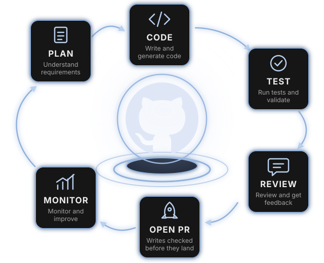

<style scoped>
section {
  display: grid; grid-template-columns: 1fr 1.1fr; align-items: center; align-content: center; column-gap: 24px;
  padding: 40px 40px 40px 72px;
  background: var(--bg);
}
.brand p { display: flex; align-items: center; gap: 16px; margin: 0; font-size: 40px; font-weight: 700; letter-spacing: -.01em; color: var(--ink); }
h1 { margin: 48px 0 0; font-size: 60px; line-height: 1.12; letter-spacing: -.025em; font-weight: 800; color: var(--ink); }
.rule { margin-top: 32px; width: 64px; height: 6px; border-radius: 3px; background: var(--accent); }
.sub { margin: 32px 0 0; font-size: 24px; line-height: 1.35; color: var(--muted); }
.meta p { margin: 20px 0 0; font-size: 20px; }
.loop p { margin: 0; }
.loop img { width: 100%; height: auto; display: block; }
</style>

<div>
<div class="brand">

 GitHub

</div>

# Repos that keep themselves up to date

<div class="rule"></div>
<div class="sub">GitHub Agentic Workflows: from AI that suggests to AI that does</div>
<div class="meta">

<span class="muted">Donal Moloney</span> · <span class="todo">TODO: talk date and audience</span>

</div>
</div>
<div class="loop">



</div>

<!--
Open with the promise, not the product: a repo whose docs keep up with its code.
"Today: what GitHub Agentic Workflows are, how they are kept in check, what happened when GitHub ran one on its own docs, and a one-month pilot I'd like us to try."
Mixed room: plain-English version first on every slide; the technical detail is there for those who want it.
Shape of the hour, so nobody is lost: why this matters now, what the thing actually is, why you can check it, what it has already done, and the one decision I want at the end.
Transition: start with something true of almost every repository in this company.
-->

---

<!-- header: Why now -->

## More than half of developers say outdated information gets in the way of their work

<div class="stat">56.5%</div>

of 12,374 developers say **outdated information** gets in the way of the context they need at work. Somewhere in our docs, a page is probably wrong, and nobody knows which one.

<span class="muted">Measured: Stack Overflow Developer Survey 2026. The page-is-wrong framing is this deck's; the survey measures the blocker, not our repositories.</span>

<!--
Pause after the title. Let people think of their own stale page. Do not fill the silence. Then make it an every-day thing: the code changes every day, the page does not, and nobody is assigned to notice.
Precision, in case the number is challenged: 6,989 of 12,374 developers picked "information is outdated" when asked what gets in the way of getting the context they need for work. Measured, but self-reported — it is what developers say gets in their way, not an audit of anyone's docs.
Careful wording: the survey says outdated information, not documentation. Hearing it as a docs problem is this deck's interpretation, so say "information" and let the room make the jump. That is the measured claim; the rest of the sentence is mine.
TODO: the "72.6% say recent or clearly up to date makes information trustworthy (n=12,996)" line could not be found in the 2026 survey on 17 Oct 2026; don't say it until a source URL is found.
Older backup if challenged: 68% of 45 developers agreed that "documentation is always outdated relative to the current state of a software system" — 24% strongly, 44% somewhat (Lethbridge, Singer and Forward, IEEE Software, 2003). Tiny sample, twenty-three years old, and the copy I read is a course-hosted PDF rather than the publisher's page.
Q: "Is this really our problem?" I'm not claiming a measured gap in our repos — I'm claiming nobody in this room can name which page it is. That is the whole point.
Transition: and the gap is widening, because of how much faster we now write the code the docs describe.
-->

---

## Code volume keeps climbing, and documentation has to keep up with all of it

<style scoped>
h2 { margin-bottom: 28px; }
.duo { display: grid; grid-template-columns: 1fr 1fr; gap: 32px; font-size: 26px; line-height: 1.4; }
.duo .stat { font-size: 80px; white-space: nowrap; margin-bottom: 12px; }
p { margin: 20px 0; }
.muted { font-size: 20px; }
</style>

<div class="duo">
<div><div class="stat">43.2 million</div>pull requests merged per month, up 23% year over year.</div>
<div><div class="stat">Nearly 1 billion</div>commits pushed in 2025, up 25.1%.</div>
</div>

**More merged code means more pages that can drift out of date.** That link is this deck's, not the report's.

<span class="muted">Measured: Octoverse 2025 (GitHub). The volume figures are measured; the link to documentation is this deck's interpretation.</span>

<!--
Plain line: the amount of code being written and merged is climbing fast, and every change is a chance for a page to fall behind it.
Numbers: 43.2M pull requests merged per month (+23% year over year) and nearly 1 billion commits pushed in 2025 (+25.1%), both from Octoverse 2025. Measured by GitHub.
Careful wording: do not claim a measured docs gap from these. The docs evidence is the survey on slide 2. The step from more code to staler docs is my interpretation and the slide says so.
Q: "Is AI really behind the growth?" Octoverse reports the growth; do not attribute all of it to AI.
Transition: and as that code piles up, we are handing the agent more of the work. Here is the ladder.
-->

---

## Each rung hands the agent more of the work, and at L4 it does the work and we approve

<style scoped>h2 { margin-bottom: 12px; } p { margin: 10px 0; } .muted { font-size: 20px; }</style>


**L4 = it does the work, we approve.** That is where this talk sits.

<span class="muted">Ladder: Feng et al., arXiv 2506.12469. Illustrative bars, not measurements; placing gh-aw at L4 is this deck's reading.</span>

<!--
Plain line: each step up this ladder, the agent does more of the work and we do less of the deciding. L4 is "it does the work, we approve" — and that is exactly the shape of a draft pull request.
Technical: the ladder runs L1 Operator to L5 Observer (Feng et al.). L4 Approver is my reading of gh-aw: the agent does the work, a human approves the consequential step, the pull request. It is not the paper's classification of gh-aw.
Sources and caveats: the bars are illustrative proportions, not measurements. If someone reads a number off them, correct it. Only the paper's levels are cited; the L4 placement is mine and the slide says so.
Delivery: do not narrate the ladder level by level. Say the L4 line, point at the marker, and move on; a level-by-level tour loses the non-technical half of the room.
L4 is where the previous slide's volume argument lands: the more code, the more of the work we hand over, and the draft pull request is the approval step.
Q: "Which level are we at today?" TODO: say which level we are at today; I have not measured it.
Q: "Is L5 where this is heading?" Do not predict. gh-aw as documented keeps a human at the pull request.
Transition: I've tried to close this gap before, and it's worth telling you how that went.
-->

---

## I built something similar before, and it showed me what was missing

<style scoped>
h2 { margin-bottom: 20px; }
.beats { display: grid; grid-template-columns: 1fr 1fr 1fr; gap: 18px; }
.beats .card { border-top: 4px solid var(--warn); }
.beats .card p { margin: 6px 0 0; font-size: 24px; }
.shot { margin: 14px 0 0; border: 2px dashed var(--warn); border-radius: 10px; min-height: 170px; display: flex; align-items: center; justify-content: center; }
.todo { font-size: 22px; margin: 14px 0 0; }
</style>

<div class="beats">
<div class="card"><span class="k">1 · What I built</span>

<span class="todo">TODO: one sentence.</span>

</div>
<div class="card"><span class="k">2 · What worked</span>

<span class="todo">TODO: one sentence.</span>

</div>
<div class="card"><span class="k">3 · What was missing</span>

<span class="todo">TODO: one sentence — the gap the rest of this talk fills.</span>

</div>
</div>

<p class="todo">TODO: confirm the landing line is "it only ran when a person remembered to run it".</p>

<div class="shot"><span class="todo">TODO: screenshot of the earlier project goes here.</span></div>

<!--
TODO: tell the story of the earlier project in three beats: what I built, what worked, what it could never do.
IMPORTANT, the hidden contract with the next slide: the third beat must land on "it only ran when a person remembered to run it". The turn on slide 6 is "it stopped waiting to be asked", so if column three is really about quality, cost or adoption instead, slide 5 to slide 6 becomes a non-sequitur. Either make the third beat about who had to start it, or change slide 6's transition to match the gap you actually name.
If this story will not be ready, CUT this slide rather than show an empty strip (day-of fallback: delete the whole slide; nothing else references it). The arc survives: slide 5 runs into slide 6 as a "but". What you lose is the only human moment in the deck, so cutting is the worse of two acceptable options — but an empty table at the hinge is the unacceptable one.
Keep it to ninety seconds. This slide exists to buy credibility, not to relive the project.
End hard on the third beat, because the next slide is the thing that answers it. If the third beat is weak, the whole talk is a product demo instead of a story.
Q: "Why didn't that one work?" Answer honestly; a real limitation named here makes everything after it more believable.
Transition: what changed since then is not that the AI got smarter. It's that it stopped waiting to be asked.
-->

---

<!-- header: The turn -->

## An assistant waits to be asked; this one works a shift

<style scoped>h2 { margin-bottom: 14px; } p { margin: 10px 0; } .muted { font-size: 20px; }</style>


**The chore nobody schedules is the chore that never gets done.** That wrong page is exactly that chore.

<span class="muted">Illustrative, and this deck's own framing. The only difference drawn here is who starts the work and where the output lands.</span>

<!--
Plain line: every AI tool we use today waits for a human to ask. You type, it answers, and if you are not there, nothing happens. This one has a trigger instead of a prompt, so the work happens whether or not anyone is at the keyboard — and your job changes from asking to reviewing.
This is the hinge of the talk. It is also the deck's subtitle finally on screen: from AI that suggests, to AI that does.
Careful wording: "works a shift" means a scheduled or event-driven shift. It is NOT self-directed and it is NOT always-on. It runs when a trigger fires, and a human still reviews the output. Say that plainly if anyone hears "autonomous".
Name no products here. Specific assistants have specific configurable behaviours, and a wrong claim about one of them loses the room for free. Keep it at the level of "an assistant you ask" versus "a workflow with a trigger".
Do NOT say "every AI tool waits to be asked" — it is false and the first technical objector wins the room with it. Dependabot, scheduled bots and any Action that calls a model already run unprompted. The claim is about assistants, the things we type at, which is why the title says "an assistant".
Q: "Isn't that just Dependabot?" Fair, and the honest answer is that Dependabot runs one fixed task; this takes a brief in plain English and does work that needs interpretation. Concede the scheduling point rather than fighting it.
The diagram is illustrative, not measured. No hours, no counts.
Q: "So it's a cron job with an AI in it?" Close enough to be a fair question, and the honest answer is yes — plus a brief, a sandbox and a checked outbox.
Park the worry before anyone has to raise it, because this slide is where it starts: "You should be asking what stops it breaking something. That's the act straight after I've shown you the file, and I won't skip it." Then the mechanism slides can do their job instead of the room composing an objection through all four.
Transition: so what is it, concretely? It is something you already have, briefed differently.
-->

---

<!-- header: What it is -->

## An agentic workflow is a GitHub Action you brief instead of script

<style scoped>h2 { margin-bottom: 10px; } p { margin: 6px 0; } .muted { font-size: 20px; }</style>

<p class="lede">A normal Action runs steps someone wrote. This one runs a paragraph someone wrote, and works out the steps itself.</p>


<div class="source">Documented: the gh-aw frontmatter reference. This deck's interpretation: the teammate mapping, not GitHub terminology.</div>

<!--
The title is the whole idea: say it, pause, and let the diagram carry it.
The line to add, which is not on the slide: you already have Actions that run a script somebody wrote. This one runs a paragraph somebody wrote, and it works out the steps itself.
Then the teammate model, which carries the rest of the talk. Four pairs, and I will reuse these exact four words on every slide that follows:
- job description = the markdown body
- shift = the trigger, on:
- access badge = permissions, tools and network
- outbox you check = safe-outputs. It cannot send anything you haven't allowed.
Say the typical jobs out loud rather than listing them on the slide: maintain the repo — docs, triage, dependencies; improve code — reviews, security; report — metrics.
Sourcing, and say it: the three groups are the gh-aw home page's own headings, and the tasks are from its gallery. What's mine is which task I filed under which group, plus shortening their "Report and plan" to report.
Then point at docs: that's this talk's job, and the lowest-risk place to start.
Careful wording: the teammate mapping is mine, not GitHub's vocabulary. Don't let it get quoted back as official terminology.
Q: "Is this just Copilot in CI?" No: Copilot is one of several engines; what's new is the read-only agent plus checked outputs.
Aside if asked, not on the slide: the docs also name patterns like ChatOps, IssueOps and LabelOps.
Transition: so before the machinery, the obvious question — what kind of work would we actually give it?
-->

---

## It does three kinds of work, and documentation is the safest corner to start in

<style scoped>
h2 { margin-bottom: 22px; }
.three { display: grid; grid-template-columns: 1fr 1fr 1fr; gap: 20px; }
.card p { margin: 8px 0 0; font-size: 22px; line-height: 1.45; }
.card .k { display: block; margin-bottom: 4px; }
.three .card:first-child { background: var(--fill-accent); border-color: var(--accent); }
.three .card:first-child .k { color: var(--hi); }
p { margin: 18px 0 0; }
.muted { font-size: 20px; }
</style>

<div class="three">
<div class="card">

<span class="k">Maintain</span>
Documentation maintenance · Issue triage · Dependency analysis

</div>
<div class="card">

<span class="k">Improve code</span>
Pull request review · Security review

</div>
<div class="card">

<span class="k">Report and plan</span>
Metrics and analytics

</div>
</div>

**We are asking for one job, in the first box: a single documentation page.** It is the corner where a wrong answer costs a review comment, not an outage.

<span class="muted">Groups are the gh-aw home page's own; the example tasks are from its gallery, verified 17 Oct 2026. Sorting those tasks into those groups is this deck's.</span>

<!--
Plain line: the same mechanism does three kinds of work. Read the three headings, give one example each, and stop — this slide is a breather, not a catalogue.
This is deliberately the least technical slide in this part of the talk. The two slides either side are a compiler and a trigger table, so slow down here and let the non-technical half of the room back in. If you rush it, you lose them until the safety slide.
Technical detail: the three groups — Maintain, Improve code, Report and plan — are the gh-aw home page's own grouping. The six example tasks are from its gallery: Documentation Maintenance, Issue Triage, Dependency Analysis, Pull Request Review, Security Review, Metrics and Analytics. Which task sits in which group is my sorting, and the slide says so.
Why this matters for the ask: it makes the pilot look chosen rather than arbitrary. Docs is where being wrong is cheapest — the cost of a bad suggestion is a reviewer's comment, not a broken build or a missed vulnerability. Say that out loud; it is the argument that makes a sceptic comfortable.
Careful wording: do not imply we have run any of these, and do not promise the other two groups. The ask is one job in the first box. If someone asks "could it do security review?", the honest answer is that the mechanism is the same and the risk is not, so that is a later conversation.
Q: "Why not start with code review, that's where the money is?" Because a wrong code review costs reviewer trust, and we have no measured accuracy yet. Earn the data on the cheap job first.
Transition: so if the brief is plain English, what turns it into something GitHub will actually run?
-->

---

## You write the instructions in plain English, and one command compiles them into a GitHub Action

You write a paragraph; a tool turns it into the format GitHub runs.

<style scoped>h2 { margin-bottom: 14px; } p { margin: 10px 0; } pre { font-size: 20px; margin: 10px 0; } .muted { font-size: 20px; }</style>

```markdown
---
# settings: when it runs, what it may touch (full file next)
---
Update the docs to match the code that changed, and open a draft PR.
```


<span class="muted">Documented: gh-aw CLI reference; the body is paraphrased, the real instructions are longer.</span>

<!--
Below the frontmatter is the job description, in plain English. The real body is a page of style rules — it names the Diataxis framework and forbids pushing to the default branch; this one line is a paraphrase, and the slide says so.
gh aw compile turns the markdown into a .lock.yml, ordinary GitHub Actions YAML. You commit both, and both get reviewed.
For non-technical listeners: the settings are the rules, the body is the request, and compile turns them into something GitHub already knows how to run.
Q: "Do I need to edit the YAML?" No — the diagram answers this: you author the markdown and recompile, and the lock file is generated. Never hand-edit it.
Q: "So a change to the agent's instructions goes through review?" Yes, and that is the governance answer worth repeating: the brief is code, and it arrives as a pull request like anything else.
Transition: that's the job description written. Now, who or what starts the shift?
-->

---

## Four things can start it, and a person who starts one is permission-checked first

A person's access is checked before the run begins. A schedule has no person to check.

<style scoped>h2 { margin-bottom: 14px; } p { margin: 10px 0; } .muted { font-size: 20px; }</style>


<span class="muted">Documented: gh-aw triggers and architecture docs. push, issues and pull_request triggers enforce permission checks, and pull_request workflows block forks by default. A schedule has no triggering user, so it is not role-checked.</span>

<!--
The title lists the four. The point worth adding is the one the diagram makes: all four end in the same run, with the same permissions and the same outbox. The trigger only decides who starts the shift.
The gate is the part worth saying out loud, because it is the first thing a security-minded person wants to know: a passer-by cannot comment our agent into action. By default the allowlist is admin, maintainer or write, and the pre-activation job performs that check (gh-aw triggers and architecture docs).
Careful wording, and the diagram is drawn to match: the verified claim covers a PERSON starting a run — sources.md records it as the pre-activation job role-checking the commenter on command triggers. Do not say a scheduled run is role-checked; a schedule has no triggering user, and neither docs page ties the allowlist to schedules. On push or fork behaviour, the triggers docs (checked 18 Oct 2026) say workflows with push, issues or pull_request triggers automatically enforce permission checks, and pull_request workflows block forks by default; the diagram now routes repository events through the check. The docs do not say which role list applies to each event, so say "permission checks", not "write access", for push and issues.
Schedules can be fuzzy ("daily") rather than exact cron times.
Trying it safely (gh aw trial, staged: true) is on the ask slide, not here, so each fact is said once.
Q: "Could an outside contributor trigger it on a fork PR?" The role check is the control; say the roles, and offer to show the triggers page rather than guessing at fork-specific edge cases.
Transition: that's when it runs and who can start it. Here is the whole job, in thirteen lines.
-->

---

## Thirteen lines say when it runs, what it can read, and the one thing it can send

In plain terms: it reads the repo and can send one draft pull request.

<style scoped>
h2 { margin-bottom: 12px; }
p { margin: 8px 0; }
.cols { display: grid; grid-template-columns: 1fr 1.1fr; gap: 24px 40px; align-items: start; }
.g { position: relative; margin: 0 0 10px 38px; }
.g pre { font-size: 18px; line-height: 1.3; margin: 0; padding: 6px 12px; }
.g pre code { font-size: 18px; }
.n { display: inline-block; width: 28px; height: 28px; border-radius: 50%; background: var(--accent); color: var(--bg); font-weight: 700; font-size: 20px; line-height: 28px; text-align: center; }
.g > .n { position: absolute; left: -38px; top: 6px; }
.a { display: flex; gap: 10px; align-items: baseline; font-size: 22px; line-height: 1.3; margin: 0 0 9px; }
.a p { margin: 0; }
.a .n { flex: none; }
.muted { font-size: 20px; }
</style>

<div class="cols">
<div>

<div class="g"><span class="n">1</span>

```yaml
on:
  push:
    branches: [main]
```

</div>
<div class="g"><span class="n">2</span>

```yaml
permissions: read-all
network: defaults
```

</div>
<div class="g"><span class="n">3</span>

```yaml
safe-outputs:
  create-pull-request:
    draft: true
```

</div>
<div class="g"><span class="n">4</span>

```yaml
tools:
  github:
    toolsets: [all]
  web-fetch:
  bash: true
```

</div>
</div>
<div>

<div class="a"><span class="n">1</span>

<strong>Shift:</strong> every push to `main`

</div>
<div class="a"><span class="n">2</span>

<strong>Access badge:</strong> `read-all`, read-only; network limited to basic infrastructure

</div>
<div class="a"><span class="n">3</span>

<strong>Outbox:</strong> one draft pull request, and nothing else

</div>
<div class="a"><span class="n">4</span>

<strong>Tools:</strong> broad. `bash: true` runs arbitrary commands, in a job with no write permissions, behind a firewall.

</div>

**The agent is granted no write access here.** A separate job opens that one pull request, after a scan.

</div>
</div>

<span class="muted">Documented: `workflows/update-docs.md` in githubnext/agentics, frontmatter trimmed.</span>

<!--
This is a real file, trimmed: update-docs.md from githubnext/agentics. Not a made-up example. Say "trimmed".
Walk it against the teammate pairs from the model slide, in the same order and the same words: shift = every push to main; badge = read-all plus network: defaults; outbox = one draft pull request.
Expect "bash: true?" — it is the right question and the slide answers it in bold on purpose. Do NOT call bash a "read": it runs arbitrary commands, and a security-minded listener will catch that instantly and stop trusting the rest. The honest answer is that the commands run in a job holding no write permissions, with egress through a firewall, and that writes happen later in a separate job. The separate job is two slides away, so do not promise it as "next".
Q: "toolsets: [all] sounds like a lot." It is, and it is still read-only. The thing to inspect in review is safe-outputs, not tools — the outbox is the only way anything leaves.
Transition: that's the whole job description. Before I show you what enforces it, the uncomfortable part out loud — it will get things wrong.
-->

---

<!-- header: Is it safe? -->

## It will sometimes be wrong, so every change arrives as a draft a person reviews

<style scoped>
h2 { margin-bottom: 18px; }
.cards { grid-template-columns: 1fr 1fr 1fr; }
.card .k { display: block; }
.card p { margin: 6px 0 0; font-size: 22px; line-height: 1.35; }
.card:nth-child(2) { background: var(--fill-accent); border-color: var(--accent); }
</style>

<p class="lede">You would review a new teammate's first pull request. This one cannot skip that step.</p>

<div class="cards">
<div class="card"><span class="k">1 · It can be wrong</span>

A plausible but incorrect edit is possible. The design assumes it.

</div>
<div class="card"><span class="k">2 · What catches it</span>

It can only open a **draft** pull request, and a person reviews it. `draft: true` is a policy the agent cannot override.

</div>
<div class="card"><span class="k">3 · Where it does not fit</span>

It does not replace build, test or release pipelines. It is for work that needs interpretation.

</div>
</div>

<div class="source">Documented: gh-aw safe-outputs reference. Never merged automatically is GitHub Blog guidance (13 Feb 2026), not a hard limit.</div>

<!--
Plain line: you would review a new teammate's first pull request, and this one cannot skip that step. Three cards: it can be wrong, what catches it, where it does not fit. Prompt injection has its own slide two ahead, so it is not repeated here. Cost is on the ask slide, where the budget decision is.
Be honest first: it will sometimes be wrong. The design assumes that. Saying this before anyone asks is what buys the next three slides.
What catches it: pull requests open as drafts; the docs call draft "a policy, not a default", so the agent cannot override it at runtime.
Careful wording: "pull requests are never merged automatically" is GitHub Blog guidance, not a hard limit. An experimental merge-pull-request output does exist — it is gated by policy, and merges to the default branch are always refused. Do not upgrade that into a guarantee.
Q: "Could it replace our CI or release pipeline?" No: it's not for build, test or release pipelines; it's for work that needs interpretation. Say the limit out loud as well as showing it; naming it early buys trust.
Say the quote out loud rather than putting it on the slide: "Getting an agent to open a pull request was never the hard part. Trusting it enough to merge is." (May Walter, CTO, Hud.io, GitHub changelog, 11 Jun 2026.)
Transition: so trust is the real question. Here is the single design decision that does the most work.
-->

---

## The agent never holds a write token: a separate, checked job does the writing

<style scoped>h2 { margin-bottom: 14px; } p { margin: 10px 0; } .muted { font-size: 20px; }</style>


**The teammate drafts the letter; someone else holds the key to the postbox.** Detection is a check, not a gate: by default (`continue-on-error: true`) a failure becomes a warning, not a block.

<span class="muted">gh-aw architecture docs; four of its six jobs shown, plus the human review.</span>

<!--
The postbox line is on the slide; say it, then extend it: the checker in the middle is a separate job that reads what the teammate wrote before anyone posts anything.
Point at the keys. Three stages carry a crossed-out key and exactly one carries a real one. That single difference is the slide, and it is the answer to "bash: true" from two slides ago.
Technical version: least privilege by job boundary. Quote it exactly, because it's the architecture's claim rather than mine: "The agent job runs with minimal read-only permissions, while write operations are deferred to separate jobs" (gh-aw architecture docs).
So the model never runs in the job that holds the write token — and the frontmatter slide shows what that looks like in a real file: permissions: read-all.
Detection looks for prompt injection, secret leaks and malicious patches.
Either way, the draft pull request still goes to a person, who decides: that is what a human does after a detection warning.
Careful wording (the caveat is drawn inside the Detection box): don't say it "always blocks". By default, continue-on-error is true, so a detection warning or failure becomes a caution notice rather than a block. The diagram draws it dashed and warned for exactly this reason — if you claim a hard gate, the diagram contradicts you.
Q: "Which AI does the work?" Engine choice is a setting: GitHub Copilot, Claude Code, Codex, Antigravity (experimental) and Pi; Copilot is the usual default. Gemini is listed but deprecated in favour of Antigravity.
Careful wording: the docs list six jobs (adding pre-activation and conclusion); the diagram simplifies, so don't say "four jobs" as if that were all of them.
Q: "Is it GA?" No: public preview since 11 Jun 2026 (GitHub changelog).
Transition: separating the token doesn't make the agent right, only checkable. And its reach is as narrow as the list we give it.
-->

---

## Hidden instructions can reach the agent, and three limits narrow what they can do

<style scoped>
h2 { margin-bottom: 20px; }
.todo { font-size: 22px; }
.muted { font-size: 20px; }
</style>

<p class="lede">Prompt injection means someone tricks the AI with hidden instructions in text it reads, such as an issue or pull request.</p>


<span class="todo">OPEN QUESTION: can an injected agent send data to a domain that is on the allowlist? No documented answer yet; confirm before the talk.</span>

<div class="source">Documented: gh-aw safe-outputs, architecture and network reference.</div>

<!--
Plain line: someone hides instructions in an issue or pull request, and the agent reads them as if they were ours. Say the three steps: it enters, three limits narrow what it can do, and a person still reviews what comes out.
Script for the open question: "I do not have a documented answer; I'd rather tell you that than guess." Then point at the next slide for where the allowlist sits.
Technical: the limits are no write token (previous slide), a domain allowlist on egress, opt-in tools, and a cap (`max`) on each safe output. The `max` caps are from the safe-outputs docs; quote no number without opening the page.
Careful wording: limits narrow the damage, they do not remove the risk, and the third box is a person, not a guarantee. Do not say "can't be tricked".
Transition: here is where those limits physically sit.
-->

---

## A misled agent is boxed in by layers, not by any single wall

<style scoped>h2 { margin-bottom: 12px; } p { margin: 8px 0; } .muted { font-size: 20px; }</style>


<div class="source"><span class="todo">TODO: the allowlist data question from the previous slide is still open.</span> Documented: gh-aw architecture and network reference; the MCP gateway caveat is the docs' own wording.</div>

<!--
Labels: "web filter" is the Squid proxy and "tool connector" is the MCP gateway; the product names are small on purpose, say the plain names first. The amber box is the open question, not a claim.
Plain line: the agent works in a sealed room. It can only talk to the phone numbers we put on the list, and someone else holds the keys.
Technical: the agent is containerised and its egress goes through a proxy with a domain allowlist. Tools are opt-in under `tools:` — `bash: ["gh issue comment"]` limits bash to that one command. `network: defaults` is basic infrastructure only and is what you get if you omit `network:`; `network: {}` is no access at all.
The API proxy does a different job, and it's the most interesting idea on the slide: it keeps the engine's auth token out of the agent's container. The docs' own name for this is "agent auth-token isolation".
Careful wording: do not say there is nothing in there to steal. The same page says an in-container identifier should be treated "as leaked by design". The claim is that the engine token is held somewhere else, not that the container holds no secrets.
Careful wording: the MCP gateway is drawn dashed and marked on purpose. The docs say it "is not a strong security boundary against a compromised or malicious agent". Say that out loud — the defence is layers, not any one wall. Claiming otherwise is the fastest way to lose a security-minded room, and volunteering the weak spot is what makes the rest credible.
Q: "So it can't call out at all?" It can, but only to domains on the list. That list is in the workflow file and gets reviewed like any other code. Never say "no network" — `network: defaults` is an allowlist, not an absence, and the slide shows that.
Q: "Could an injected prompt send our data OUT to a domain that IS on the allowlist?" This is the sharpest question on the slide and the deck does not currently answer it, and the previous slide says so in amber. TODO: get the documented answer before the talk. Until then, say honestly that the allowlist limits where it can reach, the API proxy keeps the engine token out of the container, and the draft pull request is reviewed before anything lands — and that you will come back with the precise answer rather than improvising one. The deck volunteers its other weaknesses, so guessing here is the one thing that would cost the credibility the rest of this act has bought.
Transition: that's the design. The fair question now is whether it actually produces anything worth reviewing.
-->

---

<!-- header: Evidence -->

## GitHub reports that 57 of 59 pull requests from its docs workflow were merged

<style scoped>
h2 { margin-bottom: 14px; }
.row { display: grid; grid-template-columns: auto 1fr; gap: 40px; align-items: center; }
.stat { font-size: 110px; margin: 0; }
.cards .card p { font-size: 24px; }
.muted { font-size: 20px; } .todo { font-size: 20px; }
.slot { margin: 14px 0 0; border: 2px dashed var(--warn); border-radius: 10px; padding: 10px 16px; }
</style>

<div class="row">
<div class="stat">57 / 59</div>
<div class="lede">Daily Documentation Updater: 96% of its pull requests were merged. A small sample, on GitHub's own repositories.</div>
</div>

<div class="cards">
<div class="card"><span class="k">GitHub measured</span><p><strong>Merged.</strong> A person clicked merge.</p></div>
<div class="card"><span class="k">Our pilot will measure</span><p><strong>Accepted as accurate.</strong> A stricter test: merged is not the same as correct.</p></div>
</div>

<div class="slot"><span class="todo">TODO: one real linked pull request (title, link, what changed) and a recording of the run behind it.</span></div>

<div class="source">Reported by GitHub: gh-aw blog, "Meet the Workflows: Continuous Documentation", 13 Jan 2026. The post does not name the repositories.</div>

<!--
Plain line: when GitHub ran its own docs agent, people reviewed what it proposed and merged almost all of it.
The number is GitHub's own, from the gh-aw blog ("Meet the Workflows: Continuous Documentation", 13 Jan 2026): 57 of 59 docs PRs merged. Also reported there: Documentation Unbloat 88 of 103, Glossary Maintainer 10 of 10.
Caveat out loud, not just on the slide: reported by GitHub, small samples, and the post doesn't say which repos. Merged is not the same as correct. If I present this as a target we will hit, I have oversold it.
The mismatch, say it out loud: GitHub counted MERGED; our pilot counts ACCEPTED AS ACCURATE by the page owner, and may well score lower.
TODO: replace the amber slot with one real linked PR, then the recording of the run behind it. Never show a screenshot that is not a real PR. Runs take minutes, so use recordings; a live run is a bonus only.
Q: "Is 96% good?" Unknown without a baseline; GitHub gives none. Our pilot sets its own.
Outside evidence if asked: "Inside of CNCF, we are benefiting from improved documentation automation along with improving team reporting across the organization." Chris Aniszczyk, CTO of the Cloud Native Computing Foundation, GitHub Blog, 13 Feb 2026. A customer quote in a vendor post — use it as colour, not as proof.
Transition: that's GitHub's number, on GitHub's repos, and we have none of our own. Here's how far I've already got towards getting one.
-->

---

<!-- header: What I've built -->

## Ninety-eight of these are written and documented, and not one has ever run

<style scoped>h2 { margin-bottom: 18px; } p { margin: 12px 0; } .muted { font-size: 20px; } .todo { font-size: 20px; }</style>


<span class="muted">`DonalMoloney/Agentic-Workflows-Lib`, private. Measured: file counts via the GitHub API, 17 Oct 2026. Self-reported: the compile result and "not yet run" column, from the repository's own `agents.md`, not a CI result.</span>

<span class="todo">TODO: the one thing building this taught me, and whether the repo goes public before the talk.</span>

<!--
Plain line to say: I didn't come here with a slide deck. I came with 98 of these already written and documented, and not one of them has ever run. That last part is the ask.
Say the right-hand column out loud. Do not let the room hear "98" and assume production. The honest sentence is "written and documented, not yet executed".
Technical detail: 98 markdown briefs in workflows/, each with a docs page in docs/workflows/ carrying the same required-fields table. Six shared modules under workflows/shared/ are imported rather than copy-pasted, so a safety change lands in one place. Its aw.yml pins gh-aw min-version v0.83.4 — read from the repository, never exercised by a run.
Numbers and sources: both 98s and the 6 were verified through the GitHub API on 17 Oct 2026; the two filename sets are identical. "4 compiled, 0 errors" and "0 runs" come from the repo's own agents.md.
Careful wording, say none of these: not "98 workflows running", not "98 compiled", not "in production", not "the org is using it". Only 4 of 98 were compiled, and no .lock.yml files are committed at all. The acme-org owner and install strings in that repo are placeholders and resolve to nothing, so never show an install line as runnable.
Q: "So none of this actually works?" Four compile cleanly against the pinned gh-aw version, so their frontmatter and safe outputs are valid — self-reported, and with no lock files committed, I can't show you the artefact. Runtime behaviour is unproven, and that is exactly what a month of real runs would settle.
Q: "Why 98 and not 4?" The briefs are the cheap part, they are plain English. Compiling, running and reviewing is the expensive part, and I stopped before spending that without agreement.
Q: "Can we see it?" It is private. TODO: decide before the talk whether it goes public.
Q: "How long did this take you?" TODO: answer honestly; it is the question that makes 98 land or sound like padding.
Transition: and a pile of 98 files is only worth anything if each one tells you what it does and who answers for it.
-->

---

## Each of the 98 ships with a one-page spec: what it may write, and who owns it

<style scoped>h2 { margin-bottom: 18px; } table { font-size: 23px; display: table; width: 100%; } td, th { padding: 7px 14px; } .muted { font-size: 20px; } .todo { font-size: 20px; }</style>

| | `readme-auto-updater` |
| --- | --- |
| **Purpose** | Spot drift between the README and the code after a push to `main`, and propose a fix |
| **Shift** | `push` — branches: `main` |
| **Access badge** | `permissions: contents: read`; GitHub toolsets `context`, `repos` |
| **Outbox** | **one** pull request — `create-pull-request`, `max: 1` |
| **Owner** | <span class="todo">TODO: the real owning team</span> |
| **Maturity** | **Experimental** — the label the library gives all 98 |

<span class="muted">Trimmed from `docs/workflows/readme-auto-updater.md` and its frontmatter, verified 17 Oct 2026. Owner and install lines use a placeholder `acme-org` namespace and do not resolve.</span>

<!--
Plain line to say: this is the job description for one teammate out of 98 — and the page tells you, before you hire it, what it can touch, what it can send, and whose phone rings when it gets it wrong.
Deliberate callback: the row labels are the same four words as the teammate model — purpose, shift, access badge, outbox. Fourth time the room has heard them. That repetition is the point.
Technical detail: every one of the 98 docs pages uses this same required-fields table — purpose, triggers, writes, required secrets, shared imports, customization points, owner, maturity. The frontmatter backs it: permissions is contents: read only, and the single safe-output is capped at max: 1, so one run cannot open a pile of pull requests.
On draft: this file does not set draft: true, but it does not need to — the safe-outputs pull request page records draft as "a policy, not a default" with default true (verified 17 Oct 2026), so an omitted draft still yields a draft PR. Safe to say "it opens a draft" about this workflow.
Careful wording: the owner on the page is @acme-org/platform-devex, a placeholder, and the install command on that page points at a namespace that does not exist. Say "placeholder" out loud if it is on screen. Never show that install line as if someone could run it.
All 98 docs pages carry "Maturity: Experimental" — that is the library's own label on itself, not modesty for this room.
Q: "Could this have written to our README already?" No. It has never run anywhere, and permissions are read-only — the pull request would be a proposal, reviewed like any other.
Q: "Experimental means what, exactly?" Compiled and documented, never executed. Same honest line as the previous slide.
Head off a confusion this slide can cause: the room has now heard two workflow names — `update-docs` from githubnext/agentics on the file slide, and `readme-auto-updater` here from my library. Say which one the pilot would actually run, and say it plainly, or people will leave unsure what they just agreed to. TODO: decide which, and name it here and on the ask slide so the two match.
Careful wording on the owner row, and do not get this backwards: every one of the 98 has an owner field and every single one currently reads `acme-org`, a placeholder. I cannot fill in ANY of them. That is precisely what separates a library from a deployment, and saying it plainly is what makes the next slide an honest ask rather than a sales close.
Transition: ninety-eight owner fields, and not one real name in them. The first real name is the thing I'm here to ask for.
-->

---

<!-- header: The ask -->

## Pick one stale page, and let an agent keep it current for a month

<style scoped>
section { background: var(--panel); box-shadow: inset 0 6px 0 var(--accent); }
h2 { margin-bottom: 12px; color: var(--ink); }
p { font-size: 24px; margin: 10px 0; }
code { background: var(--bg); }
.need { display: grid; grid-template-columns: repeat(5, 1fr); gap: 10px; margin: 10px 0; }
.need div { background: var(--bg); border: 2px dashed var(--warn); border-radius: 8px; padding: 6px 10px; font-size: 20px; line-height: 1.3; color: var(--warn); font-weight: 600; }
.muted { font-size: 20px; }
.todo { font-size: 20px; }
</style>

<span class="k">What I need from you today: five answers I will not invent</span>

<div class="need">
<div>TODO: repository</div>
<div>TODO: page owner</div>
<div>TODO: credit budget</div>
<div>TODO: baseline (how stale now)</div>
<div>TODO: keep / stop rule</div>
</div>


<span class="todo">OPEN DECISION: pilot workflow, `update-docs` or `readme-auto-updater`. Cost follows run frequency: a push to `main` runs every time, a schedule bounds it (cap about $10 a run).</span>

<div class="source">Documented: staging is not a sandbox; <code>gh aw trial</code> is experimental (gh-aw docs).</div>

<!--
Callback to the opening: "a page is wrong right now, and nobody knows which one". Let's pick one and settle it.
The five dashed boxes are the five blanks only you can fill: repository, page owner, credit budget, baseline (how stale the page is today), keep/stop rule. Do not invent any of them.
Run frequency is part of the cost: a push-to-main trigger multiplies the per-run cap (default 1,000 AI Credits, about $10; best-effort estimate) by every push; a daily or weekly schedule bounds it. TODO: choose, then work out runs per month times the cap. Do not state a total, or call it small, until then. If asked "ten dollars times how many runs?", say that is exactly the blank.
Pilot workflow is an open decision: update-docs (file slide) vs readme-auto-updater (spec slide). Name it here and make the two slides match.
Frame it as an experiment, not a project: one hypothesis, one method, one measure, one decision rule. That is also the honest framing — we do not know the answer yet, and this is the cheapest way to find out.
Two safety nets, both from the docs: gh aw trial runs a workflow in a temporary private repository (experimental), and staged: true under safe-outputs runs it for real but previews every safe output instead of writing it. Week one is staged: true, so the first week writes nothing at all and we read what it would have done. That is the part that makes this an easy yes.
The ask: TODO (pilot repo, owner, budget, and the decision rule).
Do not present the 96% as a target we expect to hit. It is GitHub's own figure, reported by GitHub, from 59 pull requests, and the post does not say which repositories produced it. Our number is unknown, which is the whole reason to run the month.
Commands for engineers, if asked: gh extension install github/gh-aw; gh aw init; gh aw new <name> to scaffold a workflow; gh aw trial, then staged: true; approve the first pull request. The first two take minutes.
Precision: gh aw new creates a template in .github/workflows, it does not fetch the agentics file. That comes from gh aw add-wizard githubnext/agentics/<name>, and I have not confirmed the exact path for update-docs, so don't recite it as a known command.
Careful wording on staging: it writes nothing to our repository, but the docs say plainly that "staging is not a sandbox" — custom jobs, scripts, external MCP servers and custom credentials still run. Say "it writes nothing to our repo", never "it can't do anything".
Supporting guidance: "Start with low-risk outputs such as comments, drafts, or reports before enabling pull request creation." (GitHub Blog.) Use it to justify staging first and reviewing everything — not as GitHub endorsing this pilot. Read closely it says low-risk outputs before enabling pull requests, and our method ends at draft pull requests, so don't present it as a blessing.
Q: "What if it just wastes reviewer time?" Staged mode shows us what it would have written before any pull request exists, and the measure is the share we merge without edits. A month of bad drafts is a cheap no, not an expensive one.
Q: "What does it cost?" The per-run default is 1,000 AI Credits (about $10); TODO: the pilot budget.
Q: "Who reviews the PRs?" Whoever owns the page today. The pilot adds a reviewer's queue, not a new team.
Q: "What if it's rubbish?" Then we have spent four weeks and a capped amount of credits, and I will say so on this slide next time. TODO: the actual four-week credit figure — do not characterise it as trivial without it.
Transition: thank you; the next three slides are reference, and they stay up for questions.
-->

---

<!-- header: Appendix -->
## You debug it like any Action: every run leaves logs you can audit

<style scoped>.cards { grid-template-columns: 1fr 1fr 1fr; margin: 24px 0; } .card .k { display: block; } .card p { font-size: 24px; } .muted { font-size: 20px; }</style>

<div class="cards">
<div class="card"><span class="k">1 · Review the change</span>

The `.md` workflow and generated `.lock.yml` in the pull request.

</div>
<div class="card"><span class="k">2 · Watch the run</span>

The Activation, Agent, Detection and Safe outputs jobs: four of the six.

</div>
<div class="card"><span class="k">3 · Dig in</span>

`gh aw logs <workflow>` across runs; `gh aw audit <run-id>` for one run.

</div>
</div>

<span class="muted">Documented: gh-aw architecture and CLI reference.</span>

<!--
Backup for "how would we know what it did?". Nothing new to learn operationally: it's an Actions run.
Three levels: review the workflow change in a PR, watch the jobs in the Actions UI, then use the CLI.
gh aw logs analyzes logs and artifacts across runs; the home page says it lists tokens, AIC and turns per run. gh aw audit gives a detailed report for one run.
For managers: there's a receipt for every run, and the receipt is the same kind of receipt every other Action already leaves.
Transition: and if you want to try it after this, these are the links.
-->

---

<style scoped>
ul { font-size: 24px; }
li { margin: 14px 0; }
li code { background: var(--chip); border: 1px solid var(--line); border-radius: 6px; }
.muted { font-size: 20px; }
.todo { font-size: 22px; }
</style>

## Try it yourself: my examples and the official docs

- <span class="todo">TODO: my sites and example repository URLs</span>
- `https://github.github.com/gh-aw` — the docs, and `/gallery` for ready-made workflows
- `https://github.com/githubnext/agentics` — where this deck's `update-docs.md` comes from
- <span class="muted">`https://github.blog/changelog/2026-06-11-github-agentic-workflows-is-now-in-public-preview`</span>

<!--
Leave this up during questions.
The agentics repo is where today's update-docs.md came from, so anyone can read the full version of the file I trimmed.
TODO: my own examples and URLs. Note the library repo is private, so do not put its URL here unless the decision is made to open it — a link that 404s in front of the room costs more than the slide gains.
Transition: and the last slide is just the fact-check trail, if anyone wants to audit me.
-->

---

<style scoped>
ul { font-size: 22px; }
li { margin: 8px 0; }
</style>

## Status and sources

- How to read a source line: **Measured** (counted, method named) · **Reported by GitHub** · **Self-reported** (my repo) · **Documented** (gh-aw docs) · **This deck's interpretation**.
- Fact-checked 18 Oct 2026 against the gh-aw documentation, GitHub changelog and GitHub Blog sources cited on each slide; Stack Overflow Developer Survey 2026, Octoverse 2025 and GitHub Next last checked 17 Oct 2026.
- Status: **public preview since 11 Jun 2026** (GitHub changelog). The gh-aw docs site still links a technical-preview deck; treat that as a leftover.
- This deck's choice of measure: GitHub counted pull requests **merged**; the pilot counts **accepted as accurate** by the page owner. The two are not the same, and the 57/59 figure is not a target.
- Left off on purpose: the daily AI Credit cap (cost-management page says 5,000 per workflow per day by default; frontmatter page says `max-daily-ai-credits` is disabled by default), and "always blocks" for detection (`continue-on-error` defaults to `true`, turning detection warnings/failures into a caution notice).
- This deck's own models, not GitHub's: the teammate mapping, the assistant-versus-shift comparison, and placing gh-aw at L4 on the autonomy ladder.

<!--
Backup slide; don't present it. Render with: marp deck-v3/deck.md
It exists so that anything contested can be settled from the deck itself rather than from memory.
The last bullet is the one to point at if someone accuses the deck of dressing up its own framing as vendor documentation.
-->
