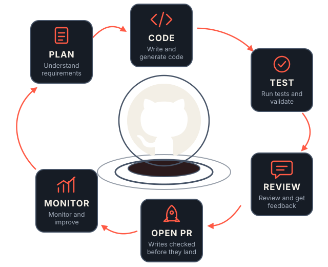

<style scoped>
section {
  display: grid; grid-template-columns: 1fr 1.05fr; align-items: center; align-content: center; column-gap: 28px;
  padding: 40px 40px 40px 72px;
}
.brand p { display: flex; align-items: center; gap: 16px; margin: 0; font-size: 36px; font-weight: 700; letter-spacing: -.01em; color: var(--ink); }
h1 { margin: 56px 0 0; font-size: 84px; line-height: 1.02; letter-spacing: -.04em; font-weight: 800; }
.rule { margin-top: 36px; width: 88px; height: 8px; background: var(--accent); }
.sub { margin: 32px 0 0; font-size: 26px; line-height: 1.35; color: var(--muted); }
.meta p { margin: 22px 0 0; font-size: 20px; }
.loop p { margin: 0; }
.loop img { width: 100%; height: auto; display: block; }
</style>

<div>
<div class="brand">

 GitHub

</div>

# Repos that keep themselves up to date

<div class="rule"></div>
<div class="sub">GitHub Agentic Workflows: from AI that suggests to AI that does</div>
<div class="meta">

<span class="muted">Donal Moloney</span>

</div>
</div>
<div class="loop">



</div>

<!--
Say: "I'm going to tell you about one wrong page, and a teammate that fixes it."
Technical: the product is GitHub Agentic Workflows (gh-aw). Say its name once and move on; the story is about the page, not the product.
Shape of the talk, so nobody is lost: the problem, what changed, what the thing is, why you can check it, what happened when GitHub used it, and one decision I want from you at the end.
Mixed room: every slide gives the plain-English version first. The technical detail is there for whoever wants it.
Transition: start with a question about a page you own.
-->

---

<!-- _class: say -->

## A page in our docs is wrong right now.

<p class="muted" style="font-size:28px">Nobody here can say which one.</p>

<!--
Say the question. Then stop talking for five full seconds. Do not fill the silence; let people think of their own stale page.
This slide has no source on purpose: it is a question, not a claim. The next slide gives the evidence.
Careful wording: "nobody can say" is a rhetorical line about this room, not a measured gap in our repositories. If challenged, agree: I haven't audited ours, and that is part of the ask.
Transition: and it is not just us.
-->

---

<!-- header: The problem -->
<!-- _class: num -->

## More than half of developers say outdated information gets in their way

<div class="stat">56.5%</div>

of 12,374 developers say **outdated information** blocks the context they need at work.

<span class="muted">Measured: Stack Overflow Developer Survey 2026. The page-is-wrong framing is this deck's; the survey measures the blocker, not our repositories.</span>

<!--
Plain line: more than half of developers say the information they need is out of date.
Precision: 6,989 of 12,374 developers picked "information is outdated" when asked what gets in the way of getting the context they need for work. Measured, but self-reported: what developers say gets in their way, not an audit of anyone's docs.
Careful wording: the survey says outdated information, not documentation. Say "information" and let the room make the jump; the docs reading is this deck's interpretation.
TODO: the "72.6% say recent or clearly up to date makes information trustworthy (n=12,996)" line could not be found in the 2026 survey on 17 Oct 2026; don't say it until a source URL is found.
Older backup if challenged: 68% of 45 developers agreed that "documentation is always outdated relative to the current state of a software system" (Lethbridge, Singer and Forward, IEEE Software, 2003). Tiny sample, twenty-three years old.
Q: "Is this really our problem?" I'm not claiming a measured gap in our repos. I'm claiming nobody can name which page it is.
Transition: and the gap keeps widening, because of how fast we now write the code those pages describe.
-->

---

<!-- header: The problem -->

## The code keeps arriving faster than the pages can follow

<style scoped>
h2 { margin-bottom: 36px; }
.duo { display: grid; grid-template-columns: 1fr 1fr; gap: 40px; font-size: 28px; line-height: 1.4; }
.duo .stat { font-size: 84px; white-space: nowrap; margin-bottom: 12px; }
p { margin: 28px 0; }
</style>

<div class="duo">
<div><div class="stat">43.2 million</div>pull requests merged per month, up 23% year over year.</div>
<div><div class="stat">Nearly 1 billion</div>commits pushed in 2025, up 25.1%.</div>
</div>

**Every merge is a chance for a page to fall behind.** That link is this deck's, not the report's.

<span class="muted">Measured: Octoverse 2025 (GitHub). The volume figures are measured; the link to documentation is this deck's interpretation.</span>

<!--
Plain line: the amount of code being merged is climbing fast, and every change is a chance for a page to fall behind it.
Numbers: 43.2M pull requests merged per month (+23% year over year) and nearly 1 billion commits pushed in 2025 (+25.1%), both Octoverse 2025, measured by GitHub.
Careful wording: do not claim a measured docs gap from these. The docs evidence is the survey on the previous slide. The step from more code to staler docs is my interpretation and the slide says so. Do not attribute the growth to AI; Octoverse reports the growth, not the cause.
Where this sits on the autonomy ladder (L4: it does the work, we approve) is in the appendix, for anyone who asks.
Transition: I've tried to close this gap before, and it's worth telling you how that went.
-->

---

<!-- header: The earlier attempt -->

## I tried to fix this before, and it taught me what was missing

<style scoped>
h2 { margin-bottom: 28px; }
.beats { display: grid; grid-template-columns: 1fr 1fr 1fr; gap: 24px; }
.beats .card p { margin: 10px 0 0; font-size: 26px; }
.shot { margin: 26px 0 0; border: 2px dashed var(--line); border-radius: 10px; min-height: 150px; display: flex; align-items: center; justify-content: center; }
</style>

<div class="beats">
<div class="card"><span class="k">1 · What I built</span>

&nbsp;

</div>
<div class="card"><span class="k">2 · What worked</span>

&nbsp;

</div>
<div class="card"><span class="k">3 · What was missing</span>

&nbsp;

</div>
</div>

<!--
TODO: tell the story in three beats: what I built, what worked, what it could never do. Ninety seconds. This slide buys credibility; it is not a project retrospective.
IMPORTANT, the hidden contract with the next slide: the third beat must land on "it only ran when a person remembered to run it". The turn is "it stopped waiting to be asked". If beat three is really about quality, cost or adoption, the next slide becomes a non-sequitur. Either make beat three about who had to start it, or change the next transition.
If the story won't be ready, CUT this slide rather than show an empty strip. The arc survives: the code-volume slide runs into the turn as a "but". What you lose is the only human moment, so cutting is the worse of two acceptable options; an empty strip at the hinge is the unacceptable one.
Evidence that this failure is common, if you want an outside voice (third-party, anecdotal): Nicolas Fränkel, "A GitHub Agentic Workflow", dev.to, 16 Apr 2026 (first on blog.frankel.ch, 12 Apr). He pushed the Markdown without compiling it ("I forgot to do it, and just pushed the Markdown"), hit permission problems, and got his documentation workflow working only after a few attempts. Use as colour, not proof: one developer's account.
Q: "Why didn't that one work?" Answer honestly. A real limitation named here makes everything after it more believable.
Transition: what changed since then is not that the AI got smarter. It's that it stopped waiting to be asked.
-->

---

<!-- header: The turn -->

## An assistant waits to be asked; this one works a shift

<style scoped>section { padding-top: 80px; } h2 { margin-bottom: 8px; font-size: 46px; } p { margin: 8px 0; }</style>


**The chore nobody schedules is the chore that never gets done.** That wrong page is exactly that chore.

<span class="muted">Illustrative, and this deck's own framing: only who starts the work and where the output lands.</span>

<!--
Plain line: every assistant we use waits for a human to ask. This one has a trigger instead of a prompt, so the work happens whether or not anyone is at the keyboard, and your job changes from asking to reviewing.
This is the hinge of the talk: the subtitle finally on screen, from AI that suggests to AI that does.
Careful wording: "works a shift" means a scheduled or event-driven shift. It is NOT self-directed and NOT always-on. It runs when a trigger fires and a human still reviews the output. Say that if anyone hears "autonomous".
Name no products. Do NOT say "every AI tool waits to be asked": Dependabot, scheduled bots and any Action that calls a model already run unprompted. The claim is about assistants, the things we type at, which is why the title says "an assistant".
The diagram is illustrative: no hours, no counts.
Q: "Isn't that just Dependabot?" Fair. Dependabot runs one fixed task; this takes a brief in plain English and does work that needs interpretation. Concede the scheduling point.
Q: "So it's a cron job with an AI in it?" Close, and fair. Plus a brief, a sandbox and a checked outbox.
Park the worry now: "You should be asking what stops it breaking something. That's the act after I show you the file, and I won't skip it."
Transition: so what happens when you point one of these at documentation? GitHub did exactly that.
-->

---

<!-- header: The result -->
<!-- _class: num -->

## When GitHub ran a docs workflow, people merged 57 of the 59 pull requests it opened

<style scoped>
h2 { font-size: 48px; margin-bottom: 16px; }
.row { display: grid; grid-template-columns: auto 1fr; gap: 44px; align-items: center; }
.stat { font-size: 130px; margin: 0; }
.cards .card p { font-size: 24px; }
.slot { margin: 16px 0 0; border: 2px dashed var(--line); border-radius: 10px; padding: 8px 16px; }
</style>

<div class="row">
<div class="stat">57 / 59</div>
<div class="lede">Daily Documentation Updater: 96% merged. A small sample, and the same post reports weaker rates for other workflows.</div>
</div>

<div class="cards">
<div class="card"><span class="k">GitHub measured</span><p><strong>Merged.</strong> A person clicked merge.</p></div>
<div class="card"><span class="k">We would measure</span><p><strong>Accepted as accurate.</strong> Stricter: merged is not the same as correct.</p></div>
</div>

<div class="source">Reported by GitHub: gh-aw blog, "Meet the Workflows: Continuous Documentation", 13 Jan 2026. The post does not name the repositories.</div>

<!--
Plain line: when GitHub ran its own docs agent, people reviewed what it proposed and merged almost all of it.
The number is GitHub's own, re-read 18 Oct 2026 (authors Don Syme, Peli de Halleux, Mara Kiefer): Daily Documentation Updater 57 of 59 (96%).
The honest range from the SAME post, say it out loud because it is what makes 96% believable: Glossary Maintainer 10 of 10, Multi-device Docs Tester 2 of 2, Documentation Unbloat 88 of 103 (85%), Documentation Noob Tester 9 of 21 (43%), Slide Deck Maintainer 2 of 5 (40%). I chose the best-performing one for the title; the others are why the pilot measures its own number.
Caveats: reported by GitHub; small samples; the post doesn't say which repos (some link to githubnext/agentics, others to github/gh-aw). Merged is not the same as correct. Presenting 96% as a target we'll hit would be overselling.
The mismatch: GitHub counted MERGED; our pilot counts ACCEPTED AS ACCURATE by the page owner, and may score lower.
TODO: replace the gap with one real linked PR, then the recording. Never show a screenshot that isn't a real PR. Runs take minutes, so use recordings; a live run is a bonus. Candidates are in RESOURCES.md (github/gh-aw PRs #69936, #69394, #68929 as of 18 Oct 2026).
Q: "Is 96% good?" Unknown without a baseline; GitHub gives none. Our pilot sets its own.
Outside voice if asked: Chris Aniszczyk, CTO of the CNCF, GitHub Blog, 13 Feb 2026: "...benefiting from improved documentation automation along with improving team reporting across the organization." A customer quote in a vendor post: colour, not proof.
Transition: that's the result. Now how does it work, and why would you let it near a repository?
-->

---

<!-- header: How it works -->

## An agentic workflow is a GitHub Action you brief, not one you script

<style scoped>section { padding-top: 80px; } h2 { margin-bottom: 14px; font-size: 46px; } p { margin: 10px 0; }</style>


<span class="muted">Documented: the gh-aw frontmatter reference. This deck's interpretation: the teammate mapping, not GitHub terminology.</span>

<!--
Say the title, pause, let the diagram carry it. The line to add: you already have Actions that run a script somebody wrote; this one runs a paragraph somebody wrote.
The teammate model carries the rest of the talk. Four pairs, same four words on every slide that follows:
- job description = the markdown body
- shift = the trigger, on:
- access badge = permissions, tools and network
- outbox you check = safe-outputs. It cannot send anything you haven't allowed.
Careful wording: the teammate mapping is mine, not GitHub's vocabulary. Don't let it be quoted back as official terminology.
Q: "Is this just Copilot in CI?" No. Copilot is one of several engines; what's new is the read-only agent plus checked outputs.
Aside if asked: the docs also name patterns like ChatOps, IssueOps and LabelOps. The three kinds of work it can do are in the appendix; this talk uses one of them, documentation.
Transition: here is one, in full.
-->

---

## Its whole job is thirteen lines: when it runs, what it can read, what it can send

<style scoped>
h2 { margin-bottom: 12px; font-size: 50px; }
p { margin: 8px 0; }
.cols { display: grid; grid-template-columns: 1fr 1.1fr; gap: 24px 40px; align-items: start; }
.g { position: relative; margin: 0 0 10px 38px; }
.g pre { font-size: 18px; line-height: 1.3; margin: 0; padding: 6px 12px; }
.g pre code { font-size: 18px; }
.n { display: inline-block; width: 28px; height: 28px; border-radius: 50%; background: var(--accent); color: var(--bg); font-weight: 700; font-size: 20px; line-height: 28px; text-align: center; }
.g > .n { position: absolute; left: -38px; top: 6px; }
.a { display: flex; gap: 10px; align-items: baseline; font-size: 22px; line-height: 1.3; margin: 0 0 9px; }
.a p { margin: 0; }
.a .n { flex: none; }
</style>

<div class="cols">
<div>

<div class="g"><span class="n">1</span>

```yaml
on:
  push:
    branches: [main]
```

</div>
<div class="g"><span class="n">2</span>

```yaml
permissions: read-all
network: defaults
```

</div>
<div class="g"><span class="n">3</span>

```yaml
safe-outputs:
  create-pull-request:
    draft: true
```

</div>
<div class="g"><span class="n">4</span>

```yaml
tools:
  github:
    toolsets: [all]
  web-fetch:
  bash: true
```

</div>
</div>
<div>

<div class="a"><span class="n">1</span>

<strong>Shift:</strong> every push to `main`

</div>
<div class="a"><span class="n">2</span>

<strong>Access badge:</strong> `read-all`, read-only; network limited to basic infrastructure

</div>
<div class="a"><span class="n">3</span>

<strong>Outbox:</strong> one draft pull request, and nothing else

</div>
<div class="a"><span class="n">4</span>

<strong>Tools:</strong> broad. `bash: true` runs arbitrary commands, in a job with no write permissions, behind a firewall.

</div>

**The agent is granted no write access here.** A separate job opens that one pull request, after a scan.

</div>
</div>

<span class="muted">Documented: `workflows/update-docs.md` in githubnext/agentics, frontmatter trimmed.</span>

<!--
This is a real file, trimmed: update-docs.md from githubnext/agentics. Not a made-up example. Say "trimmed".
Walk it against the teammate pairs, same order, same words: shift = every push to main; badge = read-all plus network: defaults; outbox = one draft pull request.
Expect "bash: true?" It is the right question and the slide answers it in bold on purpose. Do NOT call bash a "read": it runs arbitrary commands, and a security-minded listener will catch that and stop trusting the rest. The honest answer: the commands run in a job holding no write permissions, with egress through a firewall, and writes happen later in a separate job. That job is the next act.
Q: "toolsets: [all] sounds like a lot." It is, and it is still read-only. The thing to inspect in review is safe-outputs, not tools: the outbox is the only way anything leaves.
This is the deck's alarm slide on purpose. v4 keeps the v3 order: demonstrate before you defend. Don't reorder.
Transition: that's the job. How does a paragraph become something GitHub will run?
-->

---

## You write a paragraph, and one command turns it into a GitHub Action

<style scoped>h2 { margin-bottom: 14px; } p { margin: 10px 0; } pre { font-size: 22px; margin: 10px 0; }</style>

```markdown
---
# on:, permissions, network, safe-outputs — the full file was the last slide
---
Update the docs to match the code that changed, and open a draft PR.
```



<span class="muted">Documented: gh-aw CLI reference. The body is paraphrased; the real instructions are longer.</span>

<!--
Below the frontmatter is the job description in plain English. The real body is a page of style rules (it names the Diataxis framework and forbids pushing to the default branch); this line is a paraphrase and the slide says so.
gh aw compile turns the markdown into a .lock.yml, ordinary GitHub Actions YAML. You commit both, and both get reviewed. Never hand-edit the lock file.
For non-technical listeners: the settings are the rules, the body is the request, and compile turns them into something GitHub already knows how to run.
Q: "So a change to the agent's instructions goes through review?" Yes. The brief is code, and it arrives as a pull request like anything else.
Who can start it (appendix): four triggers; the two a person starts are checked for write access first. Documented for comment and dispatch triggers; push and fork-PR behaviour is unconfirmed, so say "I'll check" rather than improvise.
Transition: that's the whole thing, from paragraph to run. Now the uncomfortable part, out loud.
-->

---

<!-- header: Is it safe? -->

## It will get things wrong, so everything it does is built to be checked

<style scoped>
h2 { margin-bottom: 30px; }
.three { display: grid; grid-template-columns: 1fr 1fr 1fr; gap: 22px; }
.three .card { border-top: 4px solid var(--accent); }
.three .card p { font-size: 26px; line-height: 1.35; }
</style>

<div class="three">
<div class="card"><span class="k">Wrong edits</span>

It can only open a **draft** pull request, and a person reviews it. `draft: true` is a policy the agent cannot override.

</div>
<div class="card"><span class="k">Not a fit</span>

It does not replace build, test or release pipelines. It is for work that needs interpretation.

</div>
<div class="card"><span class="k">Hidden instructions</span>

Text in an issue or pull request can try to steer it. Read-only access, output caps and a human review limit the damage.

</div>
</div>

<div class="source">Documented: gh-aw safe-outputs reference. "Never merged automatically" is GitHub Blog guidance (13 Feb 2026), not a hard limit.</div>

<!--
Plain line: you would review a new teammate's first pull request, and this one cannot skip that step. Be honest first: it will sometimes be wrong. The design assumes that. Saying it before anyone asks buys the next two slides.
Wrong edits: pull requests open as drafts; the docs call draft "a policy, not a default", so the agent cannot override it at runtime.
Careful wording: "never merged automatically" is GitHub Blog guidance, not a hard limit. An experimental merge-pull-request output exists; it is gated by policy, and merges to the default branch are always refused. Do not upgrade that into a guarantee.
Hidden instructions = prompt injection: someone plants text in an issue or pull request and the agent reads it as if we wrote it. Say it in plain words. Limits narrow the damage; they do not remove the risk. Do not say "can't be tricked".
Say the quote out loud rather than putting it on the slide: "Getting an agent to open a pull request was never the hard part. Trusting it enough to merge is." (May Walter, Hud.io, GitHub changelog, 11 Jun 2026.) A customer quote in a vendor post: colour, not proof.
Q: "Could it replace our CI or release pipeline?" No. Say the limit out loud; naming it early buys trust.
Transition: trust is the real question. Here is the single design decision that does the most work.
-->

---

## The agent never holds the write key: a separate, checked job does the writing

<style scoped>section { padding-top: 80px; } h2 { margin-bottom: 8px; font-size: 44px; } p { margin: 6px 0; font-size: 26px; line-height: 1.35; }</style>


**The teammate drafts the letter; someone else holds the key to the postbox.** Detection is a check, not a gate: by default (`continue-on-error: true`) a failure becomes a warning.

<span class="muted">gh-aw architecture docs; four of its six jobs shown.</span>

<!--
Say the postbox line, then extend it: the checker in the middle is a separate job that reads what the teammate wrote before anyone posts it.
Point at the keys. Three stages carry a crossed-out key and exactly one carries a real one. That single difference is the slide, and it answers "bash: true" from the file slide.
Technical: least privilege by job boundary. Quote exactly: "The agent job runs with minimal read-only permissions, while write operations are deferred to separate jobs" (gh-aw architecture docs).
Detection looks for prompt injection, secret leaks and malicious patches. Either way, the draft pull request still goes to a person.
Careful wording: don't say detection "always blocks". By default continue-on-error is true, so a detection failure becomes a caution notice, not a block. The diagram draws it dashed and warned for exactly this reason. The one documented hard block: a failed or skipped redaction stops publication (RESOURCES.md, re-verify before saying it).
Also careful: the docs list six jobs (adding pre-activation and conclusion). Don't say "four jobs" as if that were all.
Q: "Which AI does the work?" An engine setting: Copilot (usual default), Claude Code, Codex, Antigravity (experimental), Pi. Gemini is listed but deprecated.
Q: "Is it GA?" No: public preview since 11 Jun 2026 (GitHub changelog). The docs site still labels itself technical preview; treat that as a leftover.
Transition: separating the token doesn't make the agent right, only checkable. And its reach is as narrow as the list we give it.
-->

---

## A misled agent is boxed in by layers, not by any single wall

<style scoped>section { padding-top: 80px; } h2 { margin-bottom: 6px; font-size: 44px; } p { margin: 4px 0; }</style>


<div class="source">Documented: gh-aw architecture and network reference. The open question in the diagram is a gap, not a claim.</div>

<!--
Labels: "web filter" is the Squid proxy and "tool connector" is the MCP gateway; product names are small on purpose. The gap box is the open question, not a claim.
Plain line: the agent works in a sealed room. It can only reach the addresses on our list, and someone else holds the keys.
Technical: the agent is containerised and egress goes through a proxy with a domain allowlist. Tools are opt-in under tools:; bash: ["gh issue comment"] limits bash to that one command. network: defaults is basic infrastructure only (what you get if you omit network:); network: {} is no access at all.
The API proxy is the most interesting idea: it keeps the engine's auth token out of the agent's container ("agent auth-token isolation").
Careful wording: don't say there is nothing in there to steal. The same page says an in-container identifier should be treated "as leaked by design".
The MCP gateway is dashed on purpose. The docs say it "is not a strong security boundary against a compromised or malicious agent". Say it out loud: the defence is layers, not any one wall. Volunteering the weak spot is what makes the rest credible.
Q: "So it can't call out at all?" It can, but only to domains on the list, and that list lives in the workflow file and is reviewed like code. Never say "no network".
Q: "Could an injected prompt send our data OUT to a domain that IS on the allowlist?" The sharpest question in the deck and not yet answered; the gap on the slide says so. Say: "I don't have a documented answer. I'd rather tell you that than guess." Then give the three limits you do have (allowlist, engine token held elsewhere, draft reviewed before anything lands) and promise the precise answer.
Transition: that's the design. Reading about it is cheap, so here is how far I have gone past reading.
-->

---

<!-- header: What I've built -->
<!-- _class: num -->

## Ninety-eight of these are written and documented, and not one has ever run

<style scoped>
h2 { margin-bottom: 20px; font-size: 56px; }
.duo { display: grid; grid-template-columns: 1fr 1fr; gap: 40px; font-size: 26px; line-height: 1.4; }
.duo .stat { font-size: 160px; margin-bottom: 8px; }
p { margin: 20px 0; }
</style>

<div class="duo">
<div><div class="stat">98</div><strong>written and documented:</strong> one brief and one docs page each, plus 6 shared policy and prompt modules.</div>
<div><div class="stat">0</div><strong>ever run in GitHub Actions.</strong> Only 4 of 98 compiled locally; no release tagged, and the sandbox repo does not exist.</div>
</div>

<span class="muted">`DonalMoloney/Agentic-Workflows-Lib`, private. Measured: file counts via the GitHub API, 17 Oct 2026. Self-reported: the compile result and "not yet run", from the repository's own `agents.md`, not a CI result.</span>

<!--
Plain line: I didn't come here with only a deck. I came with 98 of these already written and documented, and not one has ever run. That last part is the ask.
Say the right-hand number out loud. Don't let the room hear "98" and assume production. The honest sentence is "written and documented, not yet executed".
Technical: 98 markdown briefs in workflows/, each with a docs page in docs/workflows/ carrying the same required-fields table. Six shared modules under workflows/shared/ are imported rather than copy-pasted, so a safety change lands in one place. aw.yml pins gh-aw min-version v0.83.4 and lists only 2 of the 98 files, so installing from the manifest does not give you the library.
Numbers and sources: both 98s and the 6 verified through the GitHub API on 17 Oct 2026; the two filename sets are identical. "4 compiled, 0 errors" and "0 runs" are from the repo's own agents.md. No .lock.yml is committed.
Careful wording, say none of these: not "98 running", not "98 compiled", not "in production", not "the org is using it". The acme-org owner and install strings are placeholders and resolve to nothing; never show an install line as runnable. Each workflow page carries "Maturity: Experimental"; the one-page spec for each is in the appendix.
Q: "So none of this works?" Four compile cleanly against the pinned version (self-reported, no lock files to show). Runtime behaviour is unproven, which is what a month of real runs would settle.
Q: "Why 98 and not 4?" The briefs are the cheap part: plain English. Compiling, running and reviewing is the expensive part, and I stopped before spending that without agreement.
Q: "Can we see it?" It's private. TODO: decide before the talk whether it goes public. Don't put the URL on a slide until then.
Q: "How long did this take you?" TODO: answer honestly; it is what makes 98 land or sound like padding.
Transition: and a pile of files is worth nothing until someone puts a real name on one. That is the ask.
-->

---

<!-- header: The ask -->

## Pick one stale page, and let an agent keep it current for a month

<style scoped>
section { background: var(--panel); border-top: 8px solid var(--accent); }
h2 { font-size: 64px; margin-bottom: 40px; }
.need { display: grid; grid-template-columns: repeat(5, 1fr); gap: 14px; margin: 18px 0 30px; }
.need div { background: var(--bg); border: 2px dashed var(--line); border-radius: 10px; padding: 14px 16px 22px; font-size: 24px; line-height: 1.25; color: var(--ink); font-weight: 700; }
.need b { display: block; font-size: 52px; line-height: 1; color: var(--accent); letter-spacing: -.04em; margin-bottom: 14px; }
</style>

<span class="k">Five answers I need from you today, and will not invent</span>

<div class="need">
<div><b>1</b>The repository</div>
<div><b>2</b>The page owner</div>
<div><b>3</b>The credit budget</div>
<div><b>4</b>How stale it is now</div>
<div><b>5</b>The keep or stop rule</div>
</div>

<span class="muted">Cost follows run frequency: a push to `main` runs every time, a schedule bounds it (cap about $10 a run, best-effort estimate).</span>

<!--
Callback to the opening: "A page in our docs is wrong right now." Let's pick one and find out.
The five boxes are the blanks only you can fill. Do not invent any of them. Read them out, one breath each.
Run frequency is part of the cost: a push-to-main trigger multiplies the per-run cap (default 1,000 AI Credits, about $10; best-effort estimate) by every push; a daily or weekly schedule bounds it. TODO: choose, then work out runs per month times the cap. Don't state a total or call it small until then.
Pilot workflow is an open decision: update-docs (file slide) vs readme-auto-updater (spec, appendix). TODO: name one here and make both slides match.
Frame it as an experiment: one hypothesis, one method, one measure, one decision rule. Honest framing: we don't know the answer, and this is the cheapest way to find out.
Q: "What does it cost?" Per-run default 1,000 AI Credits (about $10). TODO: the pilot budget.
Q: "Who reviews?" Whoever owns the page today. The pilot adds a queue, not a team.
Q: "What if it's rubbish?" Then we've spent four weeks and a capped amount of credits, and I'll say so. TODO: the actual four-week credit figure; don't call it trivial without it.
Transition: and here is what the month would look like.
-->

---

## The month: one week of rehearsal, three weeks of drafts someone reviews

<style scoped>
h2 { margin-bottom: 26px; font-size: 54px; }
.tl { display: grid; grid-template-columns: repeat(4, 1fr); gap: 22px; position: relative; margin-top: 30px; }
.tl::before { content: ""; position: absolute; left: 0; right: 0; top: 14px; height: 4px; background: var(--line); }
.tl > div { position: relative; padding-top: 48px; font-size: 24px; line-height: 1.35; }
.tl > div::before { content: ""; position: absolute; left: 0; top: 4px; width: 24px; height: 24px; border-radius: 50%; background: var(--bg); border: 4px solid var(--accent); }
.tl > div.end::before { background: var(--accent); }
.tl strong { display: block; font-size: 32px; letter-spacing: -.02em; margin: 4px 0 8px; }
.measure { margin-top: 30px; border-left: 6px solid var(--accent); padding: 0 0 0 24px; }
.measure p { margin: 0; font-size: 28px; line-height: 1.3; }
</style>

<div class="tl">
<div><span class="k">Week 0</span><strong>Find the page</strong>The one whose code changed after the page did.</div>
<div><span class="k">Week 1</span><strong>Rehearse</strong><code>staged: true</code>: it runs for real but writes nothing to our repo. We read what it would have done.</div>
<div><span class="k">Weeks 2 to 4</span><strong>Review</strong>Draft pull requests only, and the page owner reviews every one.</div>
<div class="end"><span class="k">Then</span><strong>Keep or stop</strong>By the rule we agreed before it started.</div>
</div>

<div class="measure">

**We measure the share the page owner accepts as accurate,** not the share merged.

</div>

<div class="source">Documented: staging is not a sandbox; <code>gh aw trial</code> is experimental (gh-aw docs).</div>

<!--
Plain line: first a rehearsal where it writes nothing, then drafts a person reviews, then a decision we made in advance.
Two safety nets, both documented: gh aw trial runs a workflow in a temporary private repository (experimental), and staged: true under safe-outputs runs it for real but previews every safe output instead of writing it. Week one is staged, so week one writes nothing and we read what it would have done. That is the part that makes this an easy yes.
Careful wording on staging: it writes nothing to our repository, but the docs say plainly "staging is not a sandbox": custom jobs, scripts, external MCP servers and custom credentials still run. Say "it writes nothing to our repo", never "it can't do anything". The split into one staged week and three review weeks is this deck's proposal, not GitHub's guidance.
The measure: GitHub counted pull requests MERGED; we count ACCEPTED AS ACCURATE by the page owner, and may score lower. Do not present the 96% as a target. It is GitHub's figure from 59 pull requests, and the same post reports 40% to 100% across its docs workflows. Our number is unknown, which is the reason to run the month.
Supporting guidance: "Start with low-risk outputs such as comments, drafts, or reports before enabling pull request creation." (GitHub Blog.) Use it to justify staging first, not as GitHub endorsing this pilot.
Commands for engineers, if asked: gh extension install github/gh-aw; gh aw init; gh aw new <name>; gh aw trial, then staged: true; approve the first PR. gh aw new makes a template; it does not fetch the agentics file (that is gh aw add-wizard githubnext/agentics/<name>, exact path for update-docs unconfirmed, so don't recite it).
Q: "What if it wastes reviewer time?" Staged mode shows what it would have written before any pull request exists, and the measure is the share accepted without edits. A month of bad drafts is a cheap no.
TODO: the keep/stop rule (the result that means keep, the result that means stop).
Transition: thank you. The slides after this are reference and stay up for questions.
-->

---

<!-- header: Appendix -->

## It does three kinds of work, and documentation is the safest corner to start in

<style scoped>
h2 { margin-bottom: 26px; font-size: 54px; }
.three { display: grid; grid-template-columns: 1fr 1fr 1fr; gap: 20px; }
.card p { margin: 8px 0 0; font-size: 24px; line-height: 1.45; }
.card .k { display: block; margin-bottom: 4px; }
.three .card:first-child { background: var(--fill-accent); border-color: var(--accent); }
p { margin: 20px 0 0; }
</style>

<div class="three">
<div class="card">

<span class="k">Maintain</span>
Documentation maintenance · Issue triage · Dependency analysis

</div>
<div class="card">

<span class="k">Improve code</span>
Pull request review · Security review

</div>
<div class="card">

<span class="k">Report and plan</span>
Metrics and analytics

</div>
</div>

**We are asking for one job, in the first box: a single documentation page.** It is the corner where a wrong answer costs a review comment, not an outage.

<span class="muted">Groups are the gh-aw home page's own; example tasks are from its gallery, verified 17 Oct 2026. Sorting tasks into groups is this deck's.</span>

<!--
Plain line: the same mechanism does three kinds of work. Read the three headings, give one example each, stop.
The six example tasks are from the gallery: Documentation Maintenance, Issue Triage, Dependency Analysis, Pull Request Review, Security Review, Metrics and Analytics. Which task sits in which group is my sorting, and the slide says so.
Why it matters for the ask: docs is where being wrong is cheapest. The cost of a bad suggestion is a reviewer's comment, not a broken build or a missed vulnerability.
Careful wording: don't imply we've run any of these, and don't promise the other groups. "Could it do security review?" Same mechanism, not the same risk; that's a later conversation.
Q: "Why not code review, that's where the money is?" A wrong code review costs reviewer trust, and we have no measured accuracy yet. Earn the data on the cheap job first.
Transition: and here is who or what can start it.
-->

---

## Four things can start it, and the two a person starts are checked for write access first

<style scoped>h2 { margin-bottom: 14px; font-size: 50px; } p { margin: 10px 0; }</style>

In plain terms: only people with write access can start it by hand.


<span class="muted">Documented: gh-aw triggers and architecture docs. A schedule has no triggering user, so it is not role-checked.</span>

<!--
All four end in the same run, with the same permissions and the same outbox. The trigger only decides who starts the shift.
The gate: a passer-by cannot comment our agent into action. By default the allowlist is admin, maintainer or write, and the pre-activation job performs that check.
Careful wording: the verified claim covers a PERSON starting a run (pre-activation role-checks the commenter on command triggers). Do not say a scheduled run is role-checked; a schedule has no triggering user. If pressed on push or fork behaviour, say you will check; there is no source for it yet.
Schedules can be fuzzy ("daily") rather than exact cron times.
Q: "Could an outside contributor trigger it on a fork PR?" The role check is the control; offer to show the triggers page rather than guessing.
Transition: next, where this talk puts the agent on the autonomy ladder.
-->

---

## Each rung hands the agent more of the work, and at L4 it does the work and we approve

<style scoped>h2 { margin-bottom: 12px; font-size: 48px; } p { margin: 10px 0; }</style>


**L4 = it does the work, we approve.** That is where this talk sits.

<span class="muted">Ladder: Feng et al., arXiv 2506.12469. Illustrative bars, not measurements; placing gh-aw at L4 is this deck's reading.</span>

<!--
Each step up, the agent does more and we decide less. L4 is "it does the work, we approve", which is the shape of a draft pull request.
The ladder runs L1 Operator to L5 Observer (Feng et al.). L4 Approver is my reading of gh-aw, not the paper's classification.
Bars are illustrative proportions. If someone reads a number off them, correct it. TODO: verify the L1-L5 labels against the full paper, or show names only.
Q: "Which level are we at today?" TODO: I have not measured it.
Q: "Is L5 where this is heading?" Don't predict. gh-aw as documented keeps a human at the pull request.
Transition: and this is the one-page spec each of the 98 ships with.
-->

---

## Each of the 98 ships with a one-page spec: what it may write, and who owns it

<style scoped>h2 { margin-bottom: 18px; } table { font-size: 22px; } td, th { padding: 4px 14px; } h2 { font-size: 46px; }</style>

| | `readme-auto-updater` |
| --- | --- |
| **Purpose** | Spot drift between the README and the code after a push to `main`, and propose a fix |
| **Shift** | `push` — branches: `main` |
| **Access badge** | `permissions: contents: read`; GitHub toolsets `context`, `repos` |
| **Outbox** | **one** pull request — `create-pull-request`, `max: 1` |
| **Owner** | — |
| **Maturity** | **Experimental** — the label the library gives all 98 |

<span class="muted">Trimmed from `docs/workflows/readme-auto-updater.md`, verified 17 Oct 2026. Owner and install lines use a placeholder `acme-org` namespace and do not resolve.</span>

<!--
This is the job description for one teammate out of 98. The page says what it can touch, what it can send, and whose phone rings when it gets it wrong. The row labels are the same four teammate words.
Every one of the 98 docs pages uses this required-fields table: purpose, triggers, writes, required secrets, shared imports, customization points, owner, maturity. The frontmatter backs it: permissions is contents: read only, and the single safe output is capped at max: 1.
On draft: this file doesn't set draft: true, but safe-outputs treats draft as "a policy, not a default" with default true (verified 17 Oct 2026), so an omitted draft still yields a draft PR.
Careful wording: every owner field reads acme-org, a placeholder. I cannot fill in ANY of them; that is what separates a library from a deployment. Never show the install line as runnable.
Two workflow names have been heard: update-docs (file slide, from githubnext/agentics) and readme-auto-updater (here, my library). TODO: say which the pilot runs and make the ask slide match.
Q: "Could this have written to our README already?" No. It has never run anywhere, and permissions are read-only.
Transition: and if you run one, this is how you'd see what it did.
-->

---

## You debug it like any Action: every run leaves logs you can audit

<style scoped>ul, ol { font-size: 28px; } li { margin: 14px 0; }</style>

1. **Review the change:** the `.md` workflow and generated `.lock.yml` in the pull request.
2. **Watch the run:** the Activation, Agent, Detection and Safe outputs jobs, four of the six.
3. **Dig in:** `gh aw logs <workflow>` across runs, `gh aw audit <run-id>` for one run.

<span class="muted">Documented: gh-aw architecture and CLI reference.</span>

<!--
Backup for "how would we know what it did?". Nothing new operationally: it's an Actions run.
Three levels: review the workflow change in a PR, watch the jobs in the Actions UI, then the CLI. gh aw logs analyses logs and artifacts across runs (the home page says it lists tokens, AIC and turns per run); gh aw audit gives a detailed report for one run.
For managers: there's a receipt for every run, the same kind every other Action already leaves.
Transition: and if you want to try it, these are the links.
-->

---

<style scoped>
h2 { margin-bottom: 22px; }
ul { font-size: 24px; }
li { margin: 12px 0; }
li code { background: var(--chip); border: 1px solid var(--line); border-radius: 6px; }
</style>

## Try it yourself: the official docs, GitHub's own workflows, and one honest account

- `https://github.github.com/gh-aw` — the docs; `/gallery` for ready-made workflows; the hands-on workshop
- `https://github.com/githubnext/agentics` — where this deck's `update-docs.md` comes from
- `https://github.github.com/gh-aw/blog/2026-01-12-welcome-to-pelis-agent-factory/` — Peli's Agent Factory: over 100 workflows the team runs on its own repos
- `https://github.github.com/gh-aw/blog/2026-01-13-meet-the-workflows-documentation/` — the source of the 57 of 59, and the weaker numbers beside it
- <span class="muted">Third-party, anecdotal: Nicolas Fränkel, "A GitHub Agentic Workflow", dev.to, 16 Apr 2026 — what went wrong first</span>

<!--
Leave this up during questions.
Peli's Agent Factory is the best next read for someone who wants to see agents doing real work in a real repo (the post says over 100 workflows in github/gh-aw, mostly used on the project itself, some at scale in GitHub internal repos).
The Fränkel post is one developer's account, so it is a candid companion, not evidence for or against.
TODO: my own examples and URLs. The library repo is private; don't put its URL here unless the decision is made to open it. A link that 404s in front of the room costs more than the slide gains.
Transition: the last slide is just the fact-check trail, if anyone wants to audit me.
-->

---

<style scoped>
h2 { margin-bottom: 22px; }
ul { font-size: 21px; line-height: 1.35; }
li { margin: 7px 0; }
section { padding-top: 80px; }
</style>

## Status and sources

- How to read a source line: **Measured** (counted, method named) · **Reported by GitHub** · **Self-reported** (my repo) · **Documented** (gh-aw docs) · **This deck's interpretation**.
- Fact-checked 17 and 18 Oct 2026 against the gh-aw documentation, GitHub changelog, Stack Overflow Developer Survey 2026, Octoverse 2025, GitHub Next, and the GitHub Blog sources cited on each slide.
- Status: **public preview since 11 Jun 2026** (GitHub changelog). The gh-aw docs home page still says technical preview; treat that as a leftover.
- This deck's choice of measure: GitHub counted pull requests **merged**; the pilot counts **accepted as accurate**. The 57/59 figure is not a target, and the same post reports 40% to 100% across docs workflows.
- Left off on purpose: the daily AI Credit cap (cost-management page says 5,000 per workflow per day by default; frontmatter page says `max-daily-ai-credits` is disabled by default), and "always blocks" for detection (`continue-on-error` defaults to `true`).
- This deck's own models, not GitHub's: the teammate mapping, the assistant-versus-shift comparison, and L4 on the autonomy ladder.

<!--
Backup slide; don't present it. It exists so anything contested can be settled from the deck itself.
The last bullet is the one to point at if someone accuses the deck of dressing up its own framing as vendor documentation.
Render with: marp deck-v4/deck.md --allow-local-files </dev/null
-->
